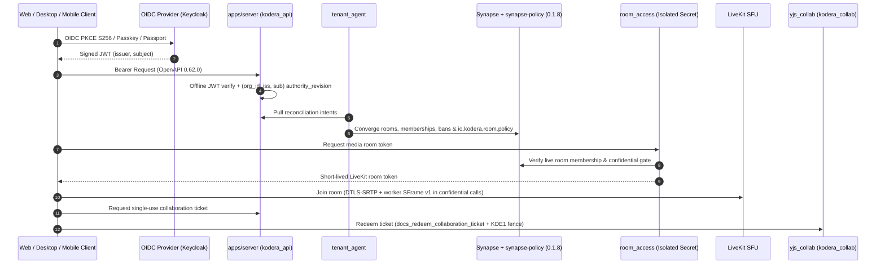

# Kodera Architecture

Status: Active

Kodera is a **multi-workspace, open-core collaboration platform**: a control plane that owns who may be where, a Matrix homeserver and a LiveKit SFU that carry the conversations, and clients that talk to all three. This document describes what the repository contains today and says so where a part is only planned. Decisions are recorded as ADRs, indexed in [`docs/adr/`](./docs/adr/README.md); a bare `ADR-NNNN` below is the server's (`SRV-ADR-NNNN`). For the detailed trust boundaries, PostgreSQL role isolation, and cryptographic wire specifications, see [`docs/security/THREAT_MODEL_AND_CRYPTOGRAPHY.md`](./docs/security/THREAT_MODEL_AND_CRYPTOGRAPHY.md).

## 1. Core Architectural Invariants

1. **One chain of authority: control plane, then Matrix room, then media (`ADR-0018`).**
   `apps/server` owns the tree of workspaces, categories and channels, `Kodera Passport` cross-workspace sessions, typed document Collections, quotas, Factur-X billing ledger, GDPR export/erasure lifecycles, zero-trust `/staff/v1/*` operations, voluntary `#proximity` check-in leases, default-off `/api/v1/organisations/{organisation_id}/confidential/*` envelope relay (`KODERA_E2EE_RELAY_ENABLED`), and the rules of who may read or post. Every channel, text or audio, is one Matrix room on the workspace's Synapse; the tenant agent creates the rooms and converges their membership to what the control plane decided. An audio room's media access derives from membership of its Matrix room: the `room_access` service checks it and mints a short-lived LiveKit token for that room only. [`packages/synapse-policy`](./packages/synapse-policy/README.md) runs inside Synapse and refuses whatever would route around this from another Matrix client.

2. **Identifiers that do not leak the transport (`ADR-0009`, `packages/kodera-rs`).**
   The control plane, the web client's URLs and the clients' models address workspaces and channels by **RFC 9562 `UuidV7`** identifiers, not by raw Matrix room IDs (`!opaque:domain`). Channels are backed by Synapse today. The same identifiers address `#proximity` frames and cryptographic room scopes in `packages/kodera-rs`.

3. **Standard channels are readable by the homeserver today; confidential rooms refuse plaintext fallback and universal E2EE remains in progress.**
   - **Today:** standard channels (`#arrivals`, `#general`, `tier-3-standard-channel`), ordinary `1:1`/group DMs (default DM E2EE `tier-1-default-e2ee` remains `Planned`), and ordinary collaborative Yjs documents are encrypted in transit (TLS at the edge) and stored by the server in clear, which is what lets a new member read history and an extension post, and what server-side search relies on; explicit confidential channels and rooms (`🔒`, `tier-2-opt-in-confidential`) refuse plaintext fallback fail-closed while full end-to-end client confidential UX remains `Planned`. The policy module refuses `m.room.encryption` in standard rooms, keeps open homeserver federation closed by default (`KODERA_FEDERATION_MODE=closed`, with explicit opt-in `open` mode), and bounds explicit partner-room federation (`packages/synapse-policy` `0.1.8`) and single-channel guest scope gates behind atomic ACL and governor locks.
   - **Confidential rooms & Zero-Knowledge roadmap:** `packages/kodera-rs` implements scoped OpenMLS (RFC 9420) over modern `openmls_*` crypto-provider traits, Vodozemac Megolm, `SFrame v1` media framing, `KVKB1` structural header validation, `KDV1` native vaults, durable device/session state, `wasm32` browser device-proof bindings and ES256 universal passkey binding, paired with `EspaceVault` IndexedDB v2 (`kodera.espace-vault.v1`, including blind-indexed `HMAC-SHA-256` local search), dedicated WebWorkers in `apps/web/src/features/confidential/` (`KVKB1` `PBKDF2-HMAC-SHA-512 -> HKDF-SHA-256 -> AES-256-GCM`, `KDE1`, `SFrame v1`), epoch-bound `KDE1` collaboration relay admission in `apps/server/yjs_collab`, and the `/api/v1/organisations/{organisation_id}/confidential/*` opaque envelope, HPKE KeyPackage, directory, consecutive MLS epoch, proof-bound cross-signing and `KVKB1` key-backup endpoints (`0.62.0`). Confidential/unclassified room sessions are quarantined rather than downgraded to plaintext. Durable multi-device MLS group coordinators, client `deviceSigner` / epoch-key wiring, native mobile key-backup wiring, interoperable browser/codec media qualification, and universal client-side end-to-end encryption across all rooms remain Planned in Track 7 of [`ROADMAP.md`](./ROADMAP.md).

4. **One codebase, a self-host profile first, clean-room Enterprise isolation.**
   - **Community profile (`deploy/community/`):** a single-node Docker Compose stack (`Caddy + Kodera Server + PostgreSQL 17 + Valkey 8 + Synapse on its own PostgreSQL + LiveKit`, `KODERA_EDITION=community`, `KODERA_BILLING_ENABLED=false`). It runs no identity provider: the server trusts the OIDC issuers listed in `KODERA_AUTH_TRUST`, the web client signs in at `KODERA_OIDC_PROVIDER_ORIGIN`, and Synapse signs members in through the same realm. Caddy routes the API, `.well-known` discovery, the Matrix client API, the room-access token endpoint, Yjs collaboration at `wss://<api-host>/documents/collab` and LiveKit signalling; the agent API is never reachable from the internet and federation is closed unless explicitly enabled. [`packages/create-kodera`](./packages/create-kodera/README.md) ships a checked copy of the same stack, and CI verifies fresh-volume cold-start boot and runtime memory bounds. The hosted Community cutover uses the promoted `auth.kodera.io` identity provider. The mobile association routes `/.well-known/apple-app-site-association` and `/.well-known/assetlinks.json` fail closed with `503 well_known_unconfigured` until `KODERA_IOS_APP_IDS` and `KODERA_ANDROID_ASSETLINKS_SHA256` respectively are configured; public edge routing and signing identifiers still require operator qualification.
   - **Enterprise Edition (`ee/`) & managed topology:** [`ee/`](./ee/README.md) is loaded strictly when `KODERA_EDITION=enterprise` (`ee/saml/`, `ee/scim/`, `ee/audit_export/`, `ee/billing/`), with zero static imports from open-source packages. Infrastructure orchestration for managed tenants lives outside the public monorepo.

5. **Defense-in-Depth Secret Isolation (`ADR-0003` & `ADR-0018`):**
   - `apps/server/config/environment.py` inspects `os.environ` before Django settings load and **refuses to start** if infrastructure credentials (`SCW_*`, `AWS_*`, `TF_*`, `SSH_*`, `KUBECONFIG`) or unadmitted secret-shaped variables are present.
   - LiveKit SFU signing credentials never enter the main WSGI API worker environment (`apps/server` HTTP API) and are held only by `room_access` (`python -m room_access`) and `tenant_agent` (for LiveKit room/participant reconciliation). In the Community profile, Synapse's database credential and the tenant agent's tokens are isolated the same way; GDPR exports use `O_NOFOLLOW` descriptor checks inside `PrivateVolume`.
   - In `apps/desktop`, the origin-fenced `tao`/`wry` native desktop host and self-host deployment wizard wrap provider tokens in `RedactedApiToken` (redacted `Debug` and `Display`), persist credentials via `OsNativeKeychainBackend` (`security -i` / `secret-tool` / `PasswordVault`) with an atomic `0600` metadata index and zeroized RAM cache, and enforce strict host/command boundaries.

6. **`#proximity` (`RFC-0001`). Status: v1/v2 codecs, RAM-only check-in broker & foreground native radio layers shipped; physical two-device qualification open.**
   `#proximity` is an everyday proximity channel with a voluntary, pseudonymous check-in; it is not an emergency service. `packages/kodera-rs` implements the frozen signed frame v1 wire format (`118 B` of fixed header and `Ed25519` signature, `<= 256 B` per frame) and the v2 rotating frame codec, signature verification, bounded replay guards, priority relay queue and transport seam. `apps/server` runs the RAM-only Unix-socket broker (`python -m apps.proximity.broker_rpc` on `/run/proximity/broker.sock`, zero proximity database table) issuing 15-minute rotating HKDF-SHA256 epoch leases, and `apps/ios` + `apps/android` provide foreground CoreBluetooth/Network.framework and Android BLE GATT/NSD adapter layers; two-device physical radio interoperability qualification remains open ([`RFC-0001`](./docs/rfcs/RFC-0001-emergency-ble-channel.md)).

## 2. Clients

- **`apps/web`** is the full production web client and customer console: cardless SMB self-serve (`<= 5` seats, `5 GiB` storage, `< 5 s`) and dedicated Sovereign workspace ordering, Matrix-backed channels (threads, reactions, typing, presence), LiveKit audio, camera video and screen sharing (plus worker-isolated `SFrame v1` media transforms), voice notes, polls, soundboard, Pro/Messages mode, private direct conversations, checked attachments, text-only link previews, payload-free Web Push, native collaborative Pages (`KDE1` confidential relay fence), typed Collections (`Table`, `Kanban`, `List`), Yjs whiteboard, sovereign CalDAV calendar & `.ics` booking, `Kodera Passport` workspace switching, `kodera-rs` `wasm32` browser device-proof harnesses, `EspaceVault` IndexedDB v2 (`kodera.espace-vault.v1`) with blind-indexed local search and local `KVKB1` key backup, sandboxed `kodera.widget.v1` extensions & marketplace, `0–100` posture advisor, Factur-X billing console, quota gauges and GDPR Art. 17/20 workflows. It talks to the control plane through the OpenAPI contract in [`packages/api-contract`](./packages/api-contract/README.md) (`0.62.0`), to Synapse with the member's own Matrix session, and to LiveKit with the token `room_access` minted.
- **`apps/ios` and `apps/android`** are native SwiftUI and Jetpack Compose companion clients (no in-app purchase and no pricing screen). They consume `@kodera/design-tokens` (`dark` Dark Precision and `light` Light Givre parity), implement `MatrixRoomClient` + `MatrixTimelineReducer` messaging (`m.login.token` SSO, `/sync`, replies, edits, redactions, reactions, Core attachments), `KDV1` Keychain/Keystore session vaults and `PacketDispatcher` (`vectors/mobile-ffi-v1.txt`), `NativeVoIPRuntime` (PushKit/CallKit) and `NativeTelecomRuntime` (`ConnectionService`) + `CallRingMachine`, foreground BLE/mDNS `#proximity` radio adapters, payload-free push wakeups, and universal WebAuthn passkey assertion verification; remote Matrix room-invitation delivery, live WebRTC media SDK binding, unmangled C-ABI dynamic Rust linking (held under `#![forbid(unsafe_code)]`), and signed physical-device/store qualification remain open gates.
- **`apps/desktop`** links `kodera-rs` and implements the origin-fenced `tao`/`wry` native desktop host and Tauri-compatible IPC bridge (`kodera://` and `matrix:` deep-links, system tray, opt-in Push-to-Talk, persistent `OsNativeKeychainBackend` with zeroized RAM cache and automated self-host stack deployment wizard); signed-installer OS keychain prompt qualification and OS-notarised macOS/Windows installers await operator signing.

## 3. Extensions, Sandboxed Widgets & Importers

[`packages/extension-sdk`](./packages/extension-sdk/README.md) (`0.2.0`) defines the manifest, signed-webhook envelope, slash-command helpers and declarative `kodera.widget.v1` cards, [`packages/create-kodera-extension`](./packages/create-kodera-extension/README.md) scaffolds zero-dependency starter extensions, [`extensions/`](./extensions/README.md) holds 23 reference implementations tested against its harness, and `apps/server` implements the outbound extension runtime v2 (scoped workspace installation, marketplace checkout/install, `sandbox=""` widget action relay, key rotation, reconciliation, dual-key HMAC delivery and pinned-IP SSRF protection) alongside bounded `Slack`, `Discord` and `Notion` workspace importers.
