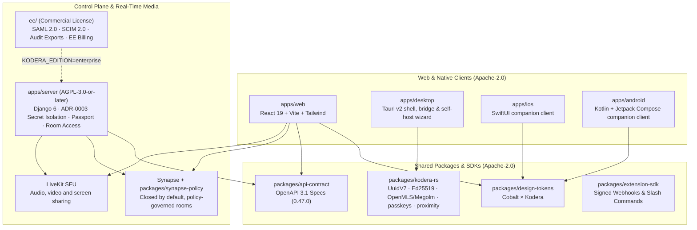

<p align="center">
  <picture>
    <source media="(prefers-color-scheme: dark)" srcset="./apps/web/public/kodera-mark-white.svg">
    <source media="(prefers-color-scheme: light)" srcset="./apps/web/public/kodera-mark-slate.svg">
    
  </picture>
</p>

<h1 align="center">Kodera</h1>

<p align="center">
  <strong>An open-core workspace for teams and communities: channels, threads and always-open audio rooms.</strong><br>
  Built on Matrix and LiveKit, hosted in Europe or on your own infrastructure.
</p>

<p align="center">
  <a href="#downloads-desktop--mobile">Downloads</a> ·
  <a href="./deploy/community/README.md">Self-Host (Docker Compose)</a> ·
  <a href="./ARCHITECTURE.md">Architecture</a> ·
  <a href="./ROADMAP.md">Roadmap</a> ·
  <a href="./docs/adr/README.md">Decisions (ADR index)</a> ·
  <a href="./docs/rfcs/RFC-0001-emergency-ble-channel.md">RFC-0001 (<code>#proximity</code>)</a> ·
  <a href="./CONTRIBUTING.md">Contribute</a> ·
  <a href="https://kodera.io">kodera.io</a>
</p>

---

> **Status: Developer Preview (`v0.x`).** Pre-`v1.0`, under active development. This page says what the repository contains today and marks everything else **Planned**. The list of planned work, and its order, is the [roadmap](./ROADMAP.md); the authoritative backlog is this repository's issues and its GitHub Project.

## Downloads (Desktop & Mobile)

Direct release builds and integrity manifests are published on [GitHub Releases (`releases/latest`)](https://github.com/kodera-hq/kodera/releases/latest):

| Platform | Architecture / Format | Direct Download |
| :--- | :--- | :--- |
| **macOS** | Universal (`Apple Silicon & Intel` — `.dmg`, `.app.tar.gz`) | [`kodera-desktop-macos-universal.dmg`](https://github.com/kodera-hq/kodera/releases/latest/download/kodera-desktop-macos-universal.dmg) · [`kodera-desktop-macos-universal.app.tar.gz`](https://github.com/kodera-hq/kodera/releases/latest/download/kodera-desktop-macos-universal.app.tar.gz) |
| **Linux** | `x86_64` / `amd64` (`.AppImage`, `.deb`) | [`kodera-desktop-linux-x86_64.AppImage`](https://github.com/kodera-hq/kodera/releases/latest/download/kodera-desktop-linux-x86_64.AppImage) · [`kodera-desktop-linux-amd64.deb`](https://github.com/kodera-hq/kodera/releases/latest/download/kodera-desktop-linux-amd64.deb) |
| **Windows** | `x64` (`.msi`, NSIS `.exe`) | [`kodera-desktop-windows-x64.msi`](https://github.com/kodera-hq/kodera/releases/latest/download/kodera-desktop-windows-x64.msi) · [`kodera-desktop-windows-x64-setup.exe`](https://github.com/kodera-hq/kodera/releases/latest/download/kodera-desktop-windows-x64-setup.exe) |
| **Android** | Universal (`.apk`) | [`kodera-android.apk`](https://github.com/kodera-hq/kodera/releases/latest/download/kodera-android.apk) |
| **Checksums & SBOM** | SHA-256 digests & CycloneDX 1.6 inventory | [`SHA256SUMS.txt`](https://github.com/kodera-hq/kodera/releases/latest/download/SHA256SUMS.txt) · [`sbom-cyclonedx.json`](https://github.com/kodera-hq/kodera/releases/latest/download/sbom-cyclonedx.json) · [All assets on GitHub Releases](https://github.com/kodera-hq/kodera/releases/latest) |

Verify downloaded binaries against [`SHA256SUMS.txt`](https://github.com/kodera-hq/kodera/releases/latest/download/SHA256SUMS.txt) before installation. OS code-signing/notarisation and Apple App Store / Google Play store listings remain operator gates (see [What is not there yet](#what-is-not-there-yet)).

## What works today

- **Channels in the web client.** Text channels with threads, replies, reactions, typing and presence, backed by a Matrix homeserver (Synapse) that a Kodera policy module keeps under the control plane's rules.
- **Always-open audio and video rooms.** Join over a LiveKit SFU, with camera video, screen sharing and who-is-in-the-room shown in the channel list. The web client publishes and plays microphone audio.
- **Direct conversations and media.** Private one-to-one and bounded group conversations, message search, checked file uploads and downloads, text-only link previews, notification history and payload-free Web Push are implemented in the web client and server.
- **Native collaborative Pages and typed Collections.** Workspace documents have a page tree, document roles, Markdown/Tiptap block editing, wikilinks, backlinks, search, a Yjs collaboration service with persisted updates and snapshots, and typed Collections (`Table`, `Kanban` and `List` views).
- **Community membership, moderation and lifecycle controls.** Canonical-realm self-signup, reusable invitation links, public local rooms, private staff/partner categories, reports, workspace moderation, transactional workspace quotas, Factur-X `380`/`381` PDF/A-3 + XML billing documents, VIES VAT evidence, verified Stripe webhook settlement and GDPR Art. 17/20 signed exports and erasure are implemented. An operator still prepares and verifies the identity provider and promotes the real Community tenant.
- **A control plane with a contract.** `apps/server` (Django) owns organisations, members, roles, workspaces, channel access, `.well-known` discovery, zero-trust `/staff/v1/*` operations, voluntary `#proximity` check-in over a RAM-only broker socket, default-off confidential envelope relay (`KODERA_E2EE_RELAY_ENABLED`), quotas, billing ledger and GDPR workflows behind an OpenAPI 3.1 contract (`0.47.0`), from which the web client's API types are generated.
- **Sign-in through OpenID Connect, WebAuthn passkeys and `Kodera Passport`.** The server trusts the issuers you list; the web client signs in at your identity provider, Synapse signs members in through the same realm, `kodera-rs` + native clients support universal ES256 passkey binding without authenticator lock-in, and `Kodera Passport` provides signed PKCE cross-workspace magic-link sign-in and multi-organisation switching.
- **A verified self-host profile.** [`deploy/community`](./deploy/community/README.md): a single-node Docker Compose stack with Synapse on PostgreSQL, federation closed by default (with opt-in `KODERA_FEDERATION_MODE=open`), rate limits set and the agent API off the internet. `scripts/ci/check-community-deploy.py` and the fresh-volume cold-start runtime gate verify it in CI on every change.
- **Extension SDK, outbound runtime v2 and workspace importers.** [`@kodera/extension-sdk`](./packages/extension-sdk/README.md) defines signed webhooks and slash commands; `apps/server` manages scoped workspace installations, key rotation, reconciliation and dual-key HMAC webhook delivery with pinned-IP SSRF guards; [`extensions/`](./extensions/README.md) carries 23 reference implementations (`hello-webhook` plus 22 domain connectors), alongside bounded `Slack`, `Discord` and `Notion` importers.
- **Native desktop, mobile, browser WASM and Rust foundations.** [`packages/kodera-rs`](./packages/kodera-rs) provides `UuidV7`, `Ed25519` device identity, `wasm32` browser device-proof bindings, scoped OpenMLS/Megolm primitives, durable device/session state, LiveKit media-key export seams, ES256 passkey binding and `#proximity` frame v1/v2 codecs; `apps/desktop` implements the origin-fenced Tauri v2 shell (`kodera://` / `matrix:`, tray, PTT, zeroized process credential vault and automated self-host stack deployment) and `apps/ios` + `apps/android` implement `ciel` companion workspace models, invitation URI coordinators, foreground BLE/mDNS proximity adapters, CallKit/`ConnectionService` call seams and payload-free push seams.
- **Enterprise governance & billing (`ee/`).** [`ee/`](./ee/README.md) implements SAML 2.0 corporate SSO, SCIM 2.0 provisioning, `Ed25519`-signed compliance audit exports, and [`ee/billing/`](./ee/billing/README.md) commercial price schedules, warm-pool governance and purchase orders behind a strict `KODERA_EDITION=enterprise` clean-room gate.
- **One design system.** [`@kodera/design-tokens`](./packages/design-tokens) is the single source of colour, type and motion for the web and native clients, with contrast gates in CI.

## What is not there yet

Status: Planned. The [roadmap](./ROADMAP.md) orders the remaining work. The [collaboration status](./docs/specs/collaboration-status.md) distinguishes shipped code from operator-run cutover and distribution gates.

- **Universal zero-knowledge encryption across every room, document and client.** Standard channels and collaborative Yjs documents are encrypted in transit and stored by the server in clear today. While `kodera-rs` OpenMLS/Megolm primitives, `wasm32` browser device-proof bindings, atomic browser confidential vault storage and the default-off `/api/v1/organisations/{organisation_id}/confidential/*` opaque envelope relay (`0.47.0`) are shipped, durable browser/native group coordinators, verified participant identity UX and encrypted LiveKit media frame rotation remain open, and universal client-side end-to-end encryption by default across all rooms, documents, attachments and calls is planned next (Track 7 in [`ROADMAP.md`](./ROADMAP.md)).
- **Live mobile messaging/calls and Rust bindings.** The mobile clients currently provide companion models and local call-preview seams. Live native Matrix messaging, real media adapters and compiled mobile Rust client bindings remain Planned implementation work. Native push delivery also requires runtime/channel acceptance.
- **Signed desktop installers, persistent OS keychain and mobile store releases.** Notarised macOS/Windows desktop installers, persistent OS keychain wiring behind the desktop credential seam, background iOS PushKit entitlement provisioning, and published Apple App Store / Google Play companion builds (v1.0 has no in-app purchase and no pricing screen) await operator signing and store submission.
- **Physical two-device `#proximity` radio qualification.** `#proximity` is an everyday proximity channel with a voluntary, pseudonymous check-in; its v1/v2 signed frame codecs, RAM-only Unix-socket check-in broker (`/run/proximity/broker.sock`), 15-minute rotating HKDF epoch leases and foreground native BLE/mDNS adapter layers are in tree, while two-device physical radio interoperability qualification remains open. It is not an emergency service ([`RFC-0001`](./docs/rfcs/RFC-0001-emergency-ble-channel.md)).
- **Live operator cutover and payment endpoint activation.** Production identity-provider cutover, live payment webhook activation and external managed-fleet provisioning remain operator-executed gates.

---

## Editions and pricing

| Edition | For | What you get | Price |
| :--- | :--- | :--- | :--- |
| **Community / Self-Host** | Developers, communities and teams who run their own server | Everything in the open-source tree, on your infrastructure: [`deploy/community`](./deploy/community/README.md). You bring an OIDC issuer and operate the stack. | **0 €** |
| **Team / Pro** | Teams who want it hosted | A workspace on the shared European cloud, with strict per-seat quotas. | **5 € excl. VAT per seat per month, billed annually** (6 € billed monthly) |
| **Sovereign / Enterprise** | Organisations that need their own tenant | A dedicated tenant, with custom terms. | **From 290 € excl. VAT per month**, or custom |

Community is what the open-source tree builds and runs without commercial dependencies (`KODERA_EDITION=community`, `KODERA_BILLING_ENABLED=false`). Team / Pro and Sovereign / Enterprise are commercial offers of Samouraï Coop at [kodera.io](https://kodera.io); commercial governance and pricing modules live under [`ee/`](./ee/README.md) (`LicenseRef-Kodera-EE`), and the open-core boundary is governed by [`GOVERNANCE.md`](./GOVERNANCE.md).

---

## Monorepo Architecture



| Path | Package / Target | License | Description |
| :--- | :--- | :--- | :--- |
| [`apps/web`](./apps/web) | `@kodera/web` | `Apache-2.0` | Customer console and workspace web client |
| [`apps/desktop`](./apps/desktop) | `@kodera/desktop` | `Apache-2.0` | Origin-fenced Tauri v2 desktop shell, deep-links, tray/PTT controls, zeroized process credential vault and self-host stack deployment wizard |
| [`apps/ios`](./apps/ios) | `KoderaiOS` | `Apache-2.0` | Native SwiftUI companion client (`ciel` parity, room/invitation models & URI coordinators, CallKit/PushKit wakeup seams, foreground BLE/mDNS proximity, universal passkey verification) |
| [`apps/android`](./apps/android) | `KoderaAndroid` | `Apache-2.0` | Native Kotlin / Jetpack Compose companion client (`ciel` parity, room/invitation models & URI coordinators, `ConnectionService` & UnifiedPush/FCM seams, foreground BLE/NSD proximity, universal passkey verification) |
| [`apps/server`](./apps/server) | `kodera-server` | `AGPL-3.0-or-later` | Control plane API, `Kodera Passport`, confidential envelope relay (`0.47.0`), proximity broker, extension runtime v2, billing/GDPR jobs, `room_access` and `tenant_agent` |
| [`packages/kodera-rs`](./packages/kodera-rs) | `kodera-rs` | `Apache-2.0` | Zero-unsafe Rust core (`UuidV7`, `Ed25519` device identity, `wasm32` browser device proofs, OpenMLS/Megolm & LiveKit media-key export seams, ES256 passkey binding, `#proximity` v1/v2 frame codecs) |
| [`packages/design-tokens`](./packages/design-tokens) | `@kodera/design-tokens` | `Apache-2.0` | Single source of truth for colour, typography and contrast gates |
| [`packages/api-contract`](./packages/api-contract) | `@kodera/api-contract` | `Apache-2.0` | Canonical OpenAPI 3.1 specifications (`0.47.0`) |
| [`packages/extension-sdk`](./packages/extension-sdk) | `@kodera/extension-sdk` | `Apache-2.0` | Zero-dependency SDK for HMAC-signed webhooks and slash commands |
| [`packages/synapse-policy`](./packages/synapse-policy) | `kodera-synapse-policy` | `AGPL-3.0-or-later` | Matrix Synapse room-governance and federation policy module |
| [`packages/create-kodera`](./packages/create-kodera) | `create-kodera` | `Apache-2.0` | Configuration generator that ships the same stack as `deploy/community`; local pre-release, not published |
| [`extensions`](./extensions/README.md) | `@kodera/ext-*` | `Apache-2.0` | 23 reference implementations built on the SDK; start from [`hello-webhook`](./extensions/hello-webhook) |
| [`deploy/community`](./deploy/community) | Docker Compose | `Apache-2.0` | Self-hosted stack (`Caddy + Postgres 17 + Valkey 8 + Synapse on its own Postgres + LiveKit`), verified cold-start in CI |
| [`ee`](./ee/README.md) | Enterprise Edition | [`ee/LICENSE`](./ee/LICENSE) | Commercial enterprise modules (`SAML 2.0`, `SCIM 2.0`, `Ed25519` audit exports, `ee/billing/`; Copyright Samouraï Coop) |

Architecture decisions are indexed in [`docs/adr/`](./docs/adr/README.md).

---

## Quickstart

### 1. Self-Host Community Edition

```bash
git clone https://github.com/kodera-hq/kodera.git
cd kodera/deploy/community
cp .env.example .env
# Populate KODERA_DOMAIN, your OIDC issuer (KODERA_OIDC_PROVIDER_ORIGIN, KODERA_AUTH_TRUST),
# hex secrets (openssl rand -hex 32) and 32-byte seal keys (openssl rand -base64 32 | tr '+/' '-_')
python3 ../../scripts/ci/check-community-deploy.py --preflight .env
docker compose up -d
```

The stack runs no identity provider: read [`deploy/community/README.md`](./deploy/community/README.md) first, in particular "Sign-in" and "Matrix sign-in". Fresh-volume cold-start boot and container memory bounds are verified in CI.

### 2. Develop Locally (Pick Only the Layer You Need)

```bash
# Extension SDK & reference extensions (zero backend required)
npm ci --ignore-scripts && npm run test:sdk

# Shared Rust core & desktop shell
cargo fmt --all -- --check && cargo clippy --locked --workspace --all-targets -- -D warnings && cargo test --locked --workspace && npm --workspace @kodera/desktop run typecheck

# Design Tokens + Web Client
npm run test:tokens && npm run typecheck && npm run test:web

# Server Control Plane static & contract gates (Python 3.12 + uv; clean env per ADR-0003)
(cd apps/server && uv sync --locked && env -i PATH="$PATH" HOME="$HOME" uv run ruff check . && env -i PATH="$PATH" HOME="$HOME" uv run mypy . && env -i PATH="$PATH" HOME="$HOME" uv run python scripts/ci/check-authz-matrix.py)

# Documentation links, the ADR index and the self-host profile
python3 scripts/ci/check-docs-truth.py && python3 scripts/ci/check-community-deploy.py
```

---

## Security, Governance & Licensing

- **Supply chain:** secrets are refused at server start-up unless admitted by name (`ADR-0003`); GitHub Actions are pinned to commit SHAs; every pull request and every push to `main` is scanned for secrets; CycloneDX SBOMs and reviewed SPDX licence subsets are enforced in CI. Signed build provenance (SLSA) is planned and not produced today.
- **Vulnerability Disclosure:** Please report security issues privately via [GitHub Security Advisories](https://github.com/kodera-hq/kodera/security/advisories/new) or `support@kodera.io` — see [`SECURITY.md`](./SECURITY.md).
- **Open-Core Governance:** Read our buyer-based open-core pledge and maintainer rings in [`GOVERNANCE.md`](./GOVERNANCE.md).
- **Licensing & Trademarks:** Client apps, design tokens, contracts, SDKs, community deploy, and Rust core are [`Apache-2.0`](./LICENSE-APACHE); server and Synapse policy are [`AGPL-3.0-or-later`](./LICENSE-AGPL); `ee/` is commercial ([`ee/LICENSE`](./ee/LICENSE)). The **Kodera** name and mark are protected under [`TRADEMARKS.md`](./TRADEMARKS.md).
