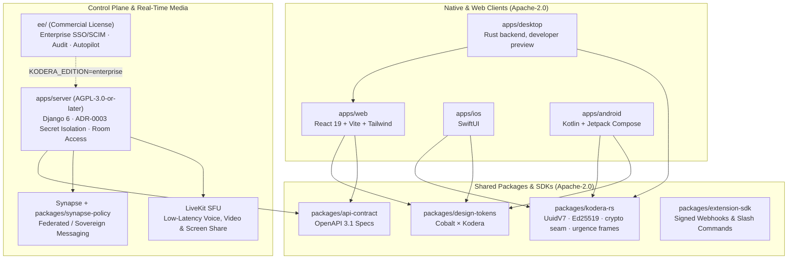

<p align="center">
  <picture>
    <source media="(prefers-color-scheme: dark)" srcset="./apps/web/public/kodera-mark-white.svg">
    <source media="(prefers-color-scheme: light)" srcset="./apps/web/public/kodera-mark-slate.svg">
    
  </picture>
</p>

<h1 align="center">Kodera</h1>

<p align="center">
  <strong>The fast, sovereign, open-core workspace for teams, communities, and resilient organisations.</strong><br>
  Instant channels, low-latency voice &amp; video rooms, native clients, and crisis-ready resilience — hosted in Europe or on your own infrastructure.
</p>

<p align="center">
  <a href="https://kodera.io"><strong>kodera.io (Managed Cloud &amp; Enterprise)</strong></a> ·
  <a href="./deploy/community/README.md">Self-Host (Docker Compose)</a> ·
  <a href="./ARCHITECTURE.md">Architecture</a> ·
  <a href="./docs/rfcs/RFC-0001-emergency-ble-channel.md">RFC-0001 (<code>#urgence</code> BLE)</a> ·
  <a href="./CONTRIBUTING.md">Contribute</a>
</p>

---

> **Status: Developer Preview (`v0.x`)** — Active pre-`v1.0` open-core development. Core API contracts, web client, design tokens, and shared Rust primitives (`kodera-rs`) are verified in CI; mobile clients (`apps/ios`, `apps/android`) and `#urgence` offline proximity relaying are under active build-out.

## Why Kodera?

Most modern collaboration tools force an uncomfortable trade-off: **consumer-fast UX locked inside US hyperscaler silos** (Discord, Slack, Teams) *or* **fragmented self-hosted stacks that struggle with onboarding and voice reliability**.

Kodera bridges both worlds:

- **Discord-Fast Real-Time Collaboration:** Instant channels, threads, presence, and one-click **LiveKit WebRTC** audio/video/screen-sharing rooms.
- **Frictionless Multi-Server Identity (`Kodera Passport`):** Join multiple workspaces from a single client using Passkeys or Magic Links — while allowing corporate workspaces to enforce strict SAML/OIDC SSO and hardware MFA per server.
- **Transport-Agnostic Cryptographic Core (`kodera-rs`):** `#![forbid(unsafe_code)]` Rust crate unifying RFC 9562 `UuidV7` routing, `Ed25519` device identity, a `CryptoProvider` seam and ciphertext envelope types (`MatrixOlmV1`, with `OpenMlsDraft` reserved for a future RFC 9420 provider; no MLS implementation ships today), and offline proximity frames shared by the Desktop developer preview, **SwiftUI iOS** and **Jetpack Compose Android**.
- **Built for Physical Resilience (`#urgence`):** Architectural support for an offline intra-building emergency channel over local Wi-Fi (`mDNS + QUIC`) and `BLE GATT` (`<= 256 B` signed frames) when internet or WAN connectivity goes dark ([`RFC-0001`](./docs/rfcs/RFC-0001-emergency-ble-channel.md)).
- **EU Cyber Resilience Act (CRA) Ready by Design:** Startup secret isolation (`ADR-0003`), SHA-pinned CI workflows, CycloneDX SBOM generation, and SLSA v1.0 provenance architecture.

---

## Ways to Run Kodera

| Deployment Mode | Best For | Operations & Hosting | Get Started |
| :--- | :--- | :--- | :--- |
| **Kodera Cloud & Business** | Startups, SMEs, NGOs & distributed teams | Zero-ops European hosting (Scaleway France), automated backups, SLA | **[Start on kodera.io →](https://kodera.io)** |
| **Kodera Autopilot** *(Managed Self-Host)* | Regulated mid-market & public sector | Runs on **your** VPC/VPS (Scaleway, OVHcloud, Hetzner); patched & monitored by Kodera | **[Talk to Engineering →](https://kodera.io)** |
| **Kodera Enterprise** | Large enterprises & critical infrastructure | Dedicated sovereign EU instances, multi-org federation, SAML 2.0 / SCIM 2.0, Managed SLA, SIEM exports, `#urgence` crisis console | **[Enterprise Licensing →](https://kodera.io)** |
| **Community Self-Host** | Developers, homelabs & open communities | Single-node Docker Compose, automatic Caddy TLS; sign-in through an OIDC issuer you operate | **[`deploy/community/`](./deploy/community/README.md)** |

---

## Monorepo Architecture



| Path | Package / Target | License | Description |
| :--- | :--- | :--- | :--- |
| [`apps/web`](./apps/web) | `@kodera/web` | `Apache-2.0` | Customer & workspace web application |
| [`apps/desktop`](./apps/desktop) | `@kodera/desktop` | `Apache-2.0` | Desktop developer preview: Rust backend seams and a local self-host preflight; no running shell and no provider calls yet |
| [`apps/ios`](./apps/ios) | `KoderaiOS` | `Apache-2.0` | Native SwiftUI iOS client |
| [`apps/android`](./apps/android) | `KoderaAndroid` | `Apache-2.0` | Native Kotlin / Jetpack Compose Android client |
| [`apps/server`](./apps/server) | `kodera-server` | `AGPL-3.0-or-later` | Control plane API, provisioning worker, `room_access` & `tenant_agent` |
| [`packages/kodera-rs`](./packages/kodera-rs) | `kodera-rs` | `Apache-2.0` | Zero-unsafe Rust core (`UuidV7`, `CryptoProvider` OpenMLS seam, `#urgence` frame codec) |
| [`packages/design-tokens`](./packages/design-tokens) | `@kodera/design-tokens` | `Apache-2.0` | Single source of truth for colour, typography & contrast gates |
| [`packages/api-contract`](./packages/api-contract) | `@kodera/api-contract` | `Apache-2.0` | Canonical OpenAPI 3.1 specifications |
| [`packages/extension-sdk`](./packages/extension-sdk) | `@kodera/extension-sdk` | `Apache-2.0` | Zero-dependency SDK for HMAC-signed webhooks & slash commands |
| [`packages/synapse-policy`](./packages/synapse-policy) | `kodera-synapse-policy` | `AGPL-3.0-or-later` | Matrix Synapse room-governance module |
| [`extensions/hello-webhook`](./extensions/hello-webhook) | `@kodera/ext-hello-webhook` | `Apache-2.0` | `< 15 min` starter slash-command extension |
| [`deploy/community`](./deploy/community) | Docker Compose | `Apache-2.0` | Self-hosted stack (`Caddy + Postgres 17 + Valkey 8 + Synapse + LiveKit`), bring your own OIDC issuer |
| [`ee`](./ee) | Enterprise Edition | [`ee/LICENSE`](./ee/LICENSE) | Commercial enterprise governance modules (Copyright Samouraï Coop) |

---

## Quickstart

> **Want zero infrastructure to maintain?** Start on Managed European Cloud or Dedicated Sovereign Hosting at **[kodera.io](https://kodera.io)**.

### 1. Self-Host Community Edition

```bash
git clone https://github.com/kodera-hq/kodera.git
cd kodera/deploy/community
cp .env.example .env
# Populate KODERA_DOMAIN, your OIDC issuer (KODERA_OIDC_PROVIDER_ORIGIN, KODERA_AUTH_TRUST),
# hex secrets (openssl rand -hex 32) and 32-byte seal keys (openssl rand -base64 32 | tr '+/' '-_')
python3 ../../scripts/ci/check-community-deploy.py --preflight .env
docker compose up -d
```

### 2. Develop Locally (Pick Only the Layer You Need)

```bash
# Extension SDK & starter bot (< 30 seconds, zero backend required)
npm ci --ignore-scripts && npm run test:sdk

# Shared Rust core & Tauri Desktop shell
cargo fmt --all -- --check && cargo clippy --locked --workspace --all-targets -- -D warnings && cargo test --locked --workspace && npm --workspace @kodera/desktop run typecheck

# Design Tokens + Web Client
npm run test:tokens && npm run typecheck && npm run test:web

# Server Control Plane static & contract gates (Python 3.12 + uv; clean env per ADR-0003)
(cd apps/server && uv sync --locked && env -i PATH="$PATH" HOME="$HOME" uv run ruff check . && env -i PATH="$PATH" HOME="$HOME" uv run mypy . && env -i PATH="$PATH" HOME="$HOME" uv run python scripts/ci/check-authz-matrix.py)
```

---

## Security, Governance & Licensing

- **Vulnerability Disclosure:** Please report security issues privately via [GitHub Security Advisories](https://github.com/kodera-hq/kodera/security/advisories/new) or `support@kodera.io` — see [`SECURITY.md`](./SECURITY.md).
- **Open-Core Governance:** Read our buyer-based open-core pledge and maintainer rings in [`GOVERNANCE.md`](./GOVERNANCE.md).
- **Licensing & Trademarks:** Client apps, design tokens, contracts, SDKs, community deploy, and Rust core are [`Apache-2.0`](./LICENSE-APACHE); server and Synapse policy are [`AGPL-3.0-or-later`](./LICENSE-AGPL); `ee/` is commercial ([`ee/LICENSE`](./ee/LICENSE)). The **Kodera** name and mark are protected under [`TRADEMARKS.md`](./TRADEMARKS.md).
