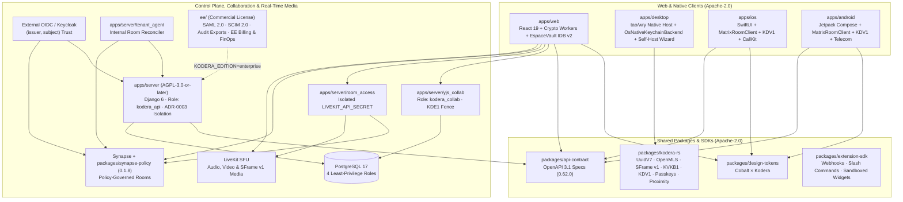

<p align="center">
  <picture>
    <source media="(prefers-color-scheme: dark)" srcset="./apps/web/public/kodera-mark-white.svg">
    <source media="(prefers-color-scheme: light)" srcset="./apps/web/public/kodera-mark-slate.svg">
    
  </picture>
</p>

<h1 align="center">Kodera</h1>

<p align="center">
  <strong>An open-core workspace for teams and communities: channels, threads and always-open audio rooms.</strong><br>
  Built on Matrix and LiveKit, hosted in Europe or on your own infrastructure.
</p>

<p align="center">
  <a href="#downloads-desktop--mobile">Downloads</a> ·
  <a href="./deploy/community/README.md">Self-Host (Docker Compose)</a> ·
  <a href="./ARCHITECTURE.md">Architecture</a> ·
  <a href="./docs/security/THREAT_MODEL_AND_CRYPTOGRAPHY.md">Threat Model &amp; Cryptography</a> ·
  <a href="./ROADMAP.md">Roadmap</a> ·
  <a href="./docs/adr/README.md">Decisions (ADR index)</a> ·
  <a href="./docs/rfcs/RFC-0001-emergency-ble-channel.md">RFC-0001 (<code>#proximity</code>)</a> ·
  <a href="./CONTRIBUTING.md">Contribute</a> ·
  <a href="https://kodera.io">kodera.io</a>
</p>

---

> **Status: Developer Preview (`v0.x`).** Pre-`v1.0`, under active development. This page says what the repository contains today and marks everything else **Planned**. The list of planned work, and its order, is the [roadmap](./ROADMAP.md); the authoritative backlog is this repository's issues and its GitHub Project.

## Downloads (Desktop & Mobile)

Direct release builds and integrity manifests are published on [GitHub Releases (`releases/latest`)](https://github.com/kodera-hq/kodera/releases/latest):

| Platform | Architecture / Format | Direct Download |
| :--- | :--- | :--- |
| **macOS** | Universal (`Apple Silicon & Intel` — `.dmg`, `.app.tar.gz`) | [`kodera-desktop-macos-universal.dmg`](https://github.com/kodera-hq/kodera/releases/latest/download/kodera-desktop-macos-universal.dmg) · [`kodera-desktop-macos-universal.app.tar.gz`](https://github.com/kodera-hq/kodera/releases/latest/download/kodera-desktop-macos-universal.app.tar.gz) |
| **Linux** | `x86_64` / `amd64` (`.AppImage`, `.deb`) | [`kodera-desktop-linux-x86_64.AppImage`](https://github.com/kodera-hq/kodera/releases/latest/download/kodera-desktop-linux-x86_64.AppImage) · [`kodera-desktop-linux-amd64.deb`](https://github.com/kodera-hq/kodera/releases/latest/download/kodera-desktop-linux-amd64.deb) |
| **Windows** | `x64` (`.msi`, NSIS `.exe`) | [`kodera-desktop-windows-x64.msi`](https://github.com/kodera-hq/kodera/releases/latest/download/kodera-desktop-windows-x64.msi) · [`kodera-desktop-windows-x64-setup.exe`](https://github.com/kodera-hq/kodera/releases/latest/download/kodera-desktop-windows-x64-setup.exe) |
| **Android** | Universal (`.apk`) | [`kodera-android.apk`](https://github.com/kodera-hq/kodera/releases/latest/download/kodera-android.apk) |
| **Checksums & SBOM** | SHA-256 digests & CycloneDX 1.6 inventory | [`SHA256SUMS.txt`](https://github.com/kodera-hq/kodera/releases/latest/download/SHA256SUMS.txt) · [`sbom-cyclonedx.json`](https://github.com/kodera-hq/kodera/releases/latest/download/sbom-cyclonedx.json) · [All assets on GitHub Releases](https://github.com/kodera-hq/kodera/releases/latest) |

Verify downloaded binaries against [`SHA256SUMS.txt`](https://github.com/kodera-hq/kodera/releases/latest/download/SHA256SUMS.txt) before installation. OS code-signing/notarisation and Apple App Store / Google Play store listings remain operator gates (see [What is not there yet](#what-is-not-there-yet)).

## What works today

- **Channels in the web client.** Text channels with threads, replies, reactions, typing and presence, backed by a Matrix homeserver (Synapse) that a Kodera policy module keeps under the control plane's rules.
- **Always-open audio and video rooms.** Join over a LiveKit SFU, with camera video, screen sharing and who-is-in-the-room shown in the channel list. The web client publishes and plays microphone audio.
- **Direct conversations and media.** Private one-to-one and bounded group conversations, message search, checked file uploads and downloads, text-only link previews, notification history and payload-free Web Push are implemented in the web client and server.
- **Native collaborative Pages and typed Collections.** Workspace documents have a page tree, document roles, Markdown/Tiptap block editing, wikilinks, backlinks, search, a Yjs collaboration service at `wss://<api-host>/documents/collab` with persisted updates and snapshots, and typed Collections (`Table`, `Kanban` and `List` views).
- **Community membership, cardless SMB self-serve (`<= 5` seats), moderation and lifecycle controls.** Canonical-realm self-signup, cardless shared-realm SMB workspace creation (`POST /api/v1/workspaces/self-serve` on `app.kodera.io/<slug>`, `<= 5` seats, `5 GiB` storage, `< 5 s` creation-to-chat without a payment card), reusable invitation links, public local rooms, private staff/partner categories, revisioned bilateral `PartnerChannelAgreement` bridges and isolated `single_channel_guest` grants, reports, workspace moderation, transactional workspace quotas, Factur-X `380`/`381` PDF/A-3 + XML billing documents, EU OSS 27-state VAT & VIES evidence, Community workspace boosts & Stripe Connect VIP passes with DAC7 `DPI2` reporting, verified Stripe webhook settlement (including dedicated Sovereign `PRO2-S`/`M`/`L` warm-pool claims), and GDPR Art. 17/20 signed exports and erasure are implemented. The hosted Community tenant is live with the promoted `auth.kodera.io` identity provider; live payment activation and store distribution remain gated.
- **A control plane with a contract.** `apps/server` (Django) owns organisations, members, roles, workspaces, channel access, `.well-known` discovery, zero-trust `/staff/v1/*` operations (including operator SRE & warm-pool diagnostics), voluntary `#proximity` check-in over a RAM-only broker socket, default-off confidential envelope & `KVKB1` key-backup relay (`KODERA_E2EE_RELAY_ENABLED`), default-off sovereign `ai_gateway` (`KODERA_AI_GATEWAY_ENABLED=false` with 3-tier opt-in, 8-language ephemeral translation, consent-gated live call captions and triple-layer `403` confidential refusal), sovereign CalDAV calendar sync & zero-PII `.ics` booking, `0–100` cybersecurity posture advisor, quotas, billing ledger and GDPR workflows behind an OpenAPI 3.1 contract (`0.62.0`), from which the web client's API types are generated.
- **Sign-in through OpenID Connect, WebAuthn passkeys and `Kodera Passport`.** The server trusts the issuers you list; the web client signs in at your identity provider, Synapse signs members in through the same realm, `kodera-rs` + native clients support universal ES256 passkey binding without authenticator lock-in, and `Kodera Passport` provides signed PKCE cross-workspace magic-link sign-in and multi-organisation switching.
- **A verified self-host profile & maintenance CLI.** [`deploy/community`](./deploy/community/README.md): a single-node Docker Compose stack with Synapse on PostgreSQL, federation closed by default (with opt-in `KODERA_FEDERATION_MODE=open`), rate limits set and the agent API off the internet, paired with the companion [`deploy/community/kodera-ctl`](./docs/self-hosting/kodera-ctl-and-webrtc-probe.md) CLI (write-quiesced `0700`/`0600` PostgreSQL snapshots, health-gated upgrades, isolated `rehearse-restore`) and `webrtc_probe.py`. `scripts/ci/check-community-deploy.py` and the fresh-volume cold-start runtime gate verify it in CI on every change.
- **Signature audio, collaborative whiteboard & workspace experience.** Zero-allocation `KoderaVoiceVisualizer`, async voice notes, `/poll` timeline & live-call `PollCard` overlays, procedural soundboard & waiting-room ambience, collaborative Yjs `<canvas>` whiteboard, sanitized RIFF/WebP custom emojis (`:shortcode:`), *Send Later* scheduled messages & personal reminders, *Kodera Labs* toggles, and the Pro/Messages mode switcher with workspace branding/admin.
- **Extension SDK, sandboxed widgets, outbound runtime v2 and workspace importers.** [`@kodera/extension-sdk`](./packages/extension-sdk/README.md) (`0.2.0`) defines signed webhooks, slash commands and declarative `kodera.widget.v1` cards rendered inside script-isolated `sandbox=""` containers; [`create-kodera-extension`](./packages/create-kodera-extension/README.md) scaffolds zero-dependency starter packages; `apps/server` manages scoped workspace installations, marketplace checkout/install, key rotation, reconciliation and dual-key HMAC webhook delivery with pinned-IP SSRF guards; [`extensions/`](./extensions/README.md) carries 23 reference implementations (`hello-webhook` plus 22 domain connectors), alongside bounded `Slack`, `Discord` and `Notion` importers.
- **Confidential room boundaries & 3-tier encryption model.** Encryption tiers follow a single contract (`tier-1-default-e2ee` for default DM/private-call E2EE, `Planned` — ordinary `1:1`/group DMs are created as server-readable private rooms today without a misleading padlock; `tier-2-opt-in-confidential` for explicit confidential channels and rooms (`🔒`); `tier-3-standard-channel` for server-readable workspace channels such as `#arrivals` and `#general`). Shipped clients enforce fail-closed refusal and room-store quarantine (`#180`) on confidential or unclassified sessions rather than downgrading to plaintext; usable end-to-end confidential room, Page and call flows in the shipped client remain `Planned`. Tested primitives in tree include WebWorker `SFrame v1` media transforms, `KDE1` envelope framing and `yjs_collab` epoch-fenced server admission (`docs_collab_fence`), WebWorker `KVKB1` encrypted key-backup sealing (`PBKDF2-HMAC-SHA-512 -> HKDF-SHA-256 -> AES-256-GCM`), client-local blind-indexed `HMAC-SHA-256` search (`EspaceVault` IndexedDB v2), and operator-gated server confidential directory, consecutive MLS epoch, proof-bound cross-signing and opaque `KVKB1` backup routes.
- **Native desktop, mobile, browser WASM and Rust foundations.** [`packages/kodera-rs`](./packages/kodera-rs/README.md) provides `UuidV7`, `Ed25519` device identity, `wasm32` browser device-proof bindings, scoped OpenMLS/Megolm primitives, `SFrame v1` media framing, `KVKB1` structural header validation, `KDV1` native session vaults, ES256 passkey binding and `#proximity` frame v1/v2 codecs; `apps/desktop` implements the origin-fenced `tao`/`wry` native desktop host with Tauri-compatible IPC (`kodera://` / `matrix:`, tray, PTT, persistent `OsNativeKeychainBackend` with zeroized RAM cache and automated self-host stack deployment) and `apps/ios` + `apps/android` implement Dark Precision (`dark`) / Light Givre (`light`) companion workspace clients with `MatrixRoomClient` + `MatrixTimelineReducer` messaging, `KDV1` Keychain/Keystore vaults, `NativeVoIPRuntime` (PushKit/CallKit) / `NativeTelecomRuntime` (`ConnectionService`) + `CallRingMachine`, foreground BLE/mDNS proximity adapters and payload-free push wakeups.
- **Enterprise governance & billing (`ee/`).** [`ee/`](./ee/README.md) implements SAML 2.0 corporate SSO, SCIM 2.0 provisioning, `Ed25519`-signed compliance audit exports, and [`ee/billing/`](./ee/billing/README.md) commercial price schedules (`PRO2-S`/`M`/`L` Sovereign sizing), Autopilot warm-pool governance (`<= 3` pre-warmed cells), per-tenant FinOps COGS attribution (`finops.py`) and purchase orders behind a strict `KODERA_EDITION=enterprise` clean-room gate.
- **One design system.** [`@kodera/design-tokens`](./packages/design-tokens) is the single source of colour, type and motion for the web and native clients, with contrast gates in CI.

## What is not there yet

Status: Planned. The [roadmap](./ROADMAP.md) orders the remaining work. The [collaboration status](./docs/specs/collaboration-status.md) distinguishes shipped code from operator-run cutover and distribution gates.

- **Universal zero-knowledge encryption across every room, document and client.** Standard channels and their ordinary collaborative Yjs documents remain readable by the server by design. While confidential rooms enforce `#180` fail-closed quarantine, worker-isolated `SFrame v1` / `KDE1` / `KVKB1` / blind-indexed local search, and operator-gated server directory/epoch/cross-signing/`KVKB1` backup endpoints, durable multi-device MLS group coordinators, native mobile key-backup restore, interoperable browser/codec media qualification, and full retirement of clear-text homeserver storage remain Planned in Track 7 of [`ROADMAP.md`](./ROADMAP.md).
- **Live mobile media SDK wiring, remote invite transport and C-ABI Rust linking.** `apps/ios` and `apps/android` implement `MatrixRoomClient` room timelines, `KDV1` Keychain/Keystore vaults, and `NativeVoIPRuntime` / `NativeTelecomRuntime` call admission in source, while remote Matrix room-invitation delivery, live WebRTC media SDK binding, unmangled C-ABI dynamic Rust linking (held while `#![forbid(unsafe_code)]` is enforced), and live push/homeserver provider qualification remain open.
- **Signed desktop installers, installed-package keychain qualification and mobile store releases.** `OsNativeKeychainBackend` (`security -i` / `secret-tool` / `PasswordVault`) is implemented in source; notarised macOS/Windows desktop installers, signed-package OS login-keychain prompt qualification, background iOS PushKit entitlement provisioning, and published Apple App Store / Google Play companion builds (v1.0 has no in-app purchase and no pricing screen) await operator signing and store submission.
- **Physical two-device `#proximity` radio qualification.** `#proximity` is an everyday proximity channel with a voluntary, pseudonymous check-in; its v1/v2 signed frame codecs, RAM-only Unix-socket check-in broker (`/run/proximity/broker.sock`), 15-minute rotating HKDF epoch leases and foreground native BLE/mDNS adapter layers are in tree, while two-device physical radio interoperability qualification remains open. It is not an emergency service ([`RFC-0001`](./docs/rfcs/RFC-0001-emergency-ble-channel.md)).
- **Remaining operator activation.** The `auth.kodera.io` identity provider, hosted Community cutover, and isolated `kodera_ctl.py rehearse-restore` harness are implemented; live production backup/restore cutover drills, live payment webhook activation, external managed-fleet provisioning and signed store distribution remain operator-executed gates.

---

## Editions and pricing

| Edition | For | What you get | Price |
| :--- | :--- | :--- | :--- |
| **Community / Self-Host** | Developers, communities and teams who run their own server | Everything in the open-source tree, on your infrastructure: [`deploy/community`](./deploy/community/README.md). You bring an OIDC issuer and operate the stack. | **0 €** |
| **Team / Pro** | Teams who want it hosted (starts with a cardless `<= 5`-seat SMB tier) | A workspace on the shared European cloud, with strict per-seat quotas. | **0 € up to 5 seats**, then **5 € excl. VAT per seat per month, billed annually** (6 € billed monthly) |
| **Sovereign / Enterprise** | Organisations that need their own tenant | A dedicated tenant, with custom terms. | **From 290 € excl. VAT per month**, or custom |

Community is what the open-source tree builds and runs without commercial dependencies (`KODERA_EDITION=community`, `KODERA_BILLING_ENABLED=false`). Team / Pro and Sovereign / Enterprise are commercial offers of Samouraï Coop at [kodera.io](https://kodera.io); commercial governance and pricing modules live under [`ee/`](./ee/README.md) (`LicenseRef-Kodera-EE`), and the open-core boundary is governed by [`GOVERNANCE.md`](./GOVERNANCE.md).

---

## Monorepo Architecture



| Path | Package / Target | License | Description |
| :--- | :--- | :--- | :--- |
| [`apps/web`](./apps/web/README.md) | `@kodera/web` | `Apache-2.0` | Customer console and workspace web client (`Crypto Workers`, `EspaceVault` IDB v2, Pages/Collections/Whiteboard, CalDAV/Booking) |
| [`apps/desktop`](./apps/desktop/README.md) | `@kodera/desktop` | `Apache-2.0` | Origin-fenced `tao`/`wry` native desktop host with Tauri-compatible IPC, deep-links, tray/PTT controls, `OsNativeKeychainBackend` with zeroized RAM cache and self-host stack deployment wizard |
| [`apps/ios`](./apps/ios/README.md) | `KoderaiOS` | `Apache-2.0` | Native SwiftUI companion client (`@kodera/design-tokens` `dark`/`light` parity, `MatrixRoomClient`, `KDV1` Keychain vault, `NativeVoIPRuntime` PushKit/CallKit, foreground BLE/mDNS proximity, universal passkeys) |
| [`apps/android`](./apps/android/README.md) | `KoderaAndroid` | `Apache-2.0` | Native Kotlin / Jetpack Compose companion client (`@kodera/design-tokens` `dark`/`light` parity, `MatrixRoomClient`, `KDV1` Keystore vault, `NativeTelecomRuntime` `ConnectionService`, foreground BLE/NSD proximity, universal passkeys) |
| [`apps/server`](./apps/server/README.md) | `kodera-server` | `AGPL-3.0-or-later` | Control plane API (`0.62.0`), cardless SMB self-serve, `Kodera Passport`, confidential & `KVKB1` relay, `yjs_collab` (`KDE1`), `ai_gateway`, CalDAV/booking, proximity broker, extension runtime v2, billing/GDPR jobs, `room_access` and `tenant_agent` |
| [`packages/kodera-rs`](./packages/kodera-rs/README.md) | `kodera-rs` | `Apache-2.0` | Zero-unsafe Rust core (`UuidV7`, `Ed25519` device identity, `wasm32` browser device proofs, OpenMLS/Megolm, `SFrame v1`, `KVKB1` header validation, `KDV1`, ES256 passkey binding, `#proximity` v1/v2 codecs) |
| [`packages/design-tokens`](./packages/design-tokens) | `@kodera/design-tokens` | `Apache-2.0` | Single source of truth for colour, typography and contrast gates |
| [`packages/api-contract`](./packages/api-contract/README.md) | `@kodera/api-contract` | `Apache-2.0` | Canonical OpenAPI 3.1 specifications (`0.62.0`) |
| [`packages/extension-sdk`](./packages/extension-sdk/README.md) | `@kodera/extension-sdk` | `Apache-2.0` | Zero-dependency SDK (`0.2.0`) for HMAC-signed webhooks, slash commands and `kodera.widget.v1` cards |
| [`packages/create-kodera-extension`](./packages/create-kodera-extension/README.md) | `create-kodera-extension` | `Apache-2.0` | Zero-dependency Node CLI scaffolder for signed webhook, slash-command and `kodera.widget.v1` extensions; local pre-release |
| [`packages/synapse-policy`](./packages/synapse-policy/README.md) | `kodera-synapse-policy` | `AGPL-3.0-or-later` | Matrix Synapse room-governance, confidential-timeline and partner/guest federation policy module (`0.1.8`) |
| [`packages/create-kodera`](./packages/create-kodera/README.md) | `create-kodera` | `Apache-2.0` | Configuration generator that ships the same stack as `deploy/community`; local pre-release, not published |
| [`extensions`](./extensions/README.md) | `@kodera/ext-*` | `Apache-2.0` | 23 reference implementations built on the SDK; start from [`hello-webhook`](./extensions/hello-webhook) |
| [`deploy/community`](./deploy/community/README.md) | Docker Compose | `Apache-2.0` | Self-hosted stack (`Caddy + Postgres 17 + Valkey 8 + Synapse on its own Postgres + LiveKit`) + `kodera-ctl`, verified cold-start in CI |
| [`ee`](./ee/README.md) | Enterprise Edition | [`ee/LICENSE`](./ee/LICENSE) | Commercial enterprise modules (`SAML 2.0`, `SCIM 2.0`, `Ed25519` audit exports, `ee/billing/` & FinOps; Copyright Samouraï Coop) |

Architecture decisions are indexed in [`docs/adr/`](./docs/adr/README.md), and the cross-stack threat model and cryptographic wire contracts live in [`docs/security/THREAT_MODEL_AND_CRYPTOGRAPHY.md`](./docs/security/THREAT_MODEL_AND_CRYPTOGRAPHY.md).

---

## Quickstart

### 1. Self-Host Community Edition

```bash
git clone https://github.com/kodera-hq/kodera.git
cd kodera/deploy/community
cp .env.example .env
# Populate KODERA_DOMAIN, your OIDC issuer (KODERA_OIDC_PROVIDER_ORIGIN, KODERA_AUTH_TRUST),
# hex secrets (openssl rand -hex 32), discovery HMAC key (openssl rand -base64 32) and base64url keys (openssl rand -base64 32 | tr '+/' '-_')
python3 ../../scripts/ci/check-community-deploy.py --preflight .env
docker compose up -d
```

The stack runs no identity provider: read [`deploy/community/README.md`](./deploy/community/README.md) first, in particular "Sign-in" and "Matrix sign-in". Fresh-volume cold-start boot and container memory bounds are verified in CI.

### 2. Develop Locally (Pick Only the Layer You Need)

```bash
# Extension SDK & reference extensions (zero backend required)
npm ci --ignore-scripts && npm run test:sdk

# Shared Rust core & desktop shell
cargo fmt --all -- --check && cargo clippy --locked --workspace --all-targets -- -D warnings && cargo test --locked --workspace && npm --workspace @kodera/desktop run typecheck

# Design Tokens + Web Client
npm run test:tokens && npm run typecheck && npm run test:web

# Server Control Plane static & contract gates (Python 3.12 + uv; clean env per ADR-0003)
(cd apps/server && uv sync --locked && env -i PATH="$PATH" HOME="$HOME" uv run ruff check . && env -i PATH="$PATH" HOME="$HOME" uv run mypy . && env -i PATH="$PATH" HOME="$HOME" uv run python scripts/ci/check-authz-matrix.py)

# Documentation links, the ADR index and the self-host profile
python3 scripts/ci/check-docs-truth.py && python3 scripts/ci/check-community-deploy.py
```

---

## Security, Governance & Licensing

- **Supply chain:** secrets are refused at server start-up unless admitted by name (`ADR-0003`); GitHub Actions are pinned to commit SHAs; every pull request and every push to `main` is scanned for secrets; CycloneDX SBOMs and reviewed SPDX licence subsets are enforced in CI. Signed build provenance (SLSA) is planned and not produced today.
- **Browser response hardening:** the live Community edge enforces a nonce-based `default-src 'none'` CSP, HSTS, `nosniff` and referrer restrictions. The standalone web server enforces a self-only CSP without inline exceptions, `Referrer-Policy: no-referrer`, `X-Content-Type-Options: nosniff` and `Cache-Control: no-store`, guarded by [`headers.test.ts`](./apps/web/tests/unit/serving/headers.test.ts). Deployment acceptance must verify the final header policy and admit `wss://<api-host>/documents/collab`.
- **Vulnerability Disclosure:** Please report security issues privately via [GitHub Security Advisories](https://github.com/kodera-hq/kodera/security/advisories/new) or `support@kodera.io` — see [`SECURITY.md`](./SECURITY.md).
- **Open-Core Governance:** Read our buyer-based open-core pledge and maintainer rings in [`GOVERNANCE.md`](./GOVERNANCE.md).
- **Licensing & Trademarks:** Client apps, design tokens, contracts, SDKs, community deploy, and Rust core are [`Apache-2.0`](./LICENSE-APACHE); server and Synapse policy are [`AGPL-3.0-or-later`](./LICENSE-AGPL); `ee/` is commercial ([`ee/LICENSE`](./ee/LICENSE)). The **Kodera** name and mark are protected under [`TRADEMARKS.md`](./TRADEMARKS.md).
