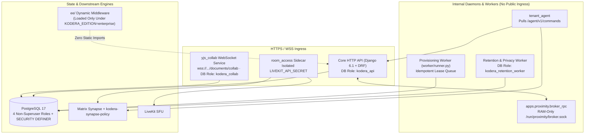

# `kodera-server` (`apps/server`)

Status: Active (`AGPL-3.0-or-later`, OpenAPI `0.62.1`)

`apps/server` is the control-plane API, real-time Yjs collaboration relay, LiveKit room-access sidecar, Matrix tenant-agent reconciler, proximity check-in broker, and background job queue of the `kodera-hq/kodera` monorepo. Server architectural decisions live in [`docs/adr/`](docs/adr/README.md); cross-stack trust boundaries and database role separation are documented in [`docs/security/THREAT_MODEL_AND_CRYPTOGRAPHY.md`](../../docs/security/THREAT_MODEL_AND_CRYPTOGRAPHY.md) and [`docs/security/README.md`](docs/security/README.md).

## Runtime Architecture & Role Isolation



## Core Boundaries & Non-Negotiable Invariants

- **Zero Infrastructure Credentials in the API (`SRV-ADR-0003`):** [`config/environment.py`](config/environment.py) inspects `os.environ` before Django settings load and refuses startup if cloud/IaC credentials (`SCW_*`, `AWS_*`, `TF_*`, `SSH_*`, `SOPS_*`, `AGE_*`, `KUBECONFIG`) or unadmitted secret variables exist.
- **Deny-By-Default Container Context:** [`.dockerignore`](.dockerignore) defaults to `**` and admits an explicit runtime file allowlist, excluding operator commands, migration scripts, test suites, and `ee/` from the Community container image.
- **PostgreSQL Four-Role Split:**
  - `kodera_api` ([`core/db/api_writer_role.py`](core/db/api_writer_role.py), verified at startup by [`core/db/api_database_boundary.py`](core/db/api_database_boundary.py)): explicit table/column grants, append-only audit tables, and narrow `SECURITY DEFINER` ports (including `billing_issue_draft_invoice`).
  - `kodera_collab` ([`yjs_collab/database-boundary.mjs`](yjs_collab/database-boundary.mjs)): scoped strictly to `docs_document*` tables and 4 `SECURITY DEFINER` routines (`docs_collab_fence`, `docs_collab_audit`, `docs_redeem_collaboration_ticket`, `docs_collab_snapshot_admit`), with zero read access to `identity_*`, `orgs_*`, `billing_*`, or `e2ee_*`.
  - `kodera_retention_worker` & `kodera_retention_admission` ([`core/db/retention_worker_role.py`](core/db/retention_worker_role.py)): separate operator admission from automated statutory GDPR Art. 17 / fiscal retention purges.
- **IsolatedTenant Profiles & Provisioning:** Tenant deployment profiles (`schemas/x-kodera.schema.json`) live in the private operations repository rather than inside `apps/server`. Every infrastructure state transition is recorded atomically as a `Job` + `AuditEvent` (`SRV-ADR-0004`); the open-source [`worker/registry.py`](worker/registry.py) registers no cloud provider handlers by default, and dedicated Sovereign warm-pool claims (`SOVEREIGN_POOL_WATERMARKS`, `<= 3` pre-warmed cells) execute purely against PostgreSQL state.

## Domain Applications & Services

- **Identity, Discovery & Organisations (`apps/identity`, `apps/orgs`, `apps/tenancy`):** Offline JWT verification (`KODERA_AUTH_TRUST`), `.well-known` realm discovery, `Kodera Passport` PKCE cross-workspace magic-link sign-in, shared-realm vs per-organisation realm binding, invitations, reusable invite links, and GDPR Art. 17/20 export and erasure (`PrivateVolume` `O_NOFOLLOW`).
- **Workspaces, Self-Serve & Governance (`apps/workspaces`, `apps/engine_intents`, `tenant_agent`, `room_access`):** Cardless shared-realm SMB workspace creation (`POST /api/v1/workspaces/self-serve`, `<= 5` seats, `< 5 s`), channel/category trees, moderation, bilateral `PartnerChannelAgreement` bridges, `single_channel_guest` grants, transactional `WorkspaceQuota` enforcement, Matrix intent reconciliation ([`tenant_agent/README.md`](tenant_agent/README.md)), and isolated LiveKit token minting ([`room_access/README.md`](room_access/README.md)).
- **Collaborative Pages, Collections & Media (`apps/docs`, `yjs_collab`, `apps/media`, `apps/notifications`):** Document trees/roles, single-use collaboration tickets, binary Yjs sync + `KDE1` confidential collaboration admission ([`yjs_collab/protocol.mjs`](yjs_collab/protocol.mjs)), typed Collections (`Table`, `Kanban`, `List`), checksum-bound S3 attachments, pinned-IP SSRF-guarded link previews, sanitized RIFF/WebP custom emojis, scheduled messages, reminders, notification inbox, and payload-free Web Push.
- **Confidentiality & Proximity (`apps/e2ee`, `apps/confidential`, `apps/proximity`):** HPKE KeyPackage & opaque envelope relays, participating-device room discovery, consecutive MLS epoch provisioning, proof-bound cross-signing bundles, opaque `KVKB1` key-backup capsules, and the RAM-only `/run/proximity/broker.sock` 15-minute HKDF epoch-lease broker (not an emergency service).
- **Sovereign AI, Calendar & Posture (`apps/ai_gateway`, `apps/calendar`, `apps/extensions`, `apps/support`):** Default-off `ai_gateway` (`KODERA_AI_GATEWAY_ENABLED=false`, 3-tier opt-in, EU `MistralAdapter` / self-hosted / AEAD `ByomAdapter`, 8-language ephemeral translation, multi-party consent-gated call captions, triple-layer `403` confidential refusal), CalDAV sync & zero-PII `.ics` booking, outbound extension runtime v2 (`kodera.widget.v1` relay, marketplace, `Slack`/`Discord`/`Notion` importers), `0–100` posture advisor, and support tickets.
- **Billing, Legal & Zero-Trust Staff API (`apps/billing`, `apps/legal`, `core/staff_api`, `apps/audit`):** Offer catalogue (`PRO2-S`/`M`/`L` Sovereign tiers), DPA generation, gap-free Factur-X `380`/`381` PDF/A-3 + EN 16931 XML ledger, EU OSS 27-state VAT & VIES evidence, Community boosts, Stripe Connect VIP passes & DAC7 `DPI2` reporting, verified Stripe `mode=payment` webhook settlement (with automated Sovereign Factur-X issuance & WarmPool claim/cold fallback), `/staff/v1/*` zero-content diagnostics (`GET /staff/v1/read/sre`), and operator `manage.py sre_status [--json]`.
- **Clean-Room Enterprise Middleware (`core/api/edition.py`, `core/api/ee_billing.py`):** Dynamically mounts [`ee/`](../../ee/README.md) (`SAML 2.0`, `SCIM 2.0`, `Ed25519` audit exports, `ee/billing/` & FinOps) strictly when `KODERA_EDITION=enterprise`.

## Contracts Owned Here

- **Customer & Agent OpenAPI 3.1 Contracts:** [`contracts/core-api.openapi.yaml`](contracts/core-api.openapi.yaml) (`0.62.1`), [`contracts/agent-api.openapi.yaml`](contracts/agent-api.openapi.yaml) (`0.11.0`), and [`contracts/staff-api.openapi.yaml`](contracts/staff-api.openapi.yaml) (`0.2.0`); see [`contracts/README.md`](contracts/README.md).

## Local Development & Verification

Toolchain baseline and runtime bootstrap details live in [`docs/dev/BASELINE.md`](docs/dev/BASELINE.md), [`docs/dev/RUNTIME_BOOTSTRAP.md`](docs/dev/RUNTIME_BOOTSTRAP.md), [`dev/README.md`](dev/README.md), and [`AGENTS.md`](AGENTS.md). Because `SRV-ADR-0003` refuses ambient SSH/SOPS/cloud variables, run Python checks inside a clean environment:

```bash
cd apps/server
uv sync --python 3.12 --locked

# Lint, strict mypy typecheck, authorization matrix & Wave/OpenAPI surface self-tests
env -i PATH="$PATH" HOME="$HOME" uv run ruff check .
env -i PATH="$PATH" HOME="$HOME" uv run mypy .
env -i PATH="$PATH" HOME="$HOME" uv run python scripts/ci/check-authz-matrix.py
env -i PATH="$PATH" HOME="$HOME" uv run python contracts/check_wave_surfaces.py --selftest

# PostgreSQL test suite & Yjs collaboration license/unit tests
env -u SOPS_AGE_KEY_FILE -u SSH_AUTH_SOCK uv run pytest
(cd yjs_collab && node --test)
```
