# Domain model, v1

**Status:** Proposed · **Owner:** API seat

The system of record for the control plane. This document closes the assessment finding that *"the data model cannot express the launch screens"*: it adds the person-across-organisations model the console needs, invitations and enrolment tokens, DPA acceptance, price snapshots and VAT on billing rows, one canonical tenant state, an `Agent` entity, and a single source of truth for tenant state.

Rules that hold for every entity are in §1; the entities are in §2 to §11; the diagram is in §12.

## 1. Conventions

- **Primary key**: server-generated UUIDv7, column `id`, stored as native PostgreSQL `uuid` and exposed in canonical lower-case form (ADR-0009). No sequential integer is ever exposed. A catalogue row that also carries a stable human key (`Plan.code`, `Pack.code`, `CapacityTier.code`) keeps its UUIDv7 and is *addressed* by the code, per [`../api/CONVENTIONS.md`](../api/CONVENTIONS.md) §4. The OpenAPI `format: uuid` declarations describe the same wire type.
- **Timestamps**: `created_at`, `updated_at` on every table, `timestamptz`, stored UTC.
- **Money**: `*_minor BIGINT` plus a `currency CHAR(3)`. No float, no decimal. Rates are integer basis points (`*_bp`).
- **Enums**: Postgres `text` with a `CHECK` constraint, mirrored by a Python `TextChoices`. Never an integer enum, never a free-text status.
- **Soft delete**: user-visible entities carry `deleted_at timestamptz NULL` and `purge_after timestamptz NULL`. Setting `deleted_at` sets `purge_after = deleted_at + retention(entity)`. A nightly `purge` job hard-deletes rows whose `purge_after` has passed and emits `<entity>.purged`. Long-lived legal, audit and deletion evidence holds immutable non-FK subject snapshots, so it remains provable without blocking a source row whose own purge clock has elapsed.
- **Never soft-deleted, never mutated during retention**: the issued content of `DpaAcceptance`, `Invoice`, `InvoiceLine`, `CreditNote` and `CreditNoteLine`, plus every `AuditEvent` and `DeletionCertificate`. A correction is a new row (§4), and each finite-retention legal row is hard-purged only after its exact `purge_after`. `DpaAcceptance` admits only its separately guarded one-time close write. The authority, subject and commercial snapshot columns of the 10-year `Order`, `Subscription` and `Payment` records are likewise immutable even though their closed-state and audited payment-allocation projections may advance under their named transition guards. `Job` and `JobStep` are never soft-deleted or deleted, and a job's specification never changes, but their status, lease and resolution columns are an operational projection that only the job queue's service functions update ([`../specs/JOB_QUEUE.md`](../specs/JOB_QUEUE.md) §3.2).
- **Retention by entity class**: operational rows 90 days after deletion; `Organisation` and its people 30 days after the `active_store_attestation` whose `closure_scope = final_organisation`, preserving the existing post-active-deletion clock while ensuring a non-final tenant closure never starts the organisation purge; the later final certificate does not restart that clock; `DpaAcceptance`, `Order` and `Subscription` until exactly `contract_ended_at + 10 years`; `Invoice`, `InvoiceLine`, `CreditNote`, `CreditNoteLine` and `Payment` until exactly the close of the financial year containing their accounting event plus 10 years; audit rows per [`AUDIT_TAXONOMY.md`](AUDIT_TAXONOMY.md). Every finite long-lived row carries explicit `retained_until` and `purge_after` values equal to its class anchor. A 10-year record carries a direct immutable non-FK organisation UUID scope snapshot, immutable non-FK snapshots or pseudonyms for every other tenant and identity authority, and complete legal/customer snapshots; it never keeps a shorter-lived subject or operational row reachable through `ON DELETE RESTRICT`. `ExitCutoffReconciliation` and its children, and `OrderedCancellationCleanup`, are finalization obligations rather than retained evidence: their finalizer copies their complete authority, scope and evidence into `DeletionCertificate`, then deletes the finalized operational tree child-first in that same transaction. They therefore do not acquire or extend a 90-day retention clock.
- **Uniqueness with soft delete**: ordinary unique constraints are partial, `WHERE deleted_at IS NULL`. Organisation and tenant slugs are the exception: once provisioning starts they remain reserved after purge and cannot identify another customer (ADR-0008). The reservation model and migration are specified before the first schema migration lands.
- **Foreign keys** are `ON DELETE RESTRICT` by default. Cascades exist only from a parent to rows that have no meaning without it (`Probe`). A never-deleted or 10-year legal/commercial evidence row never holds such a key to a shorter-lived `Organisation`, `Tenant`, `Identity` or operational row: its authority and scope identifiers are immutable non-FK UUID snapshots or pseudonyms, validated against source rows locked in the evidence-issuance transaction. This model snapshots links inside the 10-year class too, rather than relying on equal purge dates; writers validate them under locks before insertion.
- **Organisation scoping**: every table that is neither a global catalogue nor an explicitly listed system-only global control/evidence row carries `organisation_id` directly or is reachable through its explicitly classified scope anchor, and the shared queryset manager filters on that scope ([`../api/AUTHZ.md`](../api/AUTHZ.md) §6). Global catalogue rows are exactly `Plan`, `Price`, `Pack`, `CapacityTier`, `LegalDocument` and `Release`; the only model roots outside that rule are the cross-organisation `User` and the `Organisation` root itself. Mixed-scope tables are exactly `Identity`, `Incident`, `MaintenanceWindow`, `Secret` and `AuditEvent`; each row's documented authority/nullability rule below decides whether it is organisation-scoped or platform/fleet-global. The system-global staff control row is exactly `StaffRole`, which can reference only the staff branch of `Identity`. The only non-persisted model projections are `Entitlement`, `SupportTicket` and `OrganisationBootstrap`. While no helpdesk exists, `SupportTicket` is stored for at most 14 days, under the departure in `SupportTicketLink`, and the reflection exempts exactly that table while the departure stands. Executable source-contract reflection rejects every new normative table or model projection until it is explicitly classified, while runtime-registry and migration reflection separately refuse persistence of those three projections.
- **`tenant.yaml` is not a source of truth.** Core is authoritative for every field below. The worker *renders* `tenant.yaml` as a job artefact from these rows; a nightly `drift_check` job diffs the rendered file against what is on disk in the fleet checkout and raises `tenant.drift_detected`. Editing `tenant.yaml` by hand changes nothing.

## 2. People and organisations

### `User`

One row per human, independent of which organisations they belong to.

| Field | Type | Notes |
|---|---|---|
| `id` | UUIDv7 | |
| `primary_email` | citext | Unique among non-deleted rows. Contact address only, never an authentication key |
| `display_name` | text | |
| `locale` | text | `fr-fr` \| `en-us` \| `nl-nl` \| `de-de`; default `fr-fr` |
| `is_staff` | bool | True only for `Identity` rows in the `kodera-staff` realm |
| `last_login_at` | timestamptz | |
| `deleted_at`, `purge_after` | timestamptz | |

`User` holds **no** `keycloak_sub` and **no** `realm`. Those belong to `Identity`: the same person authenticating against two organisations' realms is one `User` with two identities, which is exactly the case console ADR-0002 creates and the assessment says the old model could not express.

### `Identity`

One row per (issuer, subject) pair. The natural key of authentication.

| Field | Type | Notes |
|---|---|---|
| `id` | UUIDv7 | |
| `user_id` | FK `User` | |
| `organisation_id` | FK `Organisation` NULL | The organisation whose realm the identity belongs to, bound with `issuer` and `realm` to the organisation's. Null exactly for a staff identity, which is in the staff realm `kodera-staff` ([`../specs/STAFF_IDENTITY.md`](../specs/STAFF_IDENTITY.md) §1) |
| `issuer` | text | `https://id.kodera.io/realms/{realm}` |
| `realm` | text | Denormalised from `issuer` for joins; a check constraint keeps them consistent |
| `keycloak_sub` | uuid | The `sub` claim |
| `email_at_idp` | citext | As seen at the identity provider; may differ from `User.primary_email` |
| `first_seen_at`, `last_seen_at` | timestamptz | |

Unique: `(issuer, keycloak_sub)`. Also unique: `(issuer, user_id)` — one identity per person per realm.
The feasible scope enforcement is deliberately split: `identity_staff_realm_valid` and
`identity_staff_issuer_valid` constrain organisation-null staff identities,
`organisation_realm_not_staff` prevents a customer organisation from using the staff realm, and
the composite `identity_organisation_binding_fk` binds every non-null organisation to the exact
issuer and realm. No single row `CHECK` claims to enforce that cross-table binding, and a staff
identity can never become an organisation scope anchor.

`mfa_enrolled` is not persisted on `Identity` and is never derived from `amr`. `GET /me` may project
the ephemeral Boolean only on the exact current identity when admitted signed token evidence meets
the bounded rules in [`../specs/REGISTERED_FACTOR_SIGNAL.md`](../specs/REGISTERED_FACTOR_SIGNAL.md);
unknown evidence is omitted.

### `StaffRole`

One grant of a staff role to a staff identity ([`../api/AUTHZ.md`](../api/AUTHZ.md) §4, [`../specs/STAFF_IDENTITY.md`](../specs/STAFF_IDENTITY.md) §2). The staff side of the role store, as `Membership.role` is the tenant side: a staff principal's roles are read from here, never from its token.

| Field | Type | Notes |
|---|---|---|
| `id` | UUIDv7 | |
| `identity_id` | FK `Identity`, restrict | With `realm`, references the identity's `(id, realm)`, so only a staff identity can hold a grant |
| `realm` | text | Always `kodera-staff` |
| `role` | enum | `staff_operator` \| `staff_support` \| `staff_security` |
| `created_at` | timestamptz | When granted |
| `revoked_at` | timestamptz NULL | Set once; a revoked grant is kept |

Unique: `(identity_id, role)` among the grants not revoked. A grant is never deleted and changes only by its one revocation. Written only by the operator commands `bootstrap_staff_roles` (once), `grant_staff_role` and `revoke_staff_role`, two-person and audited.

### `Organisation`

The customer. One organisation owns one realm and one or more tenants. The realm is an organisation property (ADR-0006): every tenant of the organisation authenticates against it, the organisation's second tenant reuses it, and no tenant carries a realm of its own.

| Field | Type | Notes |
|---|---|---|
| `id` | UUIDv7 | |
| `slug` | text | `^[a-z0-9]([a-z0-9-]{3,18}[a-z0-9])$`, 5–20 characters; the Keycloak realm name (ADR-0006). Not a DNS label and not a Scaleway project name: both of those are tenant properties (§5) |
| `legal_name` | text | As it appears on invoices |
| `realm` | text | Unique. The organisation's one realm, named from `slug`, created once by `realm_create` and shared by every tenant of the organisation; the value `iss` resolves to ([`../api/AUTHZ.md`](../api/AUTHZ.md) §2) |
| `country` | char(2) | ISO 3166-1 alpha-2 |
| `vat_number` | text NULL | |
| `vat_number_validated_at` | timestamptz NULL | VIES check evidence; see [`BILLING_MODEL.md`](BILLING_MODEL.md) |
| `entity_kind` | enum | `company` \| `public_body` \| `ngo` \| `international_organisation` |
| `ngo_discount_verified_at` | timestamptz NULL | Proof recorded for the NGO rate |
| `state` | enum | `prospect` \| `active` \| `suspended` \| `closing` \| `closed`. ADR-0019 decides the vocabulary; `prospect` is the intake state below and `closing` is the nonterminal offboarding state |
| `billing_email` | citext | |
| `deleted_at`, `purge_after` | timestamptz | |

**Organisation lifecycle.** `state` is a state machine of its own, independent of every tenant's ([`TENANT_STATE_MACHINE.md`](TENANT_STATE_MACHINE.md) §2): a commercial lifetime and a tenant lifetime are different things. ADR-0019 defines the five states without deciding retained-record access. The transitions the first slice specifies:

| # | From | To | Trigger | Guards | Audit |
|---|---|---|---|---|---|
| O1 | — | `prospect` | `POST /organisations`, the staff intake | slug valid and free; a recorded instruction reference and an intended owner contact; no membership of any kind is created | `organisation.intake_recorded` |
| O2 | `prospect` | `active` | `POST /owner-claims/actions/consume` by the `bootstrap` principal | claim issued, unexpired, unrevoked, unconsumed and bound to the caller's `(iss, sub)`; second factor and verified contact present; no `org_owner` exists; under the organisation lock; the first `org_owner` membership, the claim's consumption and this transition commit in one transaction | `owner_claim.consumed`, `membership.created`, `organisation.activated` |

`prospect` admits bootstrap only: no order, no tenant, no invitation, no membership. The transitions among `active`, `suspended` and the closing states follow the dunning and closure rules of [`BILLING_MODEL.md`](BILLING_MODEL.md) and are not restated here. **No transition out of `prospect` other than O2 is specified.** The first-slice specification defines neither a deadline for an unclaimed prospect nor what happens to its slug reservation, and this document invents neither: a prospect that is never claimed stays `prospect` until an owner decision adds the abandonment path. The claim itself expires (`OwnerClaim.expires_at`), the organisation does not.

> **What the first persistence slice stores, and where it differs from this table.**
> `apps/orgs` and `apps/identity` implement a subset of this document, and two differences are
> deliberate rather than drift:
>
> - the column is `state`, as this table now specifies, but persistence and the contract carry only
>   `prospect | active | suspended | closed`. They still lack ADR-0019's `closing`; the model,
>   contract, authorization and generated clients must change together in the later runtime item.
> - `Organisation` stores `slug`, `realm`, `issuer`, `name` and `state` only. The billing and legal
>   fields above — `legal_name`, `country`, `vat_number`, `entity_kind`, `ngo_discount_verified_at`
>   — are specified and not yet stored. `OrganisationIntake` is implemented as documented in
>   [`../specs/ORGANISATION_INTAKE.md`](../specs/ORGANISATION_INTAKE.md); `OwnerClaim` below has no
>   table yet.
>
> Nothing here is a decision about the model; it is a record of how much of it exists, so this
> document is not read as a description of the schema.

### `OrganisationIntake`

The record of a staff intake (`FIRST_SLICE_SPEC.md` §P1, step 1). One per organisation, written in the transaction that creates it. It is what makes "staff created this organisation on a recorded instruction" a fact with a row behind it rather than a sentence.

| Field | Type | Notes |
|---|---|---|
| `id` | UUIDv7 | |
| `organisation_id` | FK `Organisation` | Unique: one intake per organisation |
| `recorded_by_identity_id` | FK `Identity` | The staff actor. Holds no membership in the organisation, ever |
| `instruction_ref` | text | Reference of the recorded customer instruction — a ticket or signed-request identifier. Never the instruction's content |
| `intended_owner_contact_id` | FK `Contact` | The intended owner's name and address, encrypted with the other contacts. The claim is bound to an identity, not to this address |
| `bootstrap_job_id` | FK `Job` | The `realm_create` job enqueued in the same transaction |
| `created_at` | timestamptz | |

### `RealmReadiness`

The persisted pilot realm-ready fact (`apps.orgs.RealmReadiness`, migration `orgs.0009`).
`complete_realm_bootstrap` writes it; `apps.orgs.realm_readiness.realm_ready` reads counting
readiness. Its separate recording transaction and latest-job visibility are specified by the
owner-approved reconciliation in `FIRST_OWNER_BOOTSTRAP.md` §5.5.

| Field | Type | Notes |
|---|---|---|
| `id` | UUIDv7 | |
| `organisation_id`, `issuer`, `realm` | FK `Organisation` binding / text / text | Composite restrictive foreign key to the organisation's exact `(id, issuer, realm)` |
| `job_id` | UUID | Unique; the creation generation's `realm_create` job. No cross-app foreign key; the reader validates the latest job and its succeeded state |
| `recorded_by_identity_id`, `recorded_by_realm` | FK binding / text | Composite restrictive foreign key to `(Identity.id, Identity.realm)`; realm is exactly `kodera-staff` |
| `recorded_at` | timestamptz | Database clock; this fact uses its recording timestamp rather than mutable `created_at`/`updated_at` |
| `revoked_at` | timestamptz NULL | Must be at or after `recorded_at`; set once |

The trigger refuses deletion and changes to the recorded binding, job, recorder or timestamp.
Only the first revocation is permitted. A stored fact counts only when it is unrevoked, matches
the organisation's exact issuer/realm and latest `realm_create` job, which has succeeded, and that issuer
has an unexpired customer-lane trust entry. A fact recorded before job completion does not count;
trust withdrawal or a newer job hides it. Public realm discovery remains unimplemented and must
read the authoritative readiness function rather than infer readiness from the presence of a row.

### `OwnerClaim`

The limited claim of first ownership (`FIRST_SLICE_SPEC.md` §P1, steps 3 to 5). Separate from `Invitation` on purpose: an invitation grants `org_admin`, `org_billing` or `org_member` inside an organisation that has an owner; a claim creates the owner of one that has none, and the two must never share a code path or a token format.

| Field | Type | Notes |
|---|---|---|
| `id` | UUIDv7 | |
| `organisation_id` | FK `Organisation` | |
| `intended_identity_id` | FK `Identity` | The `(issuer, keycloak_sub)` the worker bound; the claim is consumed by this identity and by no other. Never resolved from an email string |
| `token_hash` | bytea | `argon2id` of the single-use token, at least 256 bits of randomness. The token itself is never stored, never logged, never in an ordinary replay or result record; a delivery payload that carries it is encrypted, narrowly readable and deleted on delivery expiry or completion |
| `expires_at` | timestamptz | Set at issue from the lifetime the security decision fixes. `FIRST_SLICE_SPEC.md` §P1 proposes 72 hours and records the lifetime as not yet decided; no column default encodes a number |
| `state` | enum | `issued` \| `consumed` \| `expired` \| `revoked` |
| `issued_at` | timestamptz | |
| `consumed_at` | timestamptz NULL | |
| `consumed_by_identity_id` | FK `Identity` NULL | Always equal to `intended_identity_id` when set; the column exists so the equality is asserted, not assumed |
| `membership_id` | FK `Membership` NULL | The first `org_owner` membership the consumption created |
| `revoked_at` | timestamptz NULL | |
| `revoked_by_identity_id` | FK `Identity` NULL | Staff, or null for the system on expiry |

Unique: `(organisation_id)` where `state = 'issued'`. Issued by the worker once the identity binding is ready, never by a request.

### `OrganisationBootstrap`

The view `GET /organisations/{organisation_id}/bootstrap` returns is computed from
`Organisation`, `OrganisationIntake`, the `realm_create` job, `Identity` and `OwnerClaim`; it has no
table of its own (invariant 14).

### `Membership`

| Field | Type | Notes |
|---|---|---|
| `id` | UUIDv7 | |
| `user_id` | FK `User` | Unique with `organisation_id` among non-deleted rows |
| `organisation_id` | FK `Organisation` | Unique with `user_id` among non-deleted rows |
| `role` | enum | Closed v1 set: `org_owner` \| `org_admin` \| `org_billing` \| `org_member` (ADR-0010) |
| `invited_by_id` | FK `User` NULL | |
| `accepted_at` | timestamptz | |
| `deleted_at`, `purge_after` | timestamptz | |

Invariant, enforced by a deferred constraint and a service-layer guard: at least one non-deleted `org_owner` per active organisation, and no membership of any role in a `prospect` one. The invariant is stated on `active` precisely so that `prospect` — an organisation with no owner yet — is not a violation of it (`FIRST_SLICE_SPEC.md` §P1, step 1).

### `Invitation`

| Field | Type | Notes |
|---|---|---|
| `id` | UUIDv7 | |
| `organisation_id` | FK `Organisation` | |
| `email` | citext | |
| `role` | enum | `org_admin` \| `org_billing` \| `org_member`; ownership requires a guarded change after acceptance |
| `token_hash` | bytea | `argon2id` of the single-use token; the token itself is never stored |
| `expires_at` | timestamptz | 14 days |
| `state` | enum | `pending` \| `accepted` \| `revoked` \| `expired` |
| `accepted_by_identity_id` | FK `Identity` NULL | |
| `sent_count`, `last_sent_at` | int, timestamptz | Resend is rate-limited |

Unique: `(organisation_id, email)` where `state = 'pending'`.

### `MemberImport`

A staging area for a member list nobody has read yet. It exists so that the column mapping and the counted preview happen **before** anything is sent: squeezing that into the batch invitation would mean a `dry_run` flag on an endpoint that sends mail.

| Field | Type | Notes |
|---|---|---|
| `id` | UUIDv7 | |
| `organisation_id` | FK `Organisation` | |
| `state` | enum | `uploaded` \| `validating` \| `ready` \| `running` \| `completed` \| `partially_failed` \| `failed` \| `discarded` |
| `filename` | text NULL | Cleared with the personal staging data; never used as a path |
| `row_count` | int | Data rows, excluding the header |
| `has_header_row` | bool | |
| `detected_columns` | jsonb | Per zero-based index: sample values as parsed. Server-side parsing, one place ([`../../contracts/CONSOLE_RECONCILIATION.md`](../../contracts/CONSOLE_RECONCILIATION.md) §4.5) |
| `column_mapping` | jsonb NULL | Target field → zero-based column index |
| `default_role` | enum | `org_admin` \| `org_billing` \| `org_member`, applied to rows whose own role cell is empty; the caller's grant ceiling still applies |
| `summary` | jsonb | The counted preview: ready, already a member, duplicate, invalid |
| `seats_used_after`, `seats_included` | int NULL | So the console can warn before, not after |
| `staging_rows` | jsonb NULL | Encrypted, ephemeral, personal: the staging entries in source-line order, served as the contract's `rows` member while present. Successful, duplicate and skipped rows are scrubbed after execution; retryable rows keep only the fields required for retry; the column is `NULL` once staging is scrubbed |
| `terminal_summary` | jsonb NULL | Non-personal, durable: per-outcome counts, stable reason codes and audit references, written when the import reaches `completed`, `partially_failed` or `failed`. It never holds an address, a name or a row value, so it survives the scrub (ADR-0011) |
| `created_by` | FK `Identity` | |
| `staging_expires_at` | timestamptz | Fixed to seven days after upload; personal staging is purged earlier on completion or discard |
| `created_at`, `updated_at` | timestamptz | |

Execution runs the **same** batch-invitation service as `Invitation` creation: one seat check, one place an `Invitation` row is written, one audit action. A pull request giving the import its own invitation-creating path is rejected. It is therefore synchronous and holds no `job_id`: nothing it does touches infrastructure.

The raw uploaded object is deleted immediately after parsing, whether parsing succeeds or fails. Personal staging data is deleted when the import becomes `completed` or `discarded`, or seven days after upload, whichever comes first. `partially_failed` and `failed` remain retryable until then, but only retryable rows retain an address. Completion keeps counts and audit references in `terminal_summary`, never row values or the filename (ADR-0011): the ephemeral `staging_rows` and the durable `terminal_summary` are two columns because one long-lived `rows` value cannot be both scrubbed and kept.

### `EnrolmentToken`

The on-site QR token from the strategy: single use, 72 hours, visible as *unclaimed*, first use enrols a passkey. A person token grants `org_member` only; a shared code never grants an administrative, billing or owner role. This is also the shape used to enrol an `Agent` (§9), distinguished by `subject_kind`.

| Field | Type | Notes |
|---|---|---|
| `id` | UUIDv7 | |
| `organisation_id` | FK `Organisation` | |
| `subject_kind` | enum | `person` \| `agent` |
| `tenant_id` | FK `Tenant` NULL | Required when `subject_kind = agent` |
| `token_hash` | bytea | |
| `expires_at` | timestamptz | 72 hours |
| `state` | enum | `unclaimed` \| `claimed` \| `revoked` \| `expired` |
| `claimed_at` | timestamptz NULL | |
| `claimed_by_identity_id` | FK `Identity` NULL | |

A second presentation of a claimed token is `401` and an alert ([`../api/AUTHZ.md`](../api/AUTHZ.md) §7).

### `Contact`

Contractual contacts, kept out of git and encrypted at rest (strategy §3.3).

| Field | Type | Notes |
|---|---|---|
| `id` | UUIDv7 | |
| `organisation_id` | FK `Organisation` | |
| `kind` | enum | `technical` \| `billing` \| `abuse` \| `dpo` \| `legal_signatory` \| `security` |
| `name`, `email`, `phone` | text (encrypted) | Envelope-encrypted column; `phone` optional |
| `is_primary` | bool | One primary per `(organisation, kind)` |

### `DpaAcceptance`

Evidence that the data-processing agreement was accepted before any processing began. Its issued
acceptance content is append-only. The separately identified closure/retention fields below admit
one audited atomic close write and are immutable afterward.

| Field | Type | Notes |
|---|---|---|
| `id` | UUIDv7 | |
| `organisation_id` | UUIDv7 | Immutable non-FK subject snapshot; the organisation may be purged after 30 days |
| `organisation_snapshot` | jsonb | Immutable legal name, registered address, country and VAT identifiers at acceptance |
| `dpa_version` | text | Version of the published DPA plus annexes |
| `dpa_document_sha256` | text | Immutable digest of the exact rendered DPA and annexes accepted |
| `annex_d_snapshot` | jsonb | Per-tenant choices at acceptance: retention, recording, AI add-on, custom domains |
| `accepted_at` | timestamptz | |
| `accepted_by_identity_id` | UUIDv7 | Immutable non-FK subject pseudonym validated against the accepting identity; the identity may be purged |
| `signatory_snapshot` | jsonb | Immutable signatory name, contractual role and address as lawfully retained acceptance evidence |
| `evidence_ref` | text | E-signature envelope identifier or request fingerprint |
| `contract_ended_at` | timestamptz NULL | Immutable contractual retention anchor, set only when the accepted contract ends |
| `close_reason` | enum NULL | Immutable `termination` \| `cancellation` \| `expiry` \| `replacement`; set exactly with `contract_ended_at` |
| `close_evidence_ref` | text NULL | Immutable authority/evidence reference for the close decision; set exactly with `contract_ended_at` and retained with this ten-year row |
| `retained_until`, `purge_after` | timestamptz NULL | Set together to exactly `contract_ended_at + 10 years`; null until the contract ends |

The acceptance writer locks the organisation and accepting identity, validates their exact scope,
and freezes both UUID snapshots and the legal/document snapshots in the insert transaction. No
later lookup of an `Organisation`, `Tenant` or `Identity` row is needed to prove the acceptance.

A `provision` job whose organisation has no acceptance of the current major DPA version fails preflight with `dpa-not-accepted`.

## 3. Catalogue and subscription

### `Plan`

A commercial plan is **versioned**; a published version is immutable.

| Field | Type | Notes |
|---|---|---|
| `id` | UUIDv7 | |
| `code` | text | `team` \| `business` \| `business_plus` \| `enterprise` \| `enterprise_multinode` \| `free` |
| `version` | int | Monotonic per `code`; `(code, version)` unique |
| `name` | text | Untranslated tier name |
| `capacity_tier` | enum | `S` \| `M` \| `L` \| `XL` — the infrastructure size this plan entitles |
| `included_apps` | text[] | `meet`, `docs`, … |
| `limits` | jsonb | `max_concurrent_participants`, `max_tenants`, `max_custom_domains`, support response target |
| `state` | enum | `draft` \| `published` \| `deprecated` |
| `published_at`, `deprecated_at` | timestamptz | |

A published `Plan` row is never updated except to move `state` to `deprecated`. A price or entitlement change is a new `version`.

### `Price`

| Field | Type | Notes |
|---|---|---|
| `id` | UUIDv7 | |
| `plan_id` | FK `Plan` | |
| `currency` | char(3) | |
| `interval` | enum | `month` \| `year` |
| `unit_amount_minor` | bigint | List price, tax-exclusive |
| `kind` | enum | `base` \| `addon` \| `one_off` |
| `addon_code` | text NULL | `docs`, `recording`, `event_pack`, `training`, `migration` |
| `state` | enum | `draft` \| `published` \| `deprecated` |

### `Pack`

A **plan** is what is sold, a **pack** is what is included, a **capacity tier** is what is deployed. Conflating them is the mistake `Tenant.capacity_tier` was split to avoid.

| Field | Type | Notes |
|---|---|---|
| `id` | UUIDv7 | |
| `code` | text | Unique. `visio-docs`, … The addressing key in the API |
| `name` | text | |
| `description` | text NULL | |
| `apps` | text[] | The app codes this pack includes; the same closed set as `Tenant.apps` and `Plan.included_apps` |
| `profile_ref` | text | The `deployment operations` profile the pack deploys |
| `capacity_tier_codes` | text[] | The tiers this pack may be deployed at |
| `available` | bool | |

Global catalogue: no `organisation_id`, readable by every principal including `anonymous`, and outside §11 invariant 12. Never soft-deleted — `available = false` retires a pack, because a `Subscription` snapshot sold last year must still resolve the pack it named.

### `CapacityTier`

| Field | Type | Notes |
|---|---|---|
| `id` | UUIDv7 | |
| `code` | text | Unique. `S` \| `M` \| `L` \| `XL`, the same values as `Plan.capacity_tier` and `Tenant.capacity_tier` |
| `name` | text | |
| `description` | text NULL | |
| `seats_included` | int | |
| `concurrent_participants_included` | int | Data on the tier, never a constant in code |
| `storage_included_bytes` | bigint | |
| `vm_shape` | text | The provider instance type the tier deploys |
| `media_ip_dedicated` | bool | Whether the tier reserves a second flexible address for `media` |
| `available` | bool | False is how a tier exists in the model and is not on sale; that is the state a rejected order names |

Global catalogue, same rules as `Pack`.

### `LegalDocument`

The published contractual templates: terms, the data-processing agreement template, the service-level agreement, the acceptable-use policy.

| Field | Type | Notes |
|---|---|---|
| `id` | UUIDv7 | |
| `code` | enum | `cgv` \| `dpa` \| `sla` \| `aup` |
| `version` | text | |
| `locale` | enum | `fr` \| `en` |
| `title` | text | |
| `pack_code` | text NULL | Set where the document is pack-specific |
| `html_url` | text NULL | |
| `sha256` | text NULL | So a customer can prove which text they read |
| `published_at` | timestamptz | |

Unique `(code, version, locale)`. Global catalogue. **Immutable once published**: a correction is a new `version`, for the same reason an issued `Invoice` is never edited. The per-organisation DPA a customer actually signs is not this row — that is `DpaAcceptance` plus the document rendered from this template.

### `Subscription`

Carries a **snapshot** of everything that priced it, so a later catalogue change cannot rewrite history.

| Field | Type | Notes |
|---|---|---|
| `id` | UUIDv7 | |
| `organisation_id` | UUIDv7 | Immutable non-FK subject snapshot validated against the locked organisation |
| `tenant_id` | UUIDv7 NULL | Immutable non-FK subject snapshot; null for organisation-level add-ons |
| `plan_id` | UUIDv7 | Immutable non-FK commercial-authority snapshot of the plan in force at signature |
| `price_id` | UUIDv7 | Immutable non-FK commercial-authority snapshot of the price in force at signature |
| `customer_snapshot` | jsonb | Immutable legal name, registered address, country and VAT identifiers at signature |
| `tenant_slug_snapshot` | text NULL | Immutable tenant label paired with `tenant_id`; null for organisation-level add-ons |
| `snapshot_plan_code`, `snapshot_plan_version` | text, int | Frozen |
| `snapshot_capacity_tier` | enum | Frozen |
| `snapshot_included_apps` | text[] | Frozen |
| `snapshot_unit_amount_minor`, `snapshot_currency`, `snapshot_interval` | | Frozen list price |
| `discount_bp` | int | Sum of applied discounts; annual −1 000 bp, NGO −1 500 bp, stacked, floor −2 350 bp |
| `discount_reasons` | text[] | `annual`, `ngo`, `founding_customer`, `negotiated` |
| `net_unit_amount_minor` | bigint | After discounts; what the invoice line uses |
| `vat_regime` | enum | [`BILLING_MODEL.md`](BILLING_MODEL.md) §3 |
| `billing_mode` | enum | `invoice_transfer` \| `card` \| `sepa_direct_debit` |
| `state` | enum | `pending` \| `active` \| `past_due` \| `suspended` \| `cancelled` \| `terminated` |
| `current_period_start_date`, `current_period_end_date` | date | |
| `cancel_at_period_end` | bool | |
| `trial_ends_at` | timestamptz NULL | |
| `contract_ended_at` | timestamptz NULL | Immutable contractual retention anchor, set when the subscription contract ends |
| `retained_until`, `purge_after` | timestamptz NULL | Set together to exactly `contract_ended_at + 10 years`; null until the contract ends |

### `Order`

What a customer bought, in one transaction. The order writes the `DpaAcceptance`, the `Subscription`, the `Tenant` in `ordered` and the `Invoice` together, and returns all of them; there is no server-side draft, because a half-filled order is a wizard's state and belongs to the wizard.

| Field | Type | Notes |
|---|---|---|
| `id` | UUIDv7 | |
| `organisation_id` | UUIDv7 | Immutable non-FK subject snapshot validated against the locked organisation |
| `state` | enum | `placed` \| `awaiting_payment` \| `paid` \| `provisioning` \| `fulfilled` \| `cancelled` |
| `pack_code`, `capacity_tier_code` | text | The catalogue keys in force when it was placed |
| `apps` | text[] | |
| `billing_period` | enum | `monthly` \| `yearly` |
| `price_snapshot` | jsonb | Frozen at placement: `price_id`, `plan_code`, `plan_version`, `pack_code`, `capacity_tier_code`, `billing_period`, `unit_amount_excl_vat`, `quantity`, `vat_regime`, `vat_rate_bp`, `total_excl_vat`, `vat_amount`, `total_incl_vat`, `captured_at` |
| `customer_snapshot` | jsonb | Immutable legal name, registered address, country and VAT identifiers at placement |
| `dpa_id` | UUIDv7 | Immutable non-FK legal-authority snapshot validated against the DPA acceptance written in the same transaction |
| `subscription_id` | UUIDv7 | Immutable non-FK commercial-authority snapshot fixed at commit and validated against the subscription written in the same order transaction |
| `invoice_id` | UUIDv7 | Immutable non-FK commercial-authority snapshot fixed at commit and validated against the invoice written in the same order transaction |
| `tenant_id` | UUIDv7 | Immutable non-FK subject snapshot fixed at commit and validated against the tenant written in the same order transaction |
| `tenant_slug_snapshot` | text | Immutable tenant label paired with `tenant_id` |
| `purchase_order_ref` | text NULL | The customer's own reference, printed on the invoice |
| `placed_by` | UUIDv7 | Immutable non-FK subject pseudonym validated against the placing identity |
| `contract_ended_at` | timestamptz NULL | Immutable contractual retention anchor, set when the order's resulting contract ends |
| `retained_until`, `purge_after` | timestamptz NULL | Set together to exactly `contract_ended_at + 10 years`; null until the contract ends |
| `created_at`, `updated_at` | timestamptz | |

`Order.state` is a commercial state and **never drives provisioning**. `Tenant.status` does ([`TENANT_STATE_MACHINE.md`](TENANT_STATE_MACHINE.md)); an order reaching `paid` moves no infrastructure by itself, which is why `provisioning` here means "the tenant's own status left `ordered`" and not "this row started a job".

### `Entitlement`

**Derived, never stored.** Computed for one organisation from its active `Subscription` snapshot, `Plan.limits` and the pack's `apps`.

| Field | Type | Notes |
|---|---|---|
| `code` | enum | `custom_domain` \| `federation` \| `on_site_enrolment` \| `recording` \| `ai_assistant` \| `priority_support` \| `audit_export` |
| `enabled` | bool | |
| `required_pack_code` | text NULL | The pack that unlocks it, so a disabled control can name its own remedy |
| `required_capacity_tier_code` | text NULL | |
| `limit` | int NULL | From `Plan.limits` |
| `used` | int NULL | Counted live |

No table, no `id`, no `organisation_id` column: it is a projection *of* an organisation and cannot be computed without naming one, so [`../api/AUTHZ.md`](../api/AUTHZ.md) §6 rule 1 holds by construction and §11 invariant 12 does not apply. A pull request that persists a computed entitlement is rejected — two sources for one answer is how a customer sees a feature offered on one screen and refused on the next.

## 4. Invoicing and payment

`Invoice`, `InvoiceLine`, `CreditNote` and `CreditNoteLine` are append-only 10-year
legal/commercial records. A
`Payment` is created from a provider fact even when no invoice can yet be resolved. It keeps immutable
provider and subject snapshots while its allocation projection advances through the audited rules
below; once an invoice authority is bound it can never be cleared or retargeted. `PaymentLink` is
operational. Every retained identifier these rows carry is a non-FK snapshot; the writer locks and
validates the named legal record and subject before insertion or the one permitted allocation, so the
legal chain remains provable without a restrictive path into a 30-day subject row.

### `Invoice`

| Field | Type | Notes |
|---|---|---|
| `id` | UUIDv7 | |
| `organisation_id` | UUIDv7 | Immutable non-FK subject snapshot validated against the locked organisation |
| `subscription_id` | UUIDv7 NULL | Immutable non-FK commercial-authority snapshot; null until the locked subscription is known, then bindable once and never retargeted |
| `order_id` | UUIDv7 NULL | Immutable non-FK commercial-authority snapshot; null until the locked order is known, then bindable once and never retargeted |
| `number` | text NULL | Null while `draft`; allocated gaplessly and fixed atomically on `issued`; [`BILLING_MODEL.md`](BILLING_MODEL.md) §4 |
| `state` | enum | `draft` \| `issued` \| `paid` \| `overdue` \| `void` \| `credited` |
| `issued_at`, `due_at` | timestamptz NULL | Both null while `draft`; fixed atomically with the number before `issued` can commit |
| `period_start_date`, `period_end_date` | date | |
| `currency` | char(3) | |
| `subtotal_excl_tax_minor`, `tax_minor`, `total_incl_tax_minor` | bigint | |
| `vat_regime` | enum | Snapshot; [`BILLING_MODEL.md`](BILLING_MODEL.md) §3 |
| `vat_rate_bp` | int | Snapshot |
| `vat_mention` | text | The exact legal sentence printed, snapshotted |
| `customer_snapshot` | jsonb | Immutable legal name, address, VAT number and country as at issue |
| `external_ref` | text NULL | Qonto invoice identifier |
| `pdf_ref` | text NULL | Object-storage reference of the issued document |
| `accounting_event_at`, `financial_year_closed_at` | timestamptz NULL | Null while `draft`; immutable issue event and exact financial-year close fixed atomically on `issued` |
| `retained_until`, `purge_after` | timestamptz NULL | Null while `draft`; both fixed atomically on `issued` to exactly `financial_year_closed_at + 10 years` |

### `InvoiceLine`

| Field | Type | Notes |
|---|---|---|
| `id` | UUIDv7 | |
| `organisation_id` | UUIDv7 | Immutable non-FK subject snapshot copied from the locked invoice's organisation scope |
| `invoice_id` | UUIDv7 | Immutable non-FK legal-authority snapshot validated against the locked invoice |
| `invoice_number_snapshot` | text NULL | Null while the locked invoice is `draft`; immutable issued number fixed atomically with invoice issuance |
| `subscription_id` | UUIDv7 NULL | Immutable non-FK commercial-authority snapshot validated against the subscription when present |
| `position` | int | Immutable invoice-local ordinal; unique with `invoice_id` |
| `description` | text | |
| `quantity` | int | |
| `snapshot_plan_code`, `snapshot_plan_version` | text, int | Frozen at line creation |
| `snapshot_price_id` | UUIDv7 | Immutable non-FK commercial-authority snapshot of the price used for this line |
| `unit_amount_minor`, `discount_bp`, `net_amount_minor` | bigint, int, bigint | |
| `tax_rate_bp`, `tax_amount_minor` | int, bigint | |
| `period_start_date`, `period_end_date` | date | |
| `accounting_event_at`, `financial_year_closed_at` | timestamptz NULL | Null while the invoice is `draft`; immutable invoice-issue event and financial-year close copied atomically from the locked issued invoice |
| `retained_until`, `purge_after` | timestamptz NULL | Null while the invoice is `draft`; both fixed atomically on issuance to exactly `financial_year_closed_at + 10 years` |

### `CreditNote`

The only correction path. A credit note references exactly one invoice and never exceeds it.

| Field | Type | Notes |
|---|---|---|
| `id` | UUIDv7 | |
| `organisation_id` | UUIDv7 | Immutable non-FK subject snapshot copied from the locked corrected invoice's organisation scope |
| `invoice_id` | UUIDv7 | Immutable non-FK legal-authority snapshot validated against the locked invoice |
| `invoice_number_snapshot` | text | Immutable issued invoice number paired with `invoice_id` |
| `customer_snapshot` | jsonb | Immutable legal name, address, VAT number and country copied from the corrected invoice |
| `number` | text | Own gapless series |
| `reason` | enum | `error` \| `goodwill` \| `sla_credit` \| `cancellation` \| `downgrade` |
| `issue_date` | date | |
| `currency` | char(3) | Immutable currency copied from the corrected invoice |
| `subtotal_excl_tax_minor`, `tax_minor`, `total_incl_tax_minor` | bigint | |
| `external_ref` | text NULL | |
| `accounting_event_at`, `financial_year_closed_at` | timestamptz | Immutable credit-issue event and the exact close of the financial year containing it |
| `retained_until`, `purge_after` | timestamptz | Both exactly `financial_year_closed_at + 10 years` |

### `CreditNoteLine`

One credited line, issued in the same transaction as its credit note and copied from the locked
invoice line it corrects. It is independently retained and purgeable: every relationship below is
an immutable non-FK authority snapshot, so neither its parent credit note nor the corrected invoice
line has to survive first.

| Field | Type | Notes |
|---|---|---|
| `id` | UUIDv7 | |
| `organisation_id` | UUIDv7 | Immutable non-FK subject snapshot copied from the locked credit note's organisation scope |
| `credit_note_id` | UUIDv7 | Immutable non-FK legal-authority snapshot validated against the credit note issued in the same transaction |
| `credit_note_number_snapshot` | text | Immutable issued credit-note number paired with `credit_note_id` |
| `invoice_line_id` | UUIDv7 | Immutable non-FK legal-authority snapshot validated against the locked corrected invoice line |
| `invoice_id` | UUIDv7 | Immutable non-FK legal-authority snapshot copied from the locked invoice line |
| `invoice_number_snapshot` | text | Immutable issued invoice number paired with `invoice_id` |
| `position` | int | Immutable position copied from the corrected invoice line; unique with `credit_note_id` |
| `description` | text | Immutable description copied from the corrected invoice line |
| `quantity` | int | Immutable quantity copied from the corrected invoice line |
| `currency` | char(3) | Immutable currency copied from the locked credit note and invoice |
| `unit_amount_minor`, `total_excl_vat_minor` | bigint | Immutable credited amounts: `unit_amount_minor` copies the locked invoice line's `unit_amount_minor`, and `total_excl_vat_minor` copies its `net_amount_minor` |
| `vat_rate_bp`, `vat_amount_minor` | int, bigint | Immutable VAT rate and amount copied from the corrected invoice line |
| `period_start`, `period_end` | date NULL | Immutable service-period dates copied from the corrected invoice line's `period_start_date` and `period_end_date` |
| `accounting_event_at`, `financial_year_closed_at` | timestamptz | Immutable credit-issue event and its financial-year close copied from the locked credit note |
| `retained_until`, `purge_after` | timestamptz | Both exactly `financial_year_closed_at + 10 years` |

The `retained_credit_note_line_authority_complete` check requires both authority pairs
(`credit_note_id`, `credit_note_number_snapshot`) and (`invoice_id`,
`invoice_number_snapshot`), plus `invoice_line_id` and `organisation_id`, non-null at insertion. The
issuance writer locks and validates the credit note, invoice and invoice line. It requires exact
source equality for organisation scope; credit-note id and number; invoice id and number;
invoice-line id; position; description; quantity; currency; `unit_amount_minor`; CreditNoteLine
`total_excl_vat_minor` to InvoiceLine `net_amount_minor`; VAT rate and
amount; service-period dates; accounting event; financial-year close; `retained_until`; and
`purge_after`. It copies every one of those values in the same transaction before insert. No later
writer may change a line or retarget either pair.

### `Payment` and `PaymentLink`

| `Payment` field | Type | Notes |
|---|---|---|
| `id` | UUIDv7 | |
| `invoice_id` | UUIDv7 NULL | Immutable non-FK legal-authority snapshot; null while unmatched or explicitly on-account, then fixed atomically on allocation after resolving and locking the invoice |
| `invoice_number_snapshot` | text NULL | Immutable issued invoice number; null exactly when `invoice_id` is null, then fixed atomically with it |
| `payment_link_id` | UUIDv7 NULL | Immutable non-FK collection-authority snapshot; null until the locked originating payment link is known, then bindable once and never retargeted |
| `organisation_id` | UUIDv7 | Immutable non-FK subject snapshot validated against the locked organisation |
| `customer_snapshot` | jsonb | Immutable legal name, country and VAT identifiers needed for payment evidence |
| `amount_minor`, `currency` | | |
| `method` | enum | `card` \| `sepa_direct_debit` \| `sepa_transfer` \| `other` |
| `state` | enum | `pending` \| `processing` \| `succeeded` \| `failed` \| `reversed` |
| `provider` | enum | `stripe` \| `qonto` |
| `provider_ref` | text | Unique per provider |
| `allocation_state` | enum | `unmatched` \| `on_account` \| `allocated`; an audited monotonic projection, never moved out of `allocated` |
| `allocation_evidence_refs` | text[] | Append-only finance decision/audit chain; empty while `unmatched`, one reference appended atomically for every later allocation-state transition, with no removal, replacement or reorder |
| `allocated_at`, `allocated_by_identity_id` | timestamptz NULL, UUIDv7 NULL | Final immutable non-FK allocation authority; `allocated_at` is required exactly for `allocated`, the identity is required for a human allocation, and an authenticated system allocation uses a null identity plus its evidence-chain entry |
| `received_at`, `reconciled_at` | timestamptz | |
| `accounting_event_at`, `financial_year_closed_at` | timestamptz | Immutable provider-payment event and the exact close of the financial year containing it |
| `retained_until`, `purge_after` | timestamptz | Both exactly `financial_year_closed_at + 10 years` |

| `PaymentLink` field | Type | Notes |
|---|---|---|
| `id` | UUIDv7 | |
| `organisation_id` | FK `Organisation` | Operational owner and direct queryset scope |
| `invoice_id` | FK `Invoice` | Operational collection link; purged before it could delay the retained invoice's own purge |
| `provider` | enum | `stripe` |
| `url` | text | |
| `expires_at` | timestamptz | |
| `state` | enum | `active` \| `used` \| `expired` \| `cancelled` |
| `deleted_at`, `purge_after` | timestamptz NULL | Both set on `used`, `expired` or `cancelled`; the operational deadline is no later than the locked invoice's `purge_after`, where child-first deletion permits equality |

The future detached-retention migration installs the `retained_evidence_authority_immutable`
`BEFORE UPDATE` trigger on `DpaAcceptance`, `Subscription`, `Order`, `Invoice`, `InvoiceLine`,
`CreditNote`, `CreditNoteLine` and `Payment`. It refuses every authority or subject UUID or paired
scope/identity snapshot change, including clearing a set value, replacing it with another UUID or
changing the paired label while keeping the UUID, with SQLSTATE `23514` and constraint
`retained_evidence_authority_immutable`. Only `Invoice.subscription_id`, `Invoice.order_id`,
`InvoiceLine.subscription_id` and `Payment.payment_link_id` may make one `NULL` to UUID transition;
for Invoice and InvoiceLine this transition is permitted only while the locked invoice is `draft`
and its `accounting_event_at`, `financial_year_closed_at`, `retained_until` and `purge_after` are all
null. That writer locks and validates the source, and the trigger refuses every later change. The
`retained_order_authority_complete` check requires `dpa_id`, `subscription_id`, `invoice_id`,
`tenant_id` and `tenant_slug_snapshot` all non-null at the order commit. The
`retained_payment_allocation_valid` check requires `(invoice_id, invoice_number_snapshot)` to be
`(null, null)` for `unmatched` or `on_account` and both non-null for `allocated`. Only the audited
allocation writer may move `unmatched` to `on_account` or `allocated`, or `on_account` to `allocated`;
it locks the Payment and same-organisation Invoice, sets the invoice pair and immutable allocation
authority atomically, requires `invoice_number_snapshot` to equal the locked `Invoice.number`,
appends exactly one immutable evidence reference per transition, and refuses every reverse
transition, evidence-chain rewrite, second allocation or retarget. The same check
requires an empty evidence chain and null final-allocation authority for `unmatched`, a non-empty
chain with null final-allocation authority for `on_account`, and a non-empty chain plus non-null
`allocated_at` for `allocated`; `allocated_by_identity_id` is null only for authenticated system
evidence. Every succeeded Payment with `allocation_state = unmatched` continues to produce
`payment_unallocated` on every reconciliation, and that finding remains open until exactly
`on_account` or `allocated` commits; provider/payment reconciliation alone cannot clear it. Each
transition emits exactly one of `payment.placed_on_account` or `payment.allocated` in the same
transaction. Its actor is exactly `staff` or `system`; metadata carries the payment and organisation
ids, previous and new allocation states, immutable decision-evidence reference and, for allocation,
the exact invoice id and number (both null for on-account). A staff event carries its authenticated
identity; a system event carries its authenticated reconciliation/job authority. The
`retained_subscription_tenant_pair` check requires
`tenant_id` and `tenant_slug_snapshot` either both null or both non-null. These trigger/check names
and predicates are the contract future migrations and reflection tests must implement; the current
runtime does not yet contain them.

The future contract-close writer locks the linked `Order`, `Subscription` and `DpaAcceptance` in a
stable order, requires the exact authority links and organisation scope to agree, and writes one
identical `contract_ended_at`, plus each row's `retained_until` and `purge_after`, atomically across
all three rows. On `DpaAcceptance` it also fixes non-null `close_reason` and `close_evidence_ref` in
that same write; all five initially-null close fields are write-once and retained until the DPA row's
ten-year purge. It emits `dpa.contract_closed` in that transaction with the exact DPA, order,
subscription and organisation identifiers, the shared `contract_ended_at`, `close_reason` and
immutable `close_evidence_ref`. The originating actor is exactly `staff`, `tenant` or `system`; a
non-system actor carries its authenticated identity and the system actor carries its authenticated
job authority. The future `retained_contract_clock_valid` check requires both deadlines exactly
`contract_ended_at + 10 years`; before contract end all three fields are null, and afterward none
may move or clear. `DpaAcceptance` is append-only for all issued acceptance content; the separate
`retained_dpa_close_once` trigger permits exactly one audited transition of its five initially-null
close/retention fields, in that atomic close write, requires all five to become non-null together,
and refuses every other update.
The future `retained_accounting_clock_valid` check and issuance writer set `accounting_event_at`, the
exact `financial_year_closed_at` containing that event, `retained_until` and `purge_after` on
`Invoice`, `InvoiceLine`, `CreditNote`, `CreditNoteLine` and `Payment`, with both deadlines exactly
`financial_year_closed_at + 10 years`. For `Invoice` and every locked `InvoiceLine`, the
`retained_invoice_issuance_complete` state/check contract permits number, `issued_at`, `due_at`,
line-number snapshot, accounting event, financial-year close and both retention deadlines to be
null only while the invoice is `draft`; the single issuance transaction allocates the number last
and fixes every one of those values non-null, with every line clock equal to its Invoice clock,
before `issued` can commit. In that same transaction, it requires every
`InvoiceLine.invoice_number_snapshot` to equal the locked `Invoice.number`. A draft cannot carry a
partial issuance field, and an issued invoice or line cannot retain a null or later-mutated issuance
field. The purge writer refuses every early purge,
missing anchor, mismatched deadline or attempted clock rewrite. `PaymentLink` remains operational
and does not acquire either long-lived clock or detached-retention trigger. Creation locks its
invoice and requires `expires_at < invoice.purge_after`. The terminal-state writer sets
`deleted_at` and `purge_after = min(deleted_at + 90 days, invoice.purge_after)` in the same
transaction. At Invoice purge, one transaction locks the Invoice and every PaymentLink and reads
one trusted database `clock_timestamp()`. It deletes every due terminal child first. If a link is
still `active` because its terminal writer was delayed or unavailable but `expires_at <=` that
trusted instant, the same transaction terminalizes and deletes it before the Invoice. It refuses
the Invoice purge only while a genuinely unexpired link has `expires_at >` that instant; the
creation boundary makes such a link impossible at or after the Invoice deadline.
The `billing_paymentlink_precedes_invoice_purge` trigger refuses creation or update whose
`expires_at` is at or beyond the retained Invoice's exact purge boundary or whose operational
`purge_after` exceeds that boundary.

## 5. Tenancy

### `Tenant`

**`tier` is split.** The old single `tier` field conflated a commercial promise with an infrastructure size, and the two move independently: an Event pack boosts capacity for 48 hours without changing the plan, and a plan can be re-versioned without resizing a VM. So:

- `plan_id` — what the customer bought (`Plan`, §3), the source of entitlements and price.
- `capacity_tier` — what is deployed (`S`/`M`/`L`/`XL`), the source of instance type, volume size and `room.max_participants`.

A mismatch between `capacity_tier` and `Plan.capacity_tier` is legal but must be explained by `capacity_override_reason`; a nightly check reports unexplained mismatches.

| Field | Type | Notes |
|---|---|---|
| `id` | UUIDv7 | |
| `organisation_id` | FK `Organisation` | |
| `slug` | text | DNS label and Scaleway project name; never a realm name — the tenant authenticates against `Organisation.realm` (ADR-0006). Permanently reserved once provisioning starts (ADR-0008) |
| `name` | text | |
| `plan_id` | FK `Plan` | |
| `capacity_tier` | enum | `S` \| `M` \| `L` \| `XL` |
| `capacity_override_reason` | text NULL | Set when `capacity_tier` ≠ `Plan.capacity_tier` (event boost, load-test finding) |
| `pack` | text | Commercial bundle, e.g. `essentiel` |
| `apps` | text[] | `meet`, `docs`, … subset of the plan's `included_apps` |
| `status` | enum | The one canonical enum ([`TENANT_STATE_MACHINE.md`](TENANT_STATE_MACHINE.md)) |
| `status_reason` | text NULL | Why the current status was entered |
| `access_generation` | bigint | Monotonic ordinary-access fence; every request, response stream and realtime session capability binds the current value |
| `ordered_cancellation_fenced_at`, `ordered_cancellation_order_id` | timestamptz NULL, FK `Order` NULL | Both null or both immutable/non-null. Set before either ordered-cancellation branch inspects bootstrap state; permanently blocks bootstrap record/verify and provisioning for this tenant |
| `region` | text | `fr-par-2` |
| `locale` | text | |
| `idp` | jsonb | `{mode: brokered\|hosted, provider, hd, allowed_email_domains[], auto_redirect}` |
| `retention` | jsonb | `{logs_days, backups_days, recording_days}` |
| `maintenance_window` | FK `MaintenanceWindow` NULL | Null means the fleet default |
| `observed` | jsonb | Last known reality: `{compose_digest, profile_version, maintenance, drift, last_drift_check_at}` |
| `is_stale` | bool | Derived by the core from `Agent.last_seen`; a flag, never a status. Staleness is **not** an `observed` key: the agent reports what it sees, the core decides whether the agent is missing ([`TENANT_STATE_MACHINE.md`](TENANT_STATE_MACHINE.md) §6) |
| `scaleway_project_id` | text NULL | Denormalised from the `verified` `ProjectBootstrap` (below); null while the tenant awaits bootstrap |
| `deleted_at`, `purge_after` | timestamptz | |

`observed` is written only by the agent heartbeat and the `drift_check` job; every other field is desired state, written only through the API.

### `TenantExit`

One immutable-boundary record per tenant once the termination transaction opens recovery. It is the
authority read by closure-resource authorization, export admission, the key/artefact service and
`delete`; none derives a cutoff from job age.

| Field | Type | Notes |
|---|---|---|
| `id` | UUIDv7 | |
| `tenant_id` | one-to-one FK `Tenant` | Created once; never replaced |
| `recovery_started_at` | timestamptz | Database time committed with entry to `decommissioning` |
| `recovery_ends_at` | timestamptz | Immutable; exactly 90 days after start |
| `effective_access_ends_at` | timestamptz | Initially `recovery_ends_at`; may move earlier once, never later |
| `closure_access_generation` | bigint | Monotonic designated-closure-principal fence; every closure-resource request, stream and realtime capability binds this value and the effective cutoff |
| `ordinary_access_ended_at` | timestamptz | Equal to `recovery_started_at`; the synchronous Core/front-door authorization fence denies every ordinary application read, session and mutation from this instant without waiting for a worker |
| `ordinary_access_fence` | bigint | Immutable copy of the incremented `Tenant.access_generation` committed at termination; stale or unavailable fence reads fail closed |
| `ordinary_write_admission` | enum | Fixed to `closed` by the termination transaction and never reopens |
| `write_fence` | bigint | Non-zero monotonic generation checked by every tenant mutation before effect |
| `export_admission` | enum | `open` \| `closed`; write-once transition to `closed` |
| `deletion_fence` | bigint | Starts at 0 and only increases; every export capability binds the current value |
| `final_backup_admission` | enum | `open` \| `closed`; authorizes only one manifest generation for the exit backup and closes when that generation seals, at recovery expiry or on an earlier deletion instruction |
| `backup_fence` | bigint | Starts at 0 and only increases; every final-backup write capability binds the current value, this exit and an absolute deadline no later than `recovery_ends_at` |
| `controller_instruction_ref` | text NULL | Immutable authenticated evidence reference for validated earlier deletion |
| `controller_instruction_accepted_at` | timestamptz NULL | `clock_timestamp()` read after the exclusive closure-delivery barrier has drained, immediately before the accepting update/commit; paired with the reference and equal to the earlier effective cutoff |
| `closed_at`, `closed_by_delete_job_id` | timestamptz NULL, FK `Job` NULL | Both set when deletion supersession is accepted |
| `write_drained_at`, `write_drain_evidence_ref` | timestamptz NULL, text NULL | Authenticated quiescence and fresh-target-read proof after every pre-fence mutation is terminal |
| `final_backup_id`, `final_backup_coverage_ref` | FK `Backup` NULL, text NULL | The final-exit backup and immutable DB/object/document high-water marks proving coverage through the drain |
| `prepared_at` | timestamptz NULL | Set by the decommission job only after services/clients and the closure-principal path are in their specified exit state |

The API transaction that accepts termination fixes both timestamps, all admissions, all fences
and status `decommissioning` **before** it enqueues the decommission job. The ordinary application
authorization boundary serializes delivery against `Tenant.access_generation` with a fair
per-tenant `access-delivery` read/write barrier. Every ordinary response chunk, realtime frame and
session heartbeat takes the barrier shared, validates its generation and completes the network
emission before releasing it. Once termination requests the barrier exclusively, later shared
entrants wait; termination drains bounded in-flight emissions, increments the generation and
commits while still exclusive, then releases. A connection admitted earlier therefore emits either
before the termination commit or not at all after it: validation and send cannot straddle the
commit. A drain timeout aborts the termination transaction and raises an incident, so the recovery
clock does not start under a false access cutoff. The front door grants nothing on an unavailable
barrier or generation read. Existing client credentials are therefore insufficient once this transaction commits. A delayed or
unavailable worker cannot preserve ordinary access or shift the recovery boundary. Every tenant
mutation checks `ordinary_write_admission` and the current `write_fence` before effect. A pre-fence
admitted write is either refused before effect or included in the authenticated drain high-water
marks. Disabling clients and stopping services are defence-in-depth cleanup. The job only verifies
the boundary, drains writes to authenticated quiescence, takes the one fenced final backup while it
remains admitted and later records `prepared_at`. A backup taken before drain completion is not
final evidence, and no compensation may restart ordinary service after termination.

The future designated-closure-principal lane is separately fenced. It may expose only exit exports,
invoices, credit notes, closure status and already-issued deletion records. Every capability binds
`TenantExit.id`, `closure_access_generation` and an absolute hard expiry no later than
`effective_access_ends_at`. Every response chunk, frame and heartbeat holds the fair per-exit
`closure-access-delivery` barrier shared across authorization, a trusted database-time check and
network emission. The transport sink carries the same absolute deadline and accepts no byte at or
after it, so natural expiry denies access even when the expiry writer, delete runner and retention
supervisor are unavailable. A validated earlier-deletion transaction takes the barrier exclusive,
drains bounded in-flight emissions, advances `closure_access_generation`, moves
`effective_access_ends_at` to its database transaction time and commits before release. A drain
timeout aborts instruction acceptance and raises an incident; it never records an earlier cutoff
that the delivery boundary did not enforce. Missing barrier, generation, cutoff or trusted-time
data fails closed. Thus a closure session minted after termination cannot outlive either cutoff.

The expiry writer or validated-instruction writer closes both admissions and advances both fences
atomically; only the instruction writer may move `effective_access_ends_at` earlier.
Export admission requires both `export_admission = open` and database time strictly before
`effective_access_ends_at`, so a delayed expiry writer cannot admit work past the boundary. Final-
backup capability issuance and every artefact-store acceptance independently require trusted time
strictly before both the capability's absolute deadline and the exit's current
`effective_access_ends_at`; the store rejects at equality. Natural expiry therefore blocks a stale,
fence-current capability without the expiry writer, while an earlier-instruction transaction also
advances `backup_fence` before release of its exclusive barrier.
Database guards reject reopening admission, moving either cutoff later, decreasing a fence,
clearing instruction evidence or binding an `Export` to another tenant's exit. The implementation
must ship mutations that attempt each forbidden write and a positive control for the one earlier
move. Its owed acceptance must pause an already-authorized read and realtime session after
generation validation but before send while termination requests the exclusive barrier: termination
must wait, those emissions must complete before its commit, and no later chunk/frame may use the old
generation even with the decommission runner unavailable. Separate closure-lane races pause after
authorization but before send at exact natural expiry and across earlier-instruction acceptance;
the hard transport deadline refuses the former, the exclusive barrier orders the latter, and
neither may depend on delete or supervisor availability.

At natural expiry or a validated earlier-deletion cutoff, the lifecycle-supersession transaction
sets `closed_by_delete_job_id`, closes export and final-backup admission, advances their fences and
accepts delete even through existing export or decommission reservations. It creates the one-per-exit
`ExitCutoffReconciliation`, creates one `ExitCutoffJobReconciliation` for every selected non-terminal
export/decommission and for every relevant terminal job with any unended `JobClaimSession` or exact
live lock across all fences, then creates one session child for every such claim (or one
`never_claimed` sentinel when durable history proves none ever existed). It sets
`cancellation_requested_by_job_id` on each non-terminal job and prevents every new claim; it does **not**
claim an external journal result, close an open dispatch, end a reservation or release a live
advisory lock inside that transaction. The delete stays queued and ordinary access stays denied.

| `ExitCutoffReconciliation` field | Type | Notes |
|---|---|---|
| `id` | UUIDv7 | |
| `organisation_id`, `tenant_id` | UUIDv7 snapshots | Direct scoping retained after source-row purge; neither is a foreign key |
| `tenant_exit_id` | one-to-one FK `TenantExit` | Exactly one cutoff obligation per exit |
| `delete_job_id` | FK `Job` | Same tenant; delete is the superseding authority |
| `reason`, `cutoff_at` | enum, timestamptz | `natural_expiry` \| `controller_instruction`; exact trusted cutoff |
| `state` | enum | `fenced` \| `jobs_reaping` \| `jobs_reaped` \| `evidence_sealed` \| `finalized` |
| `backup_slot_manifest_ref`, `backup_scope_sha256` | text NULL | Every issued final-backup slot plus accepted version or authenticated absence; required for `evidence_sealed` |
| `delete_takeover_requested_at` | timestamptz NULL | Set once by the lease sweep when the exact delete claim expires after steps 1–8 are durably succeeded, before or after the destruction marker; routes the same job/reservation to the unbounded supervisor obligation instead of exhausting it |
| `destruction_completed_at` | timestamptz NULL | First phase: fixed with the exact delete claim after steps 1–8 and the destructive effect succeed, while that claim's durable reservation and live locks remain held |
| `delete_claim_session_id` | one-to-one FK `JobClaimSession` NULL | Fixed with `destruction_completed_at`; the exact delete claim whose post-commit session and locks must close before the delete job or finalizer can finish |
| `delete_runner_close_outcome`, `delete_runner_close_evidence_ref` | enum NULL, text NULL | `released` only when the owning runner unlocked normally; otherwise `terminated` or `already_absent` under complete-tuple matching. A destruction-complete delete cannot be `never_claimed` |
| `delete_runner_absence_evidence_ref`, `delete_runner_closed_at` | text NULL, timestamptz NULL | Fresh proof that every live lock for the exact delete job/fence is absent; `terminated` and `already_absent` additionally prove the complete backend tuple absent. The second phase requires these fields before it ends the session/reservation and succeeds the job |
| `sealed_at`, `finalized_at` | timestamptz NULL | Seal follows complete child/backup evidence; finalization additionally requires `destruction_completed_at`, completed delete-runner closure and the linked delete job `succeeded` |

| `ExitCutoffJobReconciliation` field | Type | Notes |
|---|---|---|
| `id` | UUIDv7 | |
| `cutoff_reconciliation_id` | FK `ExitCutoffReconciliation` | Parent cutoff; unique with `job_id` |
| `job_id` | one-to-one FK `Job` | A selected same-tenant `export` or `decommission`; terminal jobs remain immutable but get a reap-only child when any historical claim session/live lock did not close |
| `kind`, `action`, `state` | enum, enum, enum | Snapshotted `export` \| `decommission`; `cancel_and_reconcile` \| `reap_only`; `fenced` \| `sessions_reaping` \| `sessions_reaped` \| `dispatch_resolved` |
| `transferred_dispatch_id` | one-to-one FK `JobDispatch` NULL | This job's open unresolved dispatch; adopted on cancellation and never used to resume the job |
| `dispatch_terminal_evidence_ref`, `resolved_at` | text NULL, timestamptz NULL | Required before `dispatch_resolved` when a dispatch transferred; a child with no dispatch may resolve after reap |

| `ExitCutoffClaimSessionReconciliation` field | Type | Notes |
|---|---|---|
| `id` | UUIDv7 | |
| `job_reconciliation_id` | FK `ExitCutoffJobReconciliation` | Parent selected job |
| `claim_session_id` | one-to-one FK `JobClaimSession` NULL | Exact job/fence-bound session; null only on the parent's single `never_claimed` sentinel, protected by a partial unique constraint |
| `fence` | bigint NULL | Immutable copy of the claim fence; null only for the sentinel |
| `state` | enum | `reap_requested` \| `reaped` |
| `runner_reap_outcome`, `runner_reap_evidence_ref` | enum NULL, text NULL | `terminated` when the complete current backend tuple matched and was terminated; `already_absent` when that exact tuple was already absent; `never_claimed` only on the sentinel when durable history proves no session ever existed. One closed outcome is required for `reaped` |
| `runner_absence_evidence_ref` | text NULL | Fresh exact-session and job/fence live-lock absence after the closed outcome; required for every real session. The sentinel instead proves no claim row or job/fence lock ever existed |

The future retention supervisor fences further writes from every selected job, enumerates all of
its claim sessions across every fence, requests bounded reap of each recorded runner and closes each
database session. If the complete current
backend tuple matches, the supervisor terminates it and records `terminated`; if that exact tuple is
already absent (including a reused PID with another backend start/nonce), it records authenticated
`already_absent` and never terminates the mismatched backend; an unclaimed job records
`never_claimed` on the sentinel from durable claim history. Only after every session child has one
closed outcome and a subsequent fresh database/live-lock read proves each exact session and all of
that session's job/fence locks absent may the job child enter `sessions_reaped` and the retention
writer move that queued, leased, running, orphaned or reconciling export or
decommission to `cancelled`, set `superseded_by_job_id`, clear its lease and end its reservation
atomically. A terminal job's reap-only job child never rewrites its job or already-ended reservation;
it exists solely to close the post-terminal-commit/pre-unlock crash gap before delete can claim.
Each still-open dispatch transfers to its own cancel-and-reconcile child, not falsely to the singleton parent
or to another job. The sole reconciliation-trigger exception requires the matching child,
same-tenant delete, the complete session-child set, required runner proofs and trusted retention role. A failed job remains immutable
and unreserved. The queued delete becomes claimable only after every conflicting live lock is gone
and every conflicting reservation has ended.

A later obligation writer, without resuming any cancelled job, resolves every child's transferred
dispatch under authenticated terminal evidence and reconciles every export/final-backup slot against
the durable accepted-write journal and a fresh store read. Only after all children resolve may the
parent seal every accepted version, or authenticated canonical no-write evidence when none was
accepted. Store or journal unavailability keeps the obligation open, without a bounded job-attempt
budget: active-store destruction may complete after all runners are reaped, but finalization waits.
The future `complete_delete_destruction` first-phase writer locks the parent, delete job, current
`JobClaimSession` and step 9; requires the job `running` under its current fence, steps 1–8
`succeeded`, and no prior marker. It marks step 9 succeeded, fixes `delete_claim_session_id`, emits
the step/effect audit and sets `destruction_completed_at` in one database transaction while the
claim's durable reservation and live locks remain held. Once that marker commits, the lease sweep
cannot fail or orphan this delete: it is an unbounded close obligation. Only then does the owning
runner release its session advisory locks. A second idempotent close writer records `released` plus
a fresh job/fence lock-absence proof, marks the claim session ended, succeeds the job, ends its
reservation and emits terminal/infrastructure-destroyed audits in one transaction. If the runner
crashes after the first commit or after unlock, the retention supervisor instead authenticates the
complete tuple, records `terminated` or `already_absent`, proves the exact backend and every lock
absent, and performs the same durable second phase without rewriting the destruction marker.
Acceptance kills the runner at both gaps and requires convergence; a mutation allowing the sweep
to fail a marked delete must fail. If the runner dies after steps 1–8 are durably `succeeded` but
before the first-phase marker, the sweep likewise preserves the same job and reservation as an
unbounded obligation. After a closed reap outcome and fresh exact backend/lock absence proof, the
trusted supervisor may adopt only step 9, bind the dead claim and write the marker without repeating
any destructive step; it then completes the ordinary second phase. A crash-to-sweep-to-takeover-
to-finalize acceptance and a mutation restoring exhausted-job failure prove this path. Once the
parent is `evidence_sealed`, both phases exist, and the
linked delete job is `succeeded`, the idempotent obligation finalizer locks parent, tenant and delete
job; inserts exactly one initial attestation linked by unique
`exit_cutoff_reconciliation_id`, moves the parent to `finalized` with `finalized_at`, moves the tenant
to `deleted` and emits the certificate/deleted audit rows in one transaction. A crash or arbitrarily long evidence outage leaves that continuation
pending and resumable, never a failed deletion with no path forward. Missing stop/drain evidence
remains an incident and final-certificate obligation, never an access extension.

### `ProjectBootstrap`

The record ADR-0005 step 4 requires: what a named operator created by hand at the provider, and nothing that would let anyone else do it again. It carries **provider identifiers, a digest, a fingerprint, an expiry and references — never a secret value**. The key itself lives in the secret store under `secret_ref` and is read only by the worker, per job.

| Field | Type | Notes |
|---|---|---|
| `id` | UUIDv7 | |
| `tenant_id` | FK `Tenant` | The tenant whose project this is; one project per tenant |
| `provider_project_id` | text | The Scaleway project identifier |
| `provider_application_id` | text | The IAM application the key belongs to |
| `provider_policy_id` | text | The IAM policy restricted to that project |
| `policy_digest` | text | Digest of the policy as reviewed in `deployment operations`; verification compares the live policy against it |
| `access_key_fingerprint` | text | Fingerprint of the access-key identifier; never the secret key, never a digest of it |
| `key_expires_at` | timestamptz | The expiry the operator set on the key. The cadence is an owner decision ([`../security/THREAT_MODEL.md`](../security/THREAT_MODEL.md) §5, RR11) |
| `operator_identity_id` | FK `Identity` | The named operator, an identity in the `kodera-staff` realm |
| `evidence_ref` | text | Reference to the operator's evidence in the internal pack (session record, ticket); a reference, never the content |
| `secret_ref` | text | The Secret Manager reference the worker loads per job; never a value |
| `state` | enum | `recorded` \| `verified` \| `replaced` \| `expired` |
| `verified_at` | timestamptz NULL | Set by the `bootstrap_verify` job |
| `replaced_by_id` | FK `ProjectBootstrap` NULL | The record that superseded this one; required for ordinary replacement, null only when a unique `OrderedCancellationCleanup` retires the bootstrap permanently |
| `created_at`, `updated_at` | timestamptz | |

Written by staff through its own audited action (`tenant.project_bootstrap_recorded`), verified by the worker's `bootstrap_verify` job (`tenant.project_bootstrap_verified`), and replaced rather than edited (`tenant.project_bootstrap_replaced`): a failed or expired bootstrap is recovered by recording a new row that points back at the old one, without recreating the order. The sole no-successor replacement is an ordered cancellation that creates the unique cleanup obligation in the same transaction; its audit metadata records `reason = order_cancelled` and the cleanup id. Verification happens in `bootstrap_verify` and nowhere else: the API process cannot call the provider (ADR-0003), so the `ordered` → `provisioning` guard consumes `state = verified`, and `provision` step 3 re-checks the same evidence and fails closed if it changed ([`JOB_CATALOGUE.md`](JOB_CATALOGUE.md) §2). A tenant leaves `ordered` for `provisioning` only with a `verified` row whose `key_expires_at` is in the future ([`TENANT_STATE_MACHINE.md`](TENANT_STATE_MACHINE.md) T2).

Bootstrap record, replacement, `bootstrap_verify`, T2 provisioning and ordered cancellation all
lock the `Tenant` row `FOR UPDATE` first. The first three and T2 require
`ordered_cancellation_fenced_at IS NULL` and a non-cancelled current order before any row, claim or
external read; database triggers repeat the fence predicate on every ProjectBootstrap insert/state
change and on entry to `provisioning`. Cancellation sets the write-once fence and order id before it
checks for a bootstrap. A racing writer therefore either commits first and is selected into cleanup,
or observes the fence and creates/verifies/provisions nothing. An already-running verification may
finish its provider read but its fenced durable write is refused. The no-bootstrap immediate branch
cannot race a late insert, and the bootstrap-present cleanup cannot be escaped with a replacement.

The contract does not yet expose this record. The 0.5.0 polish adds the bootstrap-pending state to `Tenant` and documents the contract's `Tenant.realm` as a read-only projection of `Organisation.realm`; neither is a schema change in this document.

Never soft-deleted: a bootstrap row is evidence and follows the tenant's own retention.

### `OrderedCancellationCleanup`

Future durable obligation for the only ordered-cancellation branch that cannot attest immediately:
any lifetime `ProjectBootstrap` (`recorded`, `verified`, `expired` or `replaced`) means a real
provider project or credential boundary existed even though no workload was provisioned. The
cancellation transaction creates exactly one row, retires any still-current bootstrap, cancels the
commercial rows and leaves the tenant `ordered`.
It cannot be provisioned after that point, but it is not `deleted` and has no attestation yet.

| Field | Type | Notes |
|---|---|---|
| `id` | UUIDv7 | |
| `organisation_id` | FK `Organisation` | Same scope as `tenant_id` and `order_id` |
| `tenant_id` | FK `Tenant` | Individually unique |
| `order_id` | FK `Order` | Individually unique |
| `latest_project_bootstrap_id` | FK `ProjectBootstrap` | Latest lifetime row at cancellation; may be expired or replaced |
| `bootstrap_snapshot_ref`, `bootstrap_scope_sha256` | text | Immutable ordered manifest of every lifetime `ProjectBootstrap` row without exception: provider project/application/policy identifiers, policy digest, key fingerprint, state, predecessor relation and operator evidence reference; never a secret or `secret_ref` value |
| `cancellation_actor_type` | enum | Immutable `staff` \| `tenant` \| `system` authority captured from the authenticated cancellation transaction |
| `cancellation_actor_identity_id` | UUIDv7 NULL | Immutable non-FK identity pseudonym; required for `staff` or `tenant`, null only for `system`, and validated against the locked identity at cancellation |
| `state` | enum | `operator_cleanup_required` \| `absence_verified` \| `finalized` |
| `closed_by_identity_id`, `operator_closure_evidence_ref`, `operator_closure_evidence_sha256` | FK `Identity` NULL, text NULL | Named operator plus immutable receipt manifest proving every key/application/policy retired and every project in the bootstrap scope empty and closed; all required before verification |
| `verified_by_identity_id`, `verified_at` | FK `Identity` NULL, timestamptz NULL | Independent current `staff_security` verifier, distinct from the cancellation actor and `closed_by_identity_id`, seals a fresh exact comparison with the bootstrap snapshot |
| `verification_absence_evidence_ref`, `verification_absence_evidence_sha256` | text NULL | Immutable fresh provider-absence manifest for every bootstrap-scope member; required with `verified_at` |
| `finalized_at` | timestamptz NULL | Written only with the unique ordered-cancellation attestation and tenant `deleted` transition |

The obligation has no bounded attempt budget and cannot be waived by a cancelled order, missing
operator or organisation offboarding. Its finalizer locks cleanup, order, tenant and bootstrap.
The `ordered_cancellation_cleanup_actor_valid` check requires a non-system actor identity and only
permits a null actor identity for `system`; the `ordered_cancellation_cleanup_verifier_distinct`
check requires any verifier identity to differ from both `cancellation_actor_identity_id` when
present and `closed_by_identity_id`. The cancellation actor fields are immutable after insertion.
The finalizer requires the canonical empty workload/data-store, backup and export scopes; requires closure
evidence for every member of the bootstrap snapshot and independent verification; then atomically inserts the tenant-only
`never_provisioned` attestation, moves the cleanup to `finalized` and the tenant to `deleted`, and
emits the certificate/deleted audit rows. After copying every cleanup authority, scope and evidence
field into the attestation, the same transaction deletes the finalized cleanup row; its identifier in
the permanent attestation is a non-FK snapshot, not a retention dependency. Final-organisation offboarding continues to wait because
this tenant is not `deleted` before that transaction. Acceptance races provisioning and
offboarding against both cancellation branches and mutates away the lifetime-bootstrap guard, one
expired/replaced predecessor, closure receipt, verifier separation and finalizer atomicity.
Creation, operator closure, independent verification and finalization respectively emit
`tenant.ordered_cancellation_cleanup_recorded`, `tenant.ordered_cancellation_cleanup_closed`,
`tenant.ordered_cancellation_cleanup_verified` and
`tenant.ordered_cancellation_cleanup_finalized` in the same transaction as each state write, with
the actor and metadata fixed by [`AUDIT_TAXONOMY.md`](AUDIT_TAXONOMY.md).

### `Host`

| Field | Type | Notes |
|---|---|---|
| `id` | UUIDv7 | |
| `tenant_id` | FK `Tenant` | |
| `role` | enum | `app` \| `media` \| `shared` (the last for a future bin-packed host, ADR-0002) |
| `provider_id` | text | Scaleway instance identifier |
| `instance_type` | text | `vm-m`, … |
| `volume_gb` | int | |
| `state` | enum | `planned` \| `running` \| `stopped` \| `rebuilding` \| `destroyed` |

### `Ip`

Flexible IPv4 addresses are **retained across rebuilds**; the row outlives the host.

| Field | Type | Notes |
|---|---|---|
| `id` | UUIDv7 | |
| `tenant_id` | FK `Tenant` | |
| `address` | inet | Unique |
| `role` | enum | `web` \| `media` |
| `lifecycle` | enum | `retain` \| `release` — default `retain` |
| `state` | enum | `reserved` \| `attached` \| `detached` \| `released` |
| `host_id` | FK `Host` NULL | Current attachment |

Invariant: at most one `web` and one `media` non-released address per tenant.

### `Domain`

| Field | Type | Notes |
|---|---|---|
| `id` | UUIDv7 | |
| `tenant_id` | FK `Tenant` | |
| `fqdn` | text | Unique among non-deleted, lower-case, IDNA-encoded |
| `role` | enum | `web` \| `media` \| `docs` |
| `kind` | enum | `platform` (`{slug}.visio.kodera.io`) \| `custom` |
| `is_canonical` | bool | The host used in invitation links; one per `(tenant, role)` |
| `state` | enum | See [`DOMAIN_STATE_MACHINE.md`](DOMAIN_STATE_MACHINE.md) |
| `verification_nonce` | text NULL | |
| `nonce_issued_at`, `verified_at`, `certificate_issued_at` | timestamptz | |
| `last_check_at`, `last_check_error` | timestamptz, text | |
| `certificate_expires_at` | timestamptz NULL | |

### `FederationProvider`

A tenant's brokered identity provider. Everything here is applied to the organisation's realm by a `realm_update` job; nothing in the console ever talks to Google, Microsoft or Keycloak's admin API directly (console ADR-0003). ADR-0006 puts the realm on the organisation, so the object this record configures is shared: two tenants of one organisation are not isolated from each other at the identity layer, and a provider activated for one of them is reachable by the others. Whether the record should therefore be keyed on the organisation rather than on `tenant_id` is the open question the changelog below leaves to the owner. Naming the realm correctly does not decide it.

| Field | Type | Notes |
|---|---|---|
| `id` | UUIDv7 | |
| `tenant_id` | FK `Tenant` | One hop to `organisation_id` |
| `provider` | enum | `google` \| `microsoft` |
| `state` | enum | `draft` \| `configured` \| `active` \| `disabled` |
| `label` | text NULL | |
| `login_mode` | enum | `both` \| `redirect` — whether hosted accounts keep their own sign-in |
| `allowed_email_domains` | text[] | |
| `domain_checks` | jsonb | Per domain: whether it is verified on a `Domain` row of this tenant |
| `values` | jsonb | The generated values the customer pastes into their own console: `application_name`, `redirect_uri`, `logout_uri`, `scopes`, `account_types_label_key`, `issuer_url`, `entity_id`, `acs_url` |
| `client_id` | text NULL | |
| `client_secret_ciphertext`, `client_secret_wrapped_dek` | bytea NULL | Envelope-encrypted exactly as `Secret` is (§7). **Never in any API response**, to anybody, in any state |
| `secret_set` | bool | Derived from the ciphertext. This, and not the secret, is what the API returns |
| `secret_expires_on` | date NULL | So the console can warn before a provider secret lapses |
| `hosted_account_count` | int NULL | Counted live: how many people a redirection would affect |
| `job_id` | FK `Job` NULL | The `realm_update` job that last applied it |
| `activated_at`, `disabled_at` | timestamptz NULL | |

At most one non-`disabled` row per `(tenant, provider)`. Disabling does not delete accounts; it changes their sign-in route, and it is refused when it would leave nobody able to sign in.

### `FederationTest`

One real sign-in round trip against a provider that is not live yet, so a misconfiguration is found by an administrator rather than by the whole organisation on Monday morning.

| Field | Type | Notes |
|---|---|---|
| `id` | UUIDv7 | |
| `organisation_id` | FK `Organisation` | Denormalised for scoping, as on `Job`: without it this row is two joins from an organisation |
| `federation_provider_id` | FK `FederationProvider` | |
| `state` | enum | `pending` \| `completed` \| `expired` |
| `authorization_url` | text NULL | Short-lived, single use |
| `result` | enum NULL | `success` \| `failed` |
| `subject_email_masked` | text NULL | Masked at write time. The address itself is never stored |
| `display_name` | text NULL | |
| `domain_allowed` | bool NULL | Whether the returned domain is in `allowed_email_domains` |
| `failure_code` | enum NULL | The closed failure list of the federation flow |
| `provider_message_key` | text NULL | A message-catalogue key. The provider's own error string stays in the job log, never on a screen |
| `started_by` | FK `Identity` | |
| `completed_at`, `created_at` | timestamptz | |

## 6. Releases, backups, health

### `Release`

A reviewed set of image pins for one profile version.

| Field | Type | Notes |
|---|---|---|
| `id` | UUIDv7 | |
| `app` | text | `meet`, `docs`, `keycloak`, … |
| `version` | text | Upstream version |
| `profile_ref` | text | `deployment operations` commit SHA the profile is vendored from |
| `image_pins` | jsonb | service → image digest |
| `channel` | enum | `canary` \| `wave1` \| `wave2` \| `wave3` |
| `state` | enum | `draft` \| `approved` \| `rolled_back` \| `withdrawn` |
| `approved_by_identity_id` | FK NULL | |

### `TenantRelease`

What one tenant actually runs; the join that makes wave rollouts auditable.

| Field | Type | Notes |
|---|---|---|
| `id` | UUIDv7 | |
| `tenant_id` | FK `Tenant` | |
| `release_id` | FK `Release` | |
| `state` | enum | `pending` \| `applying` \| `active` \| `failed` \| `rolled_back` \| `superseded` |
| `applied_at`, `rolled_back_at` | timestamptz | |
| `job_id` | FK `Job` NULL | The `upgrade` job that applied it |
| `compose_digest` | text | As reported by the agent after apply |

Exactly one `active` row per `(tenant, app)`.

### `Backup`

| Field | Type | Notes |
|---|---|---|
| `id` | UUIDv7 | |
| `tenant_id` | FK `Tenant` | |
| `tenant_exit_id` | FK `TenantExit` NULL | Required only for `final_exit`; must identify the same tenant |
| `kind` | enum | `nightly` \| `safety_snapshot` \| `pre_upgrade` \| `on_demand` \| `final_exit` |
| `state` | enum | `running` \| `succeeded` \| `failed` \| `expired` |
| `started_at`, `finished_at` | timestamptz | |
| `size_bytes` | bigint | |
| `bucket`, `object_prefix` | text | Per-tenant bucket, append-only key |
| `restic_snapshot_id` | text | |
| `lock_until` | timestamptz | Object Lock COMPLIANCE expiry; a purge before this is impossible by design |
| `verified_at` | timestamptz NULL | Last successful restore drill covering this snapshot |
| `artifact_manifest_ref`, `artifact_scope_sha256` | text NULL | Required for `final_exit`; immutable issued-slot and accepted-version scope, or canonical no-write evidence |
| `backup_fence`, `hard_access_ends_at`, `accepted_write_journal_ref` | bigint NULL, timestamptz NULL, text NULL | Required for a final-exit write; the capability binds the current `TenantExit.backup_fence`, this absolute deadline and the exit id. The artefact service checks trusted time against both this deadline and the exit's current effective cutoff, then journals acceptance before replying |

### `IdentityBackupCatalogueState`, `IdentityBackupGeneration`, `IdentityBackupCapture` and `IdentityBackupClosure`

These records make the shared identity-backup fence recoverable; an object inventory without the
writers that may still publish into it is not closure evidence.

| `IdentityBackupCatalogueState` field | Type | Notes |
|---|---|---|
| `singleton_key` | text primary key, CHECK | The durable named constraint `identity_backup_catalogue_state_singleton_key` enforces `CHECK (singleton_key = 'identity-backup-catalogue')`; with the primary key this permits exactly one possible global row |
| `initialized_at` | timestamptz | Immutable one-shot initialization instant |
| `initial_head_id` | UUIDv7, not FK | Immutable non-FK snapshot of the head inserted by initialization |
| `initial_generation` | bigint | Immutable generation value of that same locked head |

| `IdentityBackupGeneration` field | Type | Notes |
|---|---|---|
| `id` | UUIDv7 | |
| `generation` | bigint unique | Monotonic, database allocated |
| `state` | enum | `open` \| `draining` \| `sealed`; the durable `identity_backup_generation_one_open` partial unique index on `(state) WHERE state = 'open'` permits at most one open generation |
| `opened_at` | timestamptz | Immutable generation-open instant fixed at insertion |
| `sealed_at` | timestamptz NULL | Null exactly while `state` is `open` or `draining`; fixed once when `state` becomes `sealed` |

| `IdentityBackupCapture` field | Type | Notes |
|---|---|---|
| `id` | UUIDv7 | |
| `generation_id` | FK `IdentityBackupGeneration` | Bound under the shared catalogue reservation to the locked unique current `open` head; the constraint trigger refuses a non-open, stale or non-head generation |
| `kind` | enum | `shared_dump` \| `realm_export` |
| `realm_slugs` | text[] NULL | Null while `registered`; fixed on entry to `snapshotting` from the exact provider snapshot that produces the dump bytes |
| `provider_snapshot_ref`, `realm_catalogue_sha256` | text NULL | Both fixed with `realm_slugs` under the catalogue reservation before it is released; bind the exact realm catalogue to the dump snapshot |
| `state` | enum | `registered` \| `snapshotting` \| `publishing` \| `published` \| `refused` \| `needs_reconciliation` |
| `write_slot_ref`, `write_capability_ref` | text NULL | Deterministic slot committed before a store capability is issued; both non-null before `publishing` |
| `store_accepted_at`, `accepted_object_ref`, `accepted_object_version`, `lock_until` | timestamptz NULL, text NULL, text NULL, timestamptz NULL | All non-null whenever the accepted-write journal proves storage succeeded, including a later `refused` or reconciled capture |
| `accepted_write_journal_ref` | text NULL | Durable artefact-service record, written independently of the Core post-call fence re-check |
| `terminal_evidence_ref` | text NULL | Authenticated publish/refusal/reconciliation proof |

| `IdentityBackupClosure` field | Type | Notes |
|---|---|---|
| `id` | UUIDv7 | |
| `organisation_id` | UUIDv7, not FK, UNIQUE | Immutable organisation snapshot; `UNIQUE` permits at most one in-flight closure and the non-FK field does not block organisation purge |
| `organisation_slug` | text | Snapshot retained after organisation purge |
| `realm_slug` | text | Snapshot: remains after organisation purge |
| `cutoff_generation` | bigint | Immutable generation closed to new captures containing this realm |
| `closure_job_id` | UUIDv7 | Immutable non-FK realm-deletion/closure authority snapshot validated against the locked final-organisation job |
| `state` | enum | `fencing` \| `draining` \| `sealed` |
| `manifest_ref`, `manifest_sha256` | text NULL | Required at `sealed`; immutable content-addressed through-cutoff inventory |
| `realm_deleted_at`, `realm_deletion_evidence_ref` | timestamptz NULL, text NULL | Provider-confirmed deletion under `closure_job_id`; both required before sealing |
| `realm_absence_verified_at`, `realm_absence_evidence_ref` | timestamptz NULL, text NULL | Fresh authenticated provider read proving the exact realm absent; both required before sealing |
| `sealed_at` | timestamptz NULL | |

The durable `identity_backup_generation_one_open` partial unique index on `(state) WHERE state =
'open'` permits at most one open generation.
The one-shot initializer holds `identity-backup-catalogue` exclusive and locks and rechecks both the
singleton marker and generation table. It requires the marker absent and table truly empty, then
inserts exactly one `open` head and the `IdentityBackupCatalogueState` row atomically; either both
commit or neither does. The marker's `initial_head_id` and `initial_generation` exactly equal that
locked inserted head and `initialized_at` is fixed by the same transaction. A concurrent initializer
serializes behind that reservation and then refuses the existing marker. The
`identity_backup_catalogue_state_immutable` trigger refuses every update or delete, so the marker
cannot clear or be rewritten. Once it exists, any zero-row or zero-open state is a fail-closed
reconciliation incident; no bootstrap, recovery or cleanup path may invent a replacement head.
Capture registration acquires the durable global `identity-backup-catalogue` reservation shared
before locking the unique current `open` head, binds that generation and its deterministic slot,
and retains the reservation through commit. The `identity_backup_capture_open_generation`
constraint trigger locks and requires exactly that unique current head and refuses zero or multiple
open rows, a `draining` or `sealed` target, and any stale-open, non-head or stale direct binding.
Snapshot-begin then reacquires
the reservation shared; realm creation and deletion hold it exclusive for their provider-effect
interval, retaining it through `needs_reconciliation`. Under the shared reservation, the capture
starts a provider-consistent snapshot and atomically fixes
`provider_snapshot_ref`, the exact `realm_slugs` catalogue and its digest before releasing the
reservation. If the provider cannot enumerate realms from that exact snapshot, the reservation is
held until dump completion. A realm is therefore either in both the bound catalogue and dump bytes
or created after that snapshot boundary and in neither. Creating a closure atomically records its
cutoff and refuses snapshot-begin for a later capture whose exact provider snapshot would contain
the realm; a still-unbound registered capture must wait or terminate with authenticated no-snapshot
evidence.
Closure creation and capture cleanup also hold `identity-backup-catalogue` exclusive. Each acquires
it before reading any capture/closure selection predicate and retains it through commit. Closure
creation atomically locks and requires exactly one old `open` head, moves exactly that row to
`draining`, creates exactly one greater monotonic `open` head, fixes the draining generation as its
cutoff and selects its through-cutoff source set under that reservation. Before commit it re-reads
the generation set and proves that exactly one old head transitioned and exactly one new current
head exists; zero or multiple old or new open rows roll the transaction back without writes.
Closure sealing reacquires the reservation
exclusive and, before setting both the generation and closure to `sealed`, rechecks under the fence
that every capture at or below the cutoff is in the sealed source set with its required terminal
outcome. No registration can enter the draining generation during that interval.
Cleanup locks the capture and every dependent unfinalized closure, then re-reads that complete set
under the same reservation immediately before deletion. Closure-first therefore makes the capture
dependent and blocks cleanup; cleanup-first commits the capture's exclusion before a later closure
may establish its source set. Removing this common reservation, releasing it before the final
recheck/delete, or inserting a closure between the recheck and delete must fail.
Every through-cutoff capture must first bind its exact snapshot catalogue or terminate with
authenticated no-snapshot evidence; an unbound capture blocks closure. Each bound capture naming
the realm must be `published` or `refused` with terminal evidence before the closure can seal;
`needs_reconciliation` blocks it. Publication
re-checks both generation and realm fence, so a pre-cutoff snapshot cannot publish outside the
sealed set. Before any store write, the capture commits a deterministic slot and receives a
slot-bound capability; the artefact service journals acceptance before replying. The manifest
contains every store-accepted version regardless of final logical state, and an authenticated
absence/refusal proof for every unused slot. A store-success/fence-rejection sequence therefore
retains the exact locked version in the `refused` capture and manifest.
`IdentityBackupCatalogueState`, `IdentityBackupGeneration` and `IdentityBackupCapture` are
system-only global control/evidence rows with no customer queryset or API. The catalogue marker is
initializer-only; only the identity-backup worker and staff security operators may act on generation
or capture rows, and reads are audited.
`IdentityBackupClosure` is organisation-scoped by its non-FK snapshot.
`IdentityBackupGeneration`, `IdentityBackupCapture` and `IdentityBackupClosure` are bounded
operational closure sources, never permanent raw evidence. The final-organisation attestation
transaction first validates the sealed operator-only exact object/version/expiry scope and retains
that content-addressed manifest at the certificate's `backup_manifest_ref` for final-purge proof. It
separately copies the exhaustive safe closure/capture projections into the customer-readable
finalization-evidence manifest, then deletes the sealed `IdentityBackupClosure` source row before
commit. An unavailable manifest store or failed digest/scope check leaves every source row untouched
and retries. A raw `IdentityBackupCapture` may remain only while its locked object exists or an
unfinalized through-cutoff closure still needs it. Under the common exclusive reservation, trusted
cleanup has two exact outcome branches. For an accepted write, all of `store_accepted_at`,
`accepted_object_ref`, `accepted_object_version`, `lock_until` and `accepted_write_journal_ref` are
non-null; cleanup performs an authenticated read of that exact object/version and deletes the
capture only after it is absent and the final closure recheck proves no pending closure can consume
it. If a closure selected that capture into its sealed scope, cleanup additionally requires the
exact object/version/expiry scope to be durable in that closure's permanent
`DeletionCertificate.backup_manifest_ref`. For a no-write outcome, those five accepted-write fields
are all null; cleanup authenticates the deterministic slot's no-accepted-journal/no-object result
and the capture's terminal no-snapshot/refusal evidence before the same final closure recheck. If a
closure selected that no-write capture, its exact slot, no-write outcome and terminal evidence must
already be durable in the closure's permanent `backup_manifest_ref`. An ordinary expired
active-organisation capture selected by no closure requires no deletion certificate and is deleted
after its matching authenticated outcome proof and no-pending-closure proof. A partial accepted-write
tuple, missing slot or terminal evidence, journal/store outage, unknown outcome or object
reappearance writes nothing and retries.
`IdentityBackupGeneration.opened_at` is immutable from insertion. The
`identity_backup_generation_state_valid` check requires `sealed_at` null exactly
for `open` and `draining`, and non-null exactly for `sealed`; only the generation transition writer
may move `open` to `draining` to `sealed`, and it fixes `sealed_at` once on sealing. No state or clock
regression, clearing or rewrite is permitted. Generation cleanup holds `identity-backup-catalogue`
exclusive through commit, locks both the candidate and unique current head, and immediately before
deletion re-reads their identities/states plus every capture, closure and unfinalized cutoff that
could reference the candidate. It deletes child-last only when the candidate is `sealed`, is not the
current head, has zero captures and closures and no unfinalized closure can include its cutoff. It
refuses an `open`, `draining` or current-head candidate, any changed head/state, any late child or
cutoff, and any unavailable recheck without writing. The idle sole open head therefore survives
indefinitely until an ordinary closure rotation replaces it; cleanup never creates a zero-head
recovery condition.
`IdentityBackupCatalogueState` is a lifetime non-personal control marker outside generation rows:
normal cleanup never touches it, it has no foreign key, provider/customer identifier or secret, and
no customer API, certificate projection or retention manifest includes it.
The operator-only backup manifest remains lifetime-resolvable for purge verification, while no
customer-readable certificate projection or customer-scoped audit row exposes raw realm lists,
provider or object references, capture identifiers or generation identifiers.
Because `generation` is otherwise a legitimate public product field, every reachable OpenAPI
schema that uses it declares an `x-kodera-projection` from the closed projection registry and stays
within that entry's exact field, operation and structural location allowlists as a closed object
whose declared fields are all required. Both `additionalProperties` and `unevaluatedProperties`
are false and no `patternProperties` escape hatch is present. Every `oneOf` or `anyOf` sibling on
the same response is equally closed, required-complete and statically disjoint; dynamic property
names explicitly declared through property patterns, name schemas, required fields or dependency
keywords cannot match a sensitive identity-backup field. Generic free-form metadata maps remain
allowed and do not by key name alone establish raw identity-backup semantics. The registry admits the unrelated
release-generation projection and the two exact safe final-organisation certificate projections;
it has no public raw identity-backup catalogue, generation, capture or closure entry. Missing,
unknown, conflicting, open, over-broad or misplaced provenance fails closed. Future serializers
must obtain this marker from the same closed registry rather than accept request- or schema-author
supplied source labels.

### `Probe` and `StatusComponent`

| `Probe` field | Type | Notes |
|---|---|---|
| `id` | UUIDv7 | |
| `tenant_id` | FK `Tenant` | |
| `kind` | enum | `web_availability` \| `join_success` \| `login_availability` \| `cert_expiry` \| `backup_age` |
| `target` | text | |
| `interval_s` | int | |
| `state` | enum | `enabled` \| `disabled` |
| `last_result`, `last_result_at` | enum, timestamptz | `ok` \| `degraded` \| `down` |

| `StatusComponent` field | Type | Notes |
|---|---|---|
| `id` | UUIDv7 | |
| `tenant_id` | FK `Tenant` | |
| `key` | enum | `web` \| `calls` \| `console` |
| `display_state` | enum | `operational` \| `degraded` \| `partial_outage` \| `major_outage` \| `maintenance` |
| `probe_ids` | UUIDv7[] | Which probes compute it |
| `message_key` | text NULL | Message-catalogue key for the plain-language sentence shown to customers |

### `Incident`

What the status page shows, and the only place a customer who cannot sign in can find out why.

| Field | Type | Notes |
|---|---|---|
| `id` | UUIDv7 | |
| `scope` | enum | `platform` \| `tenant` |
| `organisation_id` | FK `Organisation` NULL | Null when `scope = platform` |
| `tenant_id` | FK `Tenant` NULL | Set when `scope = tenant` |
| `reference` | text NULL | The public reference quoted in a ticket |
| `state` | enum | `open` \| `monitoring` \| `resolved` |
| `severity` | enum | `minor` \| `major` \| `critical` |
| `component_keys` | text[] | The `StatusComponent.key` values affected |
| `title_key`, `impact_key` | text, text NULL | Message-catalogue keys. Never free prose, so an incident reads the same in French and English |
| `started_at`, `resolved_at`, `next_update_at` | timestamptz | `next_update_at` is a promise, so it is a field rather than a habit |
| `updates` | jsonb | Append-only `{at, state, message_key}` entries |

Visibility: a `tenant` incident is `organisation_id`-scoped like every other row. A `platform` incident carries no organisation and is readable by every principal **including `anonymous`** — it is the public status page, and putting it behind a token would hide the outage from exactly the people the outage is stopping from signing in. It is therefore a global row for the purposes of §11 invariant 12, and the only one whose sibling rows are not.
The named `incident_scope_valid` check requires `scope = platform` with both
`organisation_id` and `tenant_id` null, or `scope = tenant` with both non-null;
no third nullability combination is valid.

### `MaintenanceWindow`

| Field | Type | Notes |
|---|---|---|
| `id` | UUIDv7 | |
| `organisation_id` | FK `Organisation` NULL | Null = fleet default |
| `tenant_id` | FK `Tenant` NULL | |
| `rrule` | text | `FREQ=WEEKLY;BYDAY=TU;BYHOUR=7` and similar |
| `duration_s` | int | |
| `timezone` | text | IANA zone |
| `notice_hours` | int | Minimum notice before a window is used, per the SLA |

The named `maintenance_window_scope_valid` check permits exactly one of `organisation_id` and
`tenant_id` to be set, or neither for the fleet default; it refuses both non-null.

## 7. Secrets

### `Secret`

Envelope-encrypted (ADR-0003). The API stores and serves metadata; it never holds a plaintext value and never holds the key-encryption key.

| Field | Type | Notes |
|---|---|---|
| `id` | UUIDv7 | |
| `tenant_id` | FK `Tenant` NULL | Null for a fleet-level secret |
| `name` | text | `oidc_client_secret`, `db_password`, `livekit_api_secret`, … |
| `version` | int | Monotonic per `(tenant, name)` |
| `state` | enum | `active` \| `superseded` \| `revoked` |
| `kek_id` | text | Key Manager key identifier |
| `wrapped_dek` | bytea | Data key wrapped by the KEK |
| `ciphertext` | bytea | The value under the data key |
| `config_ref` | text | The reference the agent pulls by; never the value |
| `rotated_at`, `rotation_due_at` | timestamptz | |

No API response ever contains `ciphertext`, `wrapped_dek` or a decrypted value. A serializer test asserts this by reflection over every response schema.

## 8. Jobs

The job queue's records ([`../specs/JOB_QUEUE.md`](../specs/JOB_QUEUE.md)). Each heading names the model and, in brackets, its pinned table; each name in the `Column` column is the physical column, pinned with `db_column` where Django would derive another. The acceptance tests read exactly these names, and the constraint names and the SQLSTATE given below: every refusal by a `CHECK` or a trigger of this section is SQLSTATE `23514`. The queue's audit rows are `AuditEvent` (§10), whose pinned table is `audit_auditevent`; it refuses `UPDATE` and `DELETE` by row trigger, and so do the two decision tables of this section, under the constraint names given at each. No row of any table of this section is removed by `TRUNCATE` either: that is refused by privilege, since the production role holds none, and not by trigger. A column marked *written by a later item* has no writer in the job-queue item, which leaves it at its default.

### `Job` (`jobs_job`)

Fields as fixed by ADR-0004, extended with the columns the console and the queue need. The specification columns never change after insert; the status, scheduling, lease, fence, attempt and resolution columns are an operational projection only the queue's service functions update ([`../specs/JOB_QUEUE.md`](../specs/JOB_QUEUE.md) §3.2).

| Column | Type | Notes |
|---|---|---|
| `id` | UUIDv7 | |
| `organisation_id` | FK `Organisation`, restrict | Denormalised for scoping |
| `tenant_id` | UUID NULL | No foreign key until the `Tenant` record lands. Null for `realm_create` and `realm_update`, and only for them, by a `CHECK`. Every other kind is tenant-scoped and holds that tenant's advisory lock; the organisation lock mode per kind is in [`JOB_CATALOGUE.md`](JOB_CATALOGUE.md) §1 |
| `kind` | enum | Closed set, [`JOB_CATALOGUE.md`](JOB_CATALOGUE.md) |
| `idempotency_key` | text | Unique for the life of the row; 64 lower-case hexadecimal characters, derived as [`../specs/JOB_QUEUE.md`](../specs/JOB_QUEUE.md) §3.4 states. A duplicate with the same `desired_spec_hash` returns the original job; a different hash is refused |
| `desired_spec_hash` | text | SHA-256, lower-case hexadecimal, of the desired state the job was created from |
| `status` | enum | `queued` \| `leased` \| `running` \| `succeeded` \| `failed` \| `orphaned` \| `needs_reconciliation` \| `cancelled` (ADR-0004). `orphaned`: the step could not complete and no dispatch for it is open, so the job is reclaimed automatically. `needs_reconciliation`: a dispatch is open without terminal proof, or an effect's outcome is otherwise unknown; the current A3 queue permits only an operator decision to leave it, while the future retention exception below may transfer the unresolved dispatch to that job's `ExitCutoffJobReconciliation` and cancel without resuming |
| `cancellation_requested_by_job_id` | self FK `Job` NULL | Future retention writer's ownership fence; write-once, same-tenant `delete`. The claim path refuses before allocating a fence/session/reservation; every runner write is refused; the sweep preserves the job/reservation; and operator reconciliation decisions refuse. Only the matching trusted cutoff writer may reap, transfer and cancel |
| `superseded_by_job_id` | self FK `Job` NULL | Written by the future retention supersession writer; required only for `cancelled`, and identifies the accepted same-tenant `delete` that permanently prevents resume |
| `lease_expires_at` | timestamptz NULL | Renewed every 30 s by the runner; non-null exactly while `leased` or `running`, by a `CHECK`, and compared with `clock_timestamp()` |
| `runner_id` | text NULL | The runner that holds the current claim, as that runner names itself; an identifier for operators, never an authority |
| `fence` | bigint | Strictly increasing: every claim gives it a value higher than any earlier claim of this job did, and renewing a lease keeps it. Every runner write locks the row under it first. Where [`../specs/ENVIRONMENT_ALLOCATION.md`](../specs/ENVIRONMENT_ALLOCATION.md) applies it equals the current `JobAttempt.fence` |
| `unresolved_step_id` | FK `JobStep` NULL | Set on entering `needs_reconciliation`: the step whose dispatched operation has an unknown outcome. A `CHECK` requires it and `unresolved_operation_ref` non-null whenever the status is `needs_reconciliation`; both stay recorded after a decision, as its history |
| `unresolved_operation_ref` | text NULL | Set with `unresolved_step_id`: a reference to that dispatched operation — the provider correlation or a state-file lock identifier — never its content |
| `reconciliation_decision_ref` | FK `JobReconciliationDecision` NULL | Pinned column name. The latest operator decision that took the job out of `needs_reconciliation`; audited as `job.reconciliation_decided`. A3's trigger permits only a same-transaction decision mapping to `queued` or `failed`; the future retention migration adds the sole alternative described below for a trusted transfer to the job's `ExitCutoffJobReconciliation` and `cancelled` |
| `lock_requested_at` | timestamptz NULL | The job's place in request order, written once with `clock_timestamp()` at creation or by the promotion ([`../specs/JOB_QUEUE.md`](../specs/JOB_QUEUE.md) §5.3) and never to an earlier instant. Always null for a sub-job. Claims are served in the order of this value, then `id` |
| `depends_on_job_id` | FK `Job` NULL | The `realm_create` or `realm_update` this job waits on; it is not claimed until that job is terminal, and if that job did not succeed this one is failed by its next claim, before any lock check, with `error_code = prerequisite_failed` |
| `attempt` | int | Claims counted against the budget; the claim after a `resume` decision does not count |
| `max_attempts` | int | From the kind registry |
| `not_before` | timestamptz | `NOT NULL`, `DEFAULT clock_timestamp()`. Backoff and maintenance-window scheduling. A request that defers nothing stores the creating transaction's `clock_timestamp()`, and a sub-job likewise; written once, at creation |
| `actor_type`, `actor_id` | enum, UUIDv7 NULL | Who asked |
| `parent_job_id` | FK `Job` NULL | Set on a sub-job, which runs under its parent's locks and reservation and takes none of its own; a non-terminal sub-job is an open dispatch of its parent |
| `request_id` | text NULL | Correlates with the API request that created it |
| `started_at`, `finished_at` | timestamptz NULL | Written by a later item |
| `error_code` | text NULL | Non-null exactly when `failed`: `step_failed` \| `compensation_failed` \| `prerequisite_failed` \| `orphaned_exhausted` \| `reconciliation_failed` \| `parent_not_running` \| `allocation_stale` |
| `artefact_refs` | jsonb | Plan output, rendered `tenant.yaml`, logs — references, never contents. Written by a later item |
| `created_at`, `updated_at` | timestamptz | `updated_at` is written by a later item |

The claim, the promotion, every runner write, the sweep and a decision lock the row `FOR NO KEY UPDATE`: no key of this table is ever updated or deleted, and the weaker mode does not collide with the `FOR KEY SHARE` a foreign-key check takes on a job another row names.

### `JobLockReservation` (`jobs_joblockreservation`)

The durable half of a job's lock set. Session advisory locks end with the database session that holds them; a reservation does not, so a job whose runner vanished, or that waits in `needs_reconciliation`, still keeps every conflicting job from being claimed ([`JOB_CATALOGUE.md`](JOB_CATALOGUE.md) §1, ADR-0004).

| Column | Type | Notes |
|---|---|---|
| `id` | UUIDv7 | |
| `job_id` | FK `Job`, restrict | The job whose claim wrote it. A sub-job never has one: its parent's covers it |
| `fence` | bigint | The fence of the claim that wrote it. Which writers may end the reservation is stated once, at `ended_at` |
| `lock_class` | enum | `organisation` \| `tenant` \| `target`. The job-queue item writes `organisation` and `tenant`; `target` is written by a later item, with the allocation ledger. The allocation-generation lock is never reserved: every job takes it shared, so it never conflicts between jobs |
| `lock_key` | UUID | The organisation, tenant or target the lock is keyed on |
| `mode` | enum | `shared` \| `exclusive` |
| `reserved_at` | timestamptz | `clock_timestamp()` at the insert, inside the claim's transaction; the reservation is in force from that transaction's commit |
| `ended_at` | timestamptz NULL | Set, in the transaction that writes the job's new status, only by: the owning claim making the job terminal; the sweep superseding that claim, when it makes the job `orphaned` or fails it `orphaned_exhausted`; the next claim after a `resume`, replacing it; the operator's `fail` decision; the cancellation of a job a `resume` re-queued; the future retention writer cancelling export/decommission after the exact runner/session are proved absent; the future delete close phase after its exact lock/backend absence proof; or the allocation writer failing the job as `allocation_stale` — each under its own fence or authority. Every ending write is conditional on `ended_at IS NULL` and on the job's current status and fence, so no reservation is ended twice |

Unique `(job_id, fence, lock_class, lock_key)`, and at most one unended row per `(job_id, lock_class, lock_key)`. A claim checks the unended rows of every other job, and a realm job's claim also the organisation's realm-changing outbox deliveries in flight or unresolved, against its whole lock set before it takes a live lock, and again, reservations then deliveries, once it holds them.

### `JobClaimSession` (`jobs_jobclaimsession`)

The future retention migration's non-reusable identity of the dedicated PostgreSQL session that
owns a claim's advisory locks; no current migration creates this table. The extended claim
transaction generates `id`, sets that same connection's `application_name` to
`kodera-job:<id>`, reads its own database OID, backend PID and `pg_stat_activity.backend_start`, and
inserts this row bound to the job's new fence before any external effect. A PID by itself is never
authority: the supervisor matches the complete tuple and refuses a changed or reused backend.

| Column | Type | Notes |
|---|---|---|
| `id` | UUIDv7 | Random session nonce generated by Core; appears exactly in the dedicated connection's `application_name` |
| `job_id` | FK `Job`, restrict | Owning job; unique with `fence` |
| `fence` | bigint | Claim fence active when the session was registered |
| `database_oid` | oid | Database identity read by the registered backend |
| `backend_pid` | int | `pg_backend_pid()` from that backend; never sufficient without every other identity field |
| `backend_start_at` | timestamptz | Exact `pg_stat_activity.backend_start` for `database_oid` + `backend_pid` |
| `application_name` | text | Exactly `kodera-job:<id>`; immutable snapshot checked at reap |
| `registered_at` | timestamptz | Database time in the claim transaction |
| `ended_at` | timestamptz NULL | Normal completion writes this once only after actual unlock. The retention supervisor may write it after an authenticated closed reap outcome and fresh backend/job-fence lock absence; for a destruction-complete delete this happens in the second phase that also succeeds the job and ends its reservation. A crash after another terminal commit and before unlock leaves it null so cutoff creates a reap-only child |

All identity columns are immutable. The reaper calls `pg_terminate_backend` only when the current
`pg_stat_activity` row matches `database_oid`, `backend_pid`, `backend_start_at` and
`application_name`; it records `terminated` only for that match. When the complete tuple is absent,
it records authenticated `already_absent` instead and never terminates a mismatched/reused backend.
Its later absence proof requires that exact tuple and every advisory lock bound to the job/fence to
be absent after either outcome. The implementation's acceptance mutations independently drop the
nonce, backend-start, database, job/fence, outcome and live-lock checks and must make the gate fail.

### `JobStep` (`jobs_jobstep`)

| Column | Type | Notes |
|---|---|---|
| `id` | UUIDv7 | |
| `job_id` | FK `Job`, restrict | A job is never deleted, so no cascade applies |
| `seq` | int | Order within the job; unique with `job_id` |
| `name` | text | Matches a step name in the job catalogue |
| `status` | enum | `pending` \| `running` \| `succeeded` \| `failed` \| `skipped` \| `compensated`, with the writers [`../specs/JOB_QUEUE.md`](../specs/JOB_QUEUE.md) §3.3 names. A step becomes `running` only when every lower `seq` is `succeeded` or `skipped`. The sweep never marks a step `succeeded` |
| `retry_class` | enum | `A` \| `B` \| `C` \| `D`, from the catalogue. A class `C` step is dispatched at most once per resolution cycle, and only a claim marks it `succeeded` from a dispatch closed `completed` in that cycle |
| `conditional` | bool | The kind registry lets the owning claim mark it `skipped`; no other step is ever skipped |
| `attempt` | int | Written by a later item |
| `started_at`, `finished_at` | timestamptz NULL | Written by a later item |
| `timeout_s` | int | |
| `output_ref` | text NULL | Object-storage reference; never inline output. Written by the owning claim with the step's success or failure |
| `error_code` | text NULL | |

A step's specification — `id`, `job_id`, `seq`, `name`, `retry_class`, `conditional`, `timeout_s` — never changes, and a step row is never deleted; row triggers refuse both. A step's success and its failure are each also an audit row, `job.step_succeeded` or `job.step_failed`, whichever writer records them: the owning claim, a claim completing a class `C` step, or a `resume` decision. No other transition is audited, because [`AUDIT_TAXONOMY.md`](AUDIT_TAXONOMY.md) has no action for one. `compensated` has no writer in the job-queue item.

### `JobDispatch` (`jobs_jobdispatch`)

The durable record that a step started a command, a provider call or a sub-job, written under the job-row lock before the operation starts ([`JOB_CATALOGUE.md`](JOB_CATALOGUE.md) §1). An open dispatch is what makes the sweep choose `needs_reconciliation` over `orphaned`. [`../specs/ENVIRONMENT_ALLOCATION.md`](../specs/ENVIRONMENT_ALLOCATION.md)'s `CommandDispatch` and `CommandTerminal` extend or replace it when that specification is implemented.

| Column | Type | Notes |
|---|---|---|
| `id` | UUIDv7 | |
| `job_id` | FK `Job`, restrict | At most one open dispatch per job |
| `step_id` | FK `JobStep`, restrict | Belongs to `job_id`, and was `running` when the dispatch was written |
| `fence` | bigint | The claim's fence |
| `operation_ref` | text | The provider correlation, command identifier or state-file lock identifier; never content. Changed only while the dispatch is open, by the owning claim retargeting a state-file lock look to the apply that follows it, and never on a dispatch that names a sub-job |
| `sub_job_id` | FK `Job` NULL | Set when the dispatch started a sub-job. Closed only by the sub-job's terminal write, the sweep's stranding pass or a decision, never by the parent's own close; `completed` when the sub-job `succeeded` and `failed` otherwise |
| `dispatched_at` | timestamptz | `clock_timestamp()` at the insert |
| `closed_at` | timestamptz NULL | Set once |
| `terminal_outcome` | enum NULL | `completed` \| `failed` \| `no_effect`; set with `closed_at` |
| `terminal_evidence_ref` | text NULL | A reference to the authenticated terminal proof or the operator's target read; set with `closed_at`. `close_dispatch` raises for an empty or blank one; no `CHECK` of this table requires it ([`../specs/JOB_QUEUE.md`](../specs/JOB_QUEUE.md) §9.3). A writer that ends a sub-job writes the dispatch's own `operation_ref`, the reference to the sub-job whose terminal record is the proof |

### `JobReconciliationDecision` (`jobs_jobreconciliationdecision`)

An operator's decision taking a job out of `needs_reconciliation`, under the owner's decision `external-execution-stop-evidence` ([`JOB_CATALOGUE.md`](JOB_CATALOGUE.md) §1). Immutable, and enforced: the row trigger `jobs_jobreconciliationdecision_immutable` refuses every `UPDATE` and `DELETE` (constraint `jobs_jobreconciliationdecision_immutable`). The `CHECK` `jobs_jobreconciliationdecision_partial_only_fails` requires `operation_outcome <> 'partial' OR exit = 'fail'`. The `BEFORE INSERT` trigger `jobs_jobreconciliationdecision_valid` forces `decided_txid`, whatever the insert supplied, and refuses (constraint `jobs_jobreconciliationdecision_valid`) a `decided_at` later than `clock_timestamp()` or earlier than the job's latest `JobDispatch.dispatched_at`; it never overwrites `decided_at`, which the deciding function reads under the job-row lock.

| Column | Type | Notes |
|---|---|---|
| `id` | UUIDv7 | |
| `job_id` | FK `Job`, restrict | |
| `exit` | enum | `resume` \| `fail` |
| `operation_outcome` | enum | `completed` \| `no_effect` \| `partial`: what the fresh target read shows the unresolved operation did. `partial` only with `fail`, by the `CHECK` above. A decision that closes the unresolved dispatch closes it `completed`, `no_effect` or, for `partial`, `failed` |
| `compute_terminated_provider`, `compute_terminated_resource_id`, `compute_terminated_request_id` | text | Each non-empty. The provider-API evidence that the compute which executed the operation is terminated: the provider, the compute resource and the provider's request or operation identifier |
| `compute_terminated_observed_at` | timestamptz | The provider's or operator tooling's clock; later than 5 minutes before the unresolved dispatch's `dispatched_at` |
| `target_read_provider`, `target_read_resource_id`, `target_read_request_id` | text | Each non-empty. The fresh read of the target resource recording what the operation did |
| `target_read_observed_at` | timestamptz | Not before `compute_terminated_observed_at`, and not after 5 minutes past `decided_at` |
| `unresolved_step_id`, `unresolved_operation_ref` | FK `JobStep`, text | Copied from the job at the decision |
| `dispatch_outcome_at_decision` | enum NULL | `completed` \| `failed` \| `no_effect`: the outcome the unresolved dispatch already carried when the decision was taken, because a sub-job's terminal write had closed it; null when the decision itself closed the dispatch. The decision's `operation_outcome` governs the step even when the two disagree, and the dispatch keeps the outcome its closer wrote |
| `decided_by_identity_id` | FK `Identity`, restrict | The stored staff identity of the principal built by the verified-token resolver or the ratified command-only PC-1 constructor ([`../specs/STAFF_IDENTITY.md`](../specs/STAFF_IDENTITY.md) §5); the decision reads its current grant |
| `decided_by_role` | enum | `staff_operator`, the only role that may decide: the decision reads that the identity holds a current `StaffRole` grant of it, in its own transaction, never from the request or the token |
| `decided_at` | timestamptz | `clock_timestamp()`, read once by the deciding function after it holds the job row, never before it waited for it. It is the instant the evidence order is measured against and the boundary of a class `C` step's resolution cycle: a dispatch recorded after the step's latest `resume` decision with `no_effect` belongs to the current cycle, an earlier one does not |
| `decided_txid` | bigint | Forced by `jobs_jobreconciliationdecision_valid` to `txid_current()`, the 64-bit identifier of the top-level transaction, whatever the insert supplied. The exit trigger of `Job` compares it with its own `txid_current()`, as `OutboxDeliveryReconciliationDecision.decided_txid` is compared |

No column records a lease, a heartbeat or a lock: none of them is evidence that an operation stopped. The queue checks that every evidence field is present and the time order, never the format of a reference or the authenticity of what it names: that is verified by operator tooling.

### `OutboxDelivery` (`outbox_outboxdelivery`)

A commercial effect, a message or a user-level identity operation, which ADR-0004 keeps out of the job model: committed with the change it belongs to and executed by the worker. It belongs to the application `apps.outbox`. The job queue reads it to refuse a realm job's claim while a realm-changing delivery of the organisation is in flight or unresolved ([`../specs/JOB_QUEUE.md`](../specs/JOB_QUEUE.md) §7). A `message` delivery carries an `OutboxMessage` and is sent by the mail sender ([`../specs/OUTBOX_MAIL_SENDER.md`](../specs/OUTBOX_MAIL_SENDER.md)); creating and executing the other two categories is a later item.

| Column | Type | Notes |
|---|---|---|
| `id` | UUIDv7 | |
| `organisation_id` | FK `Organisation`, restrict | |
| `category` | enum | `commercial` \| `message` \| `identity_user_operation` |
| `changes_realm` | bool | True only for an `identity_user_operation` that changes the organisation's realm |
| `status` | enum | `pending` \| `in_flight` \| `succeeded` \| `failed` \| `needs_reconciliation`. The `CHECK` `outbox_delivery_started_when_in_flight` requires a non-null `started_at` while `in_flight` or `needs_reconciliation` |
| `operation_ref` | text NULL | The provider correlation, once started |
| `reconciliation_decision_ref` | FK `OutboxDeliveryReconciliationDecision` NULL | Pinned column name. The trigger `outbox_delivery_reconciliation_exit` refuses (constraint `outbox_delivery_reconciliation_exit`) any move out of `needs_reconciliation` whose update does not set it to a decision that is for this delivery and no other, was inserted in the same transaction (`decided_txid`, below), is not the reference the delivery already carried, was decided no earlier than `started_at`, and maps to the new status: `succeeded` for `resume` with `completed`, `pending` for `resume` with `no_effect`, `failed` for `fail`. The same trigger refuses deleting a delivery `in_flight` or `needs_reconciliation` (`outbox_delivery_delete_refused`), and changing `changes_realm`, `category`, `organisation_id` or `started_at` while it is in either state (`outbox_delivery_frozen`) |
| `started_at`, `finished_at` | timestamptz NULL | `started_at` is the dispatch instant a decision's evidence must follow: never null, and frozen, while the delivery is `in_flight` or `needs_reconciliation` |
| `created_at`, `updated_at` | timestamptz | |

### `OutboxDeliveryReconciliationDecision` (`outbox_deliverydecision`)

The same record as `JobReconciliationDecision`, for a delivery and under the same rules, with the delivery's `started_at` in place of `dispatched_at`. Summary of columns: `id`, `delivery_id` (FK `OutboxDelivery`, restrict), `exit`, `operation_outcome`, the six structured evidence columns and their two `observed_at` columns, `decided_by_identity_id`, `decided_by_role`, `decided_at` and `decided_txid`. Immutable, and enforced: the row trigger `outbox_deliverydecision_immutable` refuses every `UPDATE` and `DELETE` (constraint `outbox_deliverydecision_immutable`), because the exit trigger of `OutboxDelivery` trusts what was checked and forced when the row was inserted. The `CHECK` `outbox_deliverydecision_evidence_present` requires each of the six evidence columns non-empty, and the `CHECK` `outbox_deliverydecision_partial_only_fails` requires `operation_outcome <> 'partial' OR exit = 'fail'`. The `BEFORE INSERT` trigger `outbox_deliverydecision_valid` first forces `decided_at` to `clock_timestamp()`, whatever the insert supplied, and then refuses (constraint `outbox_deliverydecision_valid`) a decision whose delivery is not in `needs_reconciliation` or whose evidence breaks the time order measured against that `decided_at`. It reads the delivery's status without a row lock, so an insert made outside the deciding function, which holds the row first, can race a transaction that moves the delivery out ([`../specs/JOB_QUEUE.md`](../specs/JOB_QUEUE.md) §7). `decided_txid` is a `bigint`, not null, that the same trigger forces to `txid_current()`, the 64-bit identifier of the top-level transaction, whatever the insert supplied: it is what the exit trigger compares with its own `txid_current()`, since a row's `xmin` is a subtransaction's identifier under a savepoint and only 32 bits wide.

### `OutboxMessage` (`outbox_message`)

The payload of one `message` delivery, inserted with it ([`../specs/OUTBOX_MAIL_SENDER.md`](../specs/OUTBOX_MAIL_SENDER.md) §2.1).

| Column | Type | Notes |
|---|---|---|
| `delivery_id` | FK `OutboxDelivery`, restrict, primary key | |
| `template_id` | text | A template of the catalogue, checked by `enqueue_message`; the column checks its shape only |
| `locale` | enum | `fr` \| `en` |
| `params` | jsonb | The template's declared parameters, string values, secret-free and free of personal data |
| `link` | text | The link without its fragment; never holds `#` |
| `sealed` | bytea NULL | The recipient and the link secret, AES-256-GCM under the seal key, bound to the delivery's id. Null once erased: at `succeeded`, `failed` or expiry |
| `expires_at` | timestamptz | Never sent after it |
| `not_before` | timestamptz | `DEFAULT clock_timestamp()`; a deferral moves it later |

### `OutboxDeliveryAttempt` (`outbox_deliveryattempt`)

One attempt to send a delivery, opened and committed before anything is sent, closed once with its outcome ([`../specs/OUTBOX_MAIL_SENDER.md`](../specs/OUTBOX_MAIL_SENDER.md) §2.2).

| Column | Type | Notes |
|---|---|---|
| `id` | UUIDv7 | |
| `delivery_id` | FK `OutboxDelivery`, restrict | |
| `seq` | integer | 1, 2, … per delivery; unique with `delivery_id` |
| `message_id` | text | The `Message-ID` the attempt sends |
| `started_at` | timestamptz | `DEFAULT clock_timestamp()` |
| `finished_at` | timestamptz NULL | Set exactly when `outcome` is |
| `outcome` | enum NULL | `accepted` \| `temporary` \| `transport` \| `permanent` \| `ambiguous` \| `abandoned`; null while open. At most one open attempt per delivery, and an outcome is written once |
| `smtp_code` | integer NULL | |
| `provider_message_id` | text NULL | The provider's queue identifier from the final reply |

### Constraint, trigger and index names

Every name below is created by the migrations of `apps.jobs`, `apps.outbox` and `apps.audit`, and is pinned: the acceptance tests and the mutant flags of [`../specs/JOB_QUEUE.md`](../specs/JOB_QUEUE.md) §9 read them by name, so renaming one is a migration and an edit of this table in the same change. The table holds every constraint and trigger those migrations create and every index the models name. It leaves out the eighteen indexes Django names itself, one for each foreign-key column declared without a database constraint (`jobs_job_parent_job_id_6a488359` and its like; the eighteenth is `outbox_deliveryattempt.delivery_id`'s): those names are not pinned. Every trigger is a `BEFORE ... FOR EACH ROW` trigger, and every refusal it raises is SQLSTATE `23514` under the constraint name given in brackets. Every foreign key is `ON DELETE RESTRICT`.

| Table | Kind | Name | Holds |
|---|---|---|---|
| `jobs_job` | unique | `jobs_job_idempotency_key_unique` | `idempotency_key` |
| | `CHECK` | `jobs_job_kind_valid`, `jobs_job_status_valid`, `jobs_job_actor_type_valid`, `jobs_job_error_code_valid` | Each column in its closed set; `error_code` null or in its set |
| | `CHECK` | `jobs_job_hashes_valid` | `desired_spec_hash` and `idempotency_key` are 64 lower-case hexadecimal digits |
| | `CHECK` | `jobs_job_tenant_null_for_realm_kinds`, `jobs_job_tenant_set_for_tenant_kinds` | `tenant_id` null exactly for `realm_create` and `realm_update` |
| | `CHECK` | `jobs_job_lease_while_claimed`, `jobs_job_no_lease_unless_claimed` | `lease_expires_at` non-null exactly while `leased` or `running` |
| | `CHECK` | `jobs_job_unresolved_step_when_reconciling`, `jobs_job_unresolved_operation_when_reconciling` | `unresolved_step_id` and `unresolved_operation_ref` non-null while `needs_reconciliation` |
| | `CHECK` | `jobs_job_error_code_when_failed`, `jobs_job_no_error_code_unless_failed` | `error_code` non-null exactly while `failed` |
| | foreign key | `jobs_job_organisation_fk`, `jobs_job_parent_fk`, `jobs_job_depends_on_fk`, `jobs_job_unresolved_step_fk`, `jobs_job_decision_fk` | Current A3 keys to `orgs_organisation`, `jobs_job`, `jobs_job`, `jobs_jobstep`, `jobs_jobreconciliationdecision`; the future retention migration adds the two self-FKs above |
| | trigger | `jobs_job_guard` (`UPDATE`, `DELETE`) | Refuses a delete (`jobs_job_delete_refused`); a change of `id`, `organisation_id`, `tenant_id`, `kind`, `idempotency_key`, `desired_spec_hash`, `max_attempts`, `actor_type`, `actor_id`, `parent_job_id`, `depends_on_job_id`, `request_id` or `created_at` (`jobs_job_specification_immutable`); a `lock_requested_at` cleared or moved earlier (`jobs_job_place_kept`) |
| | trigger | `jobs_job_cutoff_owned` (`UPDATE`) | Future retention guard: makes `cancellation_requested_by_job_id` write-once and same-tenant-delete-bound; once non-null refuses claim, runner, sweep and operator-decision changes (`jobs_job_cutoff_owned`) unless the security-definer cutoff writer supplies the transaction-local matching delete authority. The claim's final conditional update independently requires the field null |
| | trigger | `jobs_job_reconciliation_exit` (`UPDATE`) | Current A3 trigger refuses a move out of `needs_reconciliation` without its decision (`jobs_job_reconciliation_exit`). The future retention migration must add exactly one alternative: `cancelled` with same-tenant delete in both cancellation/supersession fields, a same-transaction transfer of the open dispatch to this job's `ExitCutoffJobReconciliation`, the applicable runner-termination proof, fresh session/live-lock absence proof and the trusted retention role; every missing or mismatched predicate remains refused |
| | index | `jobs_job_claimable_idx`, `jobs_job_request_order_idx`, `jobs_job_parent_idx`, `jobs_job_depends_on_idx` | `(status, not_before)` where `status` is `queued` or `orphaned`; `(lock_requested_at, id)`; `parent_job_id`; `depends_on_job_id` |
| `jobs_jobstep` | unique | `jobs_jobstep_seq_unique` | `(job_id, seq)` |
| | `CHECK` | `jobs_jobstep_status_valid`, `jobs_jobstep_retry_class_valid` | Each column in its closed set |
| | foreign key | `jobs_jobstep_job_fk` | To `jobs_job` |
| | trigger | `jobs_jobstep_guard` (`UPDATE`, `DELETE`) | Refuses a delete (`jobs_jobstep_delete_refused`) and a change of `id`, `job_id`, `seq`, `name`, `retry_class`, `conditional` or `timeout_s` (`jobs_jobstep_specification_immutable`) |
| `jobs_joblockreservation` | unique | `jobs_joblockreservation_claim_unique` | `(job_id, fence, lock_class, lock_key)` |
| | unique index | `jobs_joblockreservation_one_unended` | `(job_id, lock_class, lock_key)` where `ended_at` is null |
| | `CHECK` | `jobs_joblockreservation_lock_class_valid`, `jobs_joblockreservation_mode_valid` | Each column in its closed set |
| | foreign key | `jobs_joblockreservation_job_fk` | To `jobs_job` |
| | trigger | `jobs_joblockreservation_guard` (`UPDATE`) | Refuses a change of an `ended_at` already set (`jobs_joblockreservation_end_once`) |
| | index | `jobs_reservation_unended_idx` | `(lock_class, lock_key)` where `ended_at` is null |
| `jobs_jobdispatch` | `CHECK` | `jobs_jobdispatch_terminal_outcome_valid` | `terminal_outcome` null or in its closed set |
| | foreign key | `jobs_jobdispatch_job_fk`, `jobs_jobdispatch_step_fk`, `jobs_jobdispatch_sub_job_fk` | To `jobs_job`, `jobs_jobstep`, `jobs_job` |
| | trigger | `jobs_jobdispatch_guard` (`UPDATE`) | Refuses, once `closed_at` is set, a change of `closed_at`, `terminal_outcome` or `terminal_evidence_ref` (`jobs_jobdispatch_close_once`) |
| | index | `jobs_jobdispatch_open_idx`, `jobs_jobdispatch_sub_job_idx`, `jobs_jobdispatch_step_idx` | `job_id` where `closed_at` is null; `sub_job_id`; `(step_id, dispatched_at)` |
| `jobs_jobreconciliationdecision` | `CHECK` | `jobs_jobreconciliationdecision_exit_valid`, `jobs_jobreconciliationdecision_operation_outcome_valid`, `jobs_jobreconciliationdecision_dispatch_outcome_valid`, `jobs_jobreconciliationdecision_role_valid` | Each column in its closed set; `dispatch_outcome_at_decision` null or in its set; `decided_by_role` is `staff_operator` |
| | `CHECK` | `jobs_jobreconciliationdecision_partial_only_fails` | `operation_outcome <> 'partial' OR exit = 'fail'` |
| | foreign key | `jobs_jobreconciliationdecision_job_fk`, `jobs_jobreconciliationdecision_step_fk`, `jobs_jobreconciliationdecision_identity_fk` | To `jobs_job`, `jobs_jobstep`, `identity_identity` |
| | trigger | `jobs_jobreconciliationdecision_immutable` (`UPDATE`, `DELETE`) | Refuses both (`jobs_jobreconciliationdecision_immutable`) |
| | trigger | `jobs_jobreconciliationdecision_valid` (`INSERT`) | Forces `decided_txid`; refuses a `decided_at` out of bounds (`jobs_jobreconciliationdecision_valid`), as the table's paragraph says |
| | index | `jobs_decision_step_idx` | `(unresolved_step_id, decided_at)` |
| `outbox_outboxdelivery` | `CHECK` | `outbox_delivery_category_valid`, `outbox_delivery_status_valid` | Each column in its closed set |
| | `CHECK` | `outbox_delivery_started_when_in_flight` | `started_at` non-null while `in_flight` or `needs_reconciliation` |
| | foreign key | `outbox_delivery_organisation_fk`, `outbox_delivery_decision_fk` | To `orgs_organisation`, `outbox_deliverydecision` |
| | trigger | `outbox_delivery_reconciliation_exit` (`UPDATE`, `DELETE`) | Refuses a delete in flight or unresolved (`outbox_delivery_delete_refused`), a change of its identity columns then (`outbox_delivery_frozen`), and a move out of `needs_reconciliation` without its decision (`outbox_delivery_reconciliation_exit`) |
| `outbox_deliverydecision` | `CHECK` | `outbox_deliverydecision_exit_valid`, `outbox_deliverydecision_operation_outcome_valid`, `outbox_deliverydecision_role_valid` | Each column in its closed set; `decided_by_role` is `staff_operator` |
| | `CHECK` | `outbox_deliverydecision_evidence_present`, `outbox_deliverydecision_partial_only_fails` | As the table's paragraph says |
| | foreign key | `outbox_deliverydecision_delivery_fk`, `outbox_deliverydecision_identity_fk` | To `outbox_outboxdelivery`, `identity_identity` |
| | trigger | `outbox_deliverydecision_immutable` (`UPDATE`, `DELETE`); `outbox_deliverydecision_valid` (`INSERT`) | As the table's paragraph says, under their own names |
| `outbox_message` | `CHECK` | `outbox_message_template_id_valid`, `outbox_message_locale_valid`, `outbox_message_params_object`, `outbox_message_link_valid` | The template id's shape; `locale` in its set; `params` a JSON object; `link` 1 to 2048 characters without `#` |
| | foreign key | `outbox_message_delivery_fk` | To `outbox_outboxdelivery` |
| `outbox_deliveryattempt` | unique | `outbox_deliveryattempt_seq_unique` | `(delivery_id, seq)` |
| | unique index | `outbox_deliveryattempt_one_open` | `delivery_id` where `outcome` is null |
| | `CHECK` | `outbox_deliveryattempt_outcome_valid`, `outbox_deliveryattempt_finished_with_outcome` | `outcome` null or in its set; `finished_at` non-null exactly when `outcome` is |
| | foreign key | `outbox_deliveryattempt_delivery_fk` | To `outbox_outboxdelivery` |
| | trigger | `outbox_deliveryattempt_guard` (`UPDATE`, `DELETE`) | Refuses a change of an attempt whose `outcome` is set (`outbox_deliveryattempt_outcome_once`) and every delete (`outbox_deliveryattempt_retained`) |
| `audit_auditevent` | `CHECK` | `audit_auditevent_actor_type_valid`, `audit_auditevent_retention_class_valid` | Each column in its closed set |
| | trigger | `audit_auditevent_immutable` (`UPDATE`, `DELETE`) | Refuses both (`audit_auditevent_immutable`) |
| | index | `audit_auditevent_job_idx`, `audit_auditevent_org_idx` | `(job_id, action)`; `(organisation_id, occurred_at, id)` |

## 9. Agents

### `Agent`

| Field | Type | Notes |
|---|---|---|
| `id` | UUIDv7 | |
| `tenant_id` | FK `Tenant` | One active agent per tenant |
| `auth_method` | enum | `mtls` \| `token` |
| `fingerprint` | text NULL | SHA-256 of the client certificate, when `mtls` |
| `token_hash`, `previous_token_hash` | bytea NULL | `argon2id`, when `token`; the previous hash is valid for one hour after rotation |
| `enrolment_token_id` | FK `EnrolmentToken` NULL | Consumed at first contact |
| `enrolled_at` | timestamptz NULL | |
| `agent_version` | text | Reported |
| `seq` | bigint | Highest accepted heartbeat sequence; replay protection |
| `last_seen_at` | timestamptz | |
| `state` | enum | `pending_enrolment` \| `active` \| `revoked` |
| `vitals` | jsonb | Last heartbeat payload minus anything identifying a person |

## 10. Audit, support, and exit

### `AuditEvent`

Schema, action registry and retention are in [`AUDIT_TAXONOMY.md`](AUDIT_TAXONOMY.md). Summary of columns: `id`, `occurred_at`, `actor_type`, `actor_id`, `actor_label`, `organisation_id`, `action`, `target_urn`, `before`, `after`, `request_id`, `job_id`, `source_ip_trunc`, `retention_class`, `metadata`, `hash_prev`, `hash_self`.

The retained event is append-only evidence, not a retention dependency. `actor_id` is an immutable
non-FK UUID pseudonym, `organisation_id` is an immutable non-FK UUID scope snapshot, and `job_id` is
an immutable non-FK UUID authority snapshot; each is validated against the locked source row when
the event is emitted. `actor_label`, the target URN and the canonical
before/after/metadata payloads carry the audit meaning after those source rows are purged; no audit
column has a default-`RESTRICT` path to `Organisation`, `Tenant`, `Identity`, `Job` or another
shorter-lived operational row. This is the future detached persistence shape; current runtime rows
must be migrated before the authoritative subject purge is enabled.

### `SupportTicketLink`

Core owns the routing, the SLA clock and the pairing with the helpdesk. **Once a helpdesk exists, Core never stores ticket content; Zammad does.** Until then it does, for at most 14 days: the departure below.

**Departure while no helpdesk exists: Core stores ticket content.** Until a helpdesk mirror lands, the sentence above does not hold. `createSupportTicket` is served before any helpdesk, by the lead's decision on that operation, so Core stores the ticket itself in `support_supportticket` ([`../specs/SUPPORT_TICKETS.md`](../specs/SUPPORT_TICKETS.md) §6). **What:** the customer's `subject` and message `body`, the requester's address as Core knew it (`reply_to_email`) and the unverified `contact_email`, plus the same four values in the parameters of the ticket's outbox message, and the subject in the `201` answer the replay store keeps. **Why:** the only way the support team receives a ticket today is a mail, and the operator that builds it runs after the API answered, so the text has to wait somewhere; the API holds no outbox seal key and cannot enqueue the mail itself. **How long:** until the ticket's mail is delivered, and never longer than 14 days from the ticket's opening (`RETENTION` in `apps/support/ticket_mail.py`): each operator run erases the ticket's four values once its message's delivery `succeeded`, keeps them for one more message after a `failed` or expired one while at least an hour of the 14 days is left, and erases every ticket older than that, delivered or not. No message is given an expiry past its ticket's 14 days, and the message's copies are redacted once its delivery ends or it expires, whatever its status. The replay store's copy of the subject goes with its 24-hour purge (IDEMPOTENCY_REPLAY.md). What stays is the metadata the API answers with: the ticket's id, organisation, tenant and its context, category, severity, state, locale and timestamps. The foreign keys to `Organisation`, `Identity` and `Tenant` are `RESTRICT`, so the subject purge cannot run over these rows yet: that is owed (SUPPORT_TICKETS.md §8). When a helpdesk mirror lands, the text moves there, this table returns to the `SupportTicketLink` shape above, and this departure is removed: the retention guard's exemption for it is bound to this paragraph's first sentence.

| Field | Type | Notes |
|---|---|---|
| `id` | UUIDv7 | |
| `organisation_id` | FK `Organisation` | |
| `tenant_id` | FK NULL | |
| `provider` | enum | `zammad` |
| `external_ref` | text | Ticket number |
| `subject_key` | text | Message-catalogue key, not free text |
| `state` | enum | `open` \| `pending_customer` \| `pending_kodera` \| `solved` \| `closed` |
| `category` | enum | `calls` \| `documents` \| `login` \| `domain` \| `billing` \| `capacity` \| `security` \| `other`. It routes the ticket, so it is Core's |
| `severity` | enum | `question` \| `degraded` \| `blocked` \| `outage` |
| `sla` | jsonb | `first_response_target_s`, `next_response_due_at`. Computed server-side against business hours and French public holidays; the console renders the instant it is given and never computes one |
| `tenant_context` | jsonb | Recomputed server-side at creation and **never taken from the client**: it is what routes the ticket and sets the SLA |
| `message_count`, `last_message_at` | int, timestamptz NULL | Mirrored from the helpdesk so a list does not need one call per row |
| `opened_by_identity_id` | FK NULL | |

### `SupportTicket`

**A composed representation, not a table, once a helpdesk exists.** Until then Core stores the ticket in `support_supportticket`, for at most 14 days (the departure under `SupportTicketLink`). It is what `GET /support/tickets/{id}` returns: the columns of `SupportTicketLink` above, plus the fields read through from the helpdesk at request time.

| Field | Where it lives | Notes |
|---|---|---|
| `id`, `organisation_id`, `tenant_id`, `category`, `severity`, `state`, `sla`, `tenant_context`, `message_count`, `last_message_at`, `external_ref`, `created_at`, `updated_at` | Core, `SupportTicketLink` | |
| `created_by` | Core, `SupportTicketLink.opened_by_identity_id` | The wire name is `created_by`; the column keeps the model's `*_identity_id` suffix |
| `subject` | Helpdesk, read through | Customer prose. Core keeps only `subject_key` |
| `messages[]` (`TicketMessage`: `id`, `ticket_id`, `author_kind` `customer` \| `kodera-staff`, `author_name`, `body`, `attachments[]`, `created_at`) | Helpdesk, read through | Never persisted here. A cursor-paginated collection of its own, because a ticket with sixty messages is not one response |

`TicketMessage` has no row of its own in the [`../api/AUTHZ.md`](../api/AUTHZ.md) §5 matrix: a message is reached only through its ticket and inherits `support_ticket:read` and `support_ticket:update`. Reading a ticket a principal may not see is a `404`, decided on the Core row, before the helpdesk is called at all.

### `Export`

| Field | Type | Notes |
|---|---|---|
| `id` | UUIDv7 | |
| `organisation_id` | FK `Organisation` | |
| `tenant_id` | FK NULL | |
| `tenant_exit_id` | FK `TenantExit` NULL | Required for a recovery export; its tenant and organisation must equal this row's, and it is null for an ordinary in-service export |
| `scope` | text[] | `users_csv`, `rooms_json`, `docs_yjs`, `docs_markdown`, `drive_tree`, `realm_partial`, `audit_jsonl` |
| `state` | enum | `requested` \| `running` \| `ready` \| `collected` \| `expired` \| `failed` \| `superseding` \| `superseded` |
| `job_id` | FK `Job` NULL | |
| `object_ref` | text NULL | Encrypted archive reference |
| `recipient_key_fingerprint` | text NULL | The customer's key the archive is encrypted to |
| `published_at`, `available_until` | timestamptz NULL | Set together on `ready`; ordinary expiry is exactly 30 days after publish |
| `hard_access_ends_at` | timestamptz NULL | Trusted-time read, unwrap and write cutoff; for recovery exports set at request from `TenantExit.effective_access_ends_at`, then only moves earlier to `min(available_until, effective_access_ends_at)`; for ordinary exports set to `available_until` at publish, then moved no later than the tenant's exit cutoff when deletion links the row |
| `sha256` | text NULL | |
| `publish_fence` | bigint | Monotonic fence bound into every short-lived artefact-write capability |
| `superseded_by_delete_job_id` | FK `Job` NULL | Durable deletion link, required once delete is accepted for every export selected by the tenant, including ordinary rows with null `tenant_exit_id`, regardless of export/job state; immutable once set and identical across that tenant exit |
| `outer_key_created_at`, `outer_key_creation_evidence_ref` | timestamptz, text | Non-null from the request transaction; the key is non-exportable and all collected bytes cross it |
| `data_key_destroyed_at`, `data_key_destruction_evidence_ref` | timestamptz NULL, text NULL | Destruction of the export-specific outer storage-encryption key; both required before `superseded`, forming the durable deletion barrier even while an opaque artefact is unreachable |
| `artifact_manifest_ref`, `artifact_scope_sha256` | text, text | Current immutable content-addressed generation, created empty with the request; before each write the database appends a deterministic slot, and final supersession reconciles every issued slot and accepted-write journal entry before sealing |
| `artifacts_purged_at` | timestamptz NULL | Fresh artefact-store proof that every sealed manifest member is absent; required before the deletion final certificate, not before active-store deletion |

### `DeletionCertificate`

Append-only, never deleted, and the anchor that keeps a purged organisation provable. The storage
name is retained for compatibility, but one row is not allowed to represent both stages: an
`active_store_attestation` records active deletion and the remaining locked-backup boundary; a
later `final_certificate` proves that the last locked copy was actually purged.

| Field | Type | Notes |
|---|---|---|
| `id` | UUIDv7 | |
| `kind` | enum | `active_store_attestation` \| `final_certificate` |
| `initial_attestation_id` | UUIDv7 NULL | Immutable non-FK snapshot of the active-store attestation this final certificate completes; required and unique only on a final certificate |
| `exit_cutoff_reconciliation_id` | UUIDv7 NULL | Immutable non-FK authority snapshot; required and unique for a tenant-only active-store attestation after infrastructure deletion; null on a final certificate, ordered-cancellation evidence and final-organisation evidence |
| `ordered_cancellation_order_id` | UUIDv7 NULL | Immutable non-FK authority snapshot; required and unique only for a tenant-only `never_provisioned` workload/data-store attestation created by ordered cancellation; exactly one of this field and `exit_cutoff_reconciliation_id` is set on tenant-only initial evidence |
| `ordered_cancellation_cleanup_id` | UUIDv7 NULL | Immutable non-FK authority snapshot; required and unique iff a `ProjectBootstrap` existed at cancellation; its locked source's order, tenant and organisation must exactly equal the certificate authority/scope, and its independently verified project/key absence must be finalized in the attestation transaction |
| `identity_backup_closure_id` | UUIDv7 NULL | Immutable non-FK authority snapshot; required and unique only for a `final_organisation` initial attestation after the locked closure sealed realm deletion and through-cutoff capture evidence |
| `closure_scope` | enum | `tenant_only` \| `final_organisation`; identical on both stages. Only `final_organisation` starts the organisation/person purge clock |
| `organisation_id` | UUIDv7 | Immutable non-FK scope snapshot; the organisation may be purged |
| `organisation_slug`, `organisation_legal_name` | text | Snapshot |
| `tenant_ids` | UUIDv7[] | Immutable non-FK scope snapshots, ordered with `tenant_slugs`; exactly one for `tenant_only`, every closed tenant in the organisation for `final_organisation` |
| `tenant_slugs` | text[] | Immutable scope snapshots in the same order as `tenant_ids` |
| `scope` | jsonb | What was destroyed at this stage: active projects, stores, clients, IPs and secrets for an infrastructure-deletion attestation; canonical `never_provisioned` workload/data-store absence plus independently verified complete-scope project/application/policy/key retirement and absence evidence when ordered cancellation had any lifetime bootstrap boundary; locked backup objects for the final certificate |
| `backup_manifest_ref` | text | Immutable content-addressed reference to the canonical operator-only manifest of accepted backup objects and unused-slot no-write/refusal outcomes in the control-plane evidence store; retained and resolvable for the full lifetime of this never-deleted certificate, including after source objects are pruned |
| `backup_scope_sha256` | text | SHA-256 of the canonical immutable manifest of accepted backup object identifiers, versions and lock expiries plus every unused slot's authenticated no-write/refusal evidence; required and identical on both stages |
| `export_artifact_manifest_ref` | text | Immutable content-addressed scope union of every export linked to the accepted delete, irrespective state, including each issued slot and accepted chunk/final-object version; retained and resolvable for this certificate's full lifetime |
| `export_artifact_scope_sha256` | text | SHA-256 of that canonical scope union; required and identical on both stages, including for the canonical empty set |
| `finalization_evidence_manifest_ref` | text | Immutable content-addressed canonical finalization manifest; required, available and resolvable for the certificate's full lifetime |
| `finalization_evidence_sha256` | text | SHA-256 of the canonical finalization manifest; required and identical on both certificate stages |
| `final_purge_evidence_ref`, `final_purge_evidence_sha256` | text NULL | Null on the initial attestation; required on the final certificate. Immutable fresh absence/physical-purge evidence for every member of both backup and export-artifact scope manifests |
| `backups_locked_until` | timestamptz NULL | On an initial attestation, exactly the maximum `lock_until` when the backup manifest contains at least one accepted object; null when it contains zero accepted objects, including a non-empty no-write-only manifest |
| `backups_purged_at` | timestamptz NULL | Required on the final certificate and never set on the initial attestation |
| `issued_at` | timestamptz | |
| `job_id` | UUIDv7 NULL | Immutable non-FK authority snapshot of the delete/final-certificate job; null only for an ordered-cancellation attestation whose order authority is recorded above |
| `document_ref`, `sha256`, `signature` | text | The signed `DELETED.md` artefact |

`DeletionCertificate` has no foreign key. Every identifier above is an ordinary immutable UUID
column (or UUID array), including the link between its two never-deleted stages. The issuance writer
locks every source row named by these snapshots before validation: the exact organisation and tenant
set; and, according to the branch, the cutoff reconciliation, delete job and terminal claim, or the
cancelled order and ordered-cancellation cleanup, or the initial attestation. It validates source
identity, scope, terminal state and complete evidence under those locks, copies the identifiers and
sealed manifests, and inserts the append-only certificate before changing any source retention
state.

The durable `deletion_certificate_final_organisation_once` partial unique index on
`(organisation_id) WHERE kind = 'active_store_attestation' AND closure_scope = 'final_organisation'`
refuses more than one final-organisation initial attestation for an organisation. It survives
deletion of the temporary `IdentityBackupClosure` row. The closure-creation writer locks the
organisation and refuses a new closure when that permanent attestation already exists; the source
table's `UNIQUE (organisation_id)` independently refuses two in-flight closures.

The canonical `finalization_evidence_manifest_ref` resolves to format `1`, with the certificate
authority and scope repeated in the manifest and exactly one branch. In the schema below,
`fields = *` normatively means exactly every field in that source table's normative table above,
including every field added later; an implementation may not omit, rename, transform or substitute
a selected projection for any field. The only exceptions are the explicit `ProjectBootstrap`,
`IdentityBackupClosure` and `IdentityBackupCapture` evidence projections. Each projection's source-field classifications must
be pairwise disjoint and together classify every normative source field exactly once. A new
unclassified field, a field in two classifications, or a projection value that does not equal its
declared source or derivation aborts CI and issuance.

For `ProjectBootstrap`, any excluded field other than `secret_ref`, or moving `secret_ref` into
`include`, also aborts CI and issuance; every included field is copied without a selected
sub-projection:

- `cutoff_reconciliation` contains
  `ExitCutoffReconciliation = { cardinality = exactly_one, fields = * }`,
  `ExitCutoffJobReconciliation = { cardinality = every_child, fields = * }` and
  `ExitCutoffClaimSessionReconciliation = { cardinality = every_child, fields = * }`.
- `ordered_cancellation_immediate` contains the locked order authority/scope snapshot and canonical
  empty workload/data-store, backup and export manifests, requires zero lifetime `ProjectBootstrap`
  rows, and contains no `OrderedCancellationCleanup`, closer, verifier or cleanup-absence record.
- `ordered_cancellation_cleanup` contains
  `OrderedCancellationCleanup = { cardinality = exactly_one, fields = * }` and
  `ProjectBootstrap = { cardinality = every_lifetime_row, include = [id, tenant_id,
  provider_project_id, provider_application_id, provider_policy_id, policy_digest,
  access_key_fingerprint, key_expires_at, operator_identity_id, evidence_ref, state, verified_at,
  replaced_by_id, created_at, updated_at], exclude = [secret_ref] }`.
- `final_organisation` contains
  `IdentityBackupClosure = { cardinality = exactly_one, include = [id, organisation_id,
  organisation_slug, realm_slug, closure_job_id, state, manifest_sha256, realm_deleted_at,
  realm_absence_verified_at, sealed_at], derive = [cutoff_generation ->
  salted_cutoff_generation_digest, manifest_ref -> salted_closure_manifest_ref_digest,
  realm_deletion_evidence_ref ->
  salted_realm_deletion_evidence_digest, realm_absence_evidence_ref ->
  salted_realm_absence_evidence_digest], exclude = [] }` and
  `IdentityBackupCapture = { cardinality = every_through_cutoff, include = [kind, state,
  store_accepted_at, lock_until], derive = [id -> salted_capture_id_digest, generation_id ->
  salted_generation_id_digest, provider_snapshot_ref -> salted_provider_snapshot_digest, write_slot_ref ->
  salted_write_slot_digest, realm_slugs -> closing_realm_included, realm_catalogue_sha256 ->
  salted_realm_catalogue_commitment, write_capability_ref -> salted_write_capability_digest,
  accepted_object_ref -> salted_object_ref_digest, accepted_object_version ->
  salted_object_version_digest, accepted_write_journal_ref -> salted_journal_digest,
  terminal_evidence_ref -> salted_terminal_evidence_digest], exclude = [] }`. The sealed closure
  row supplies the closure job, realm-deletion evidence and fresh authenticated realm-absence
  evidence. Its raw operator-only manifest and provider-evidence references are replaced by
  certificate-salted digests; its global cutoff generation is likewise replaced by a
  certificate-salted digest. The raw organisation-specific authority/scope, manifest digest and
  proof timestamps remain independently verifiable. The included closure `id` and `closure_job_id`
  are exact-organisation authorities exposed only to that same customer; they never identify a
  shared generation, capture, snapshot, slot or object and are not cross-tenant correlators. The
  capture projection is a customer-readable,
  exact-organisation through-cutoff
  inventory: `closing_realm_included` is only the boolean membership result for the closing realm;
  each salted digest uses a certificate-scope salt committed in the manifest; null source values
  remain canonical nulls. It never copies another realm name, the raw provider-snapshot, capture or
  generation identifier, write-slot reference, realm catalogue, capability, journal or object
  reference/version. Issuance
  rejects a capture outside the locked closure's generation range, any entry scoped to another
  organisation, any unsalted/raw cross-organisation value, and any source field left unclassified.

Initial-attestation branch selection is an exact XOR. In the tuple
(`exit_cutoff_reconciliation_id`, `ordered_cancellation_order_id`,
`ordered_cancellation_cleanup_id`, `identity_backup_closure_id`), `cutoff_reconciliation` requires
`closure_scope = tenant_only`, exactly `(set, null, null, null)` and the complete cutoff tree.
`ordered_cancellation_immediate` requires `closure_scope = tenant_only`, exactly
`(null, set, null, null)` and zero lifetime bootstrap rows. `ordered_cancellation_cleanup` requires
`closure_scope = tenant_only`, exactly `(null, set, set, null)` and the complete lifetime bootstrap
set. `final_organisation` requires `closure_scope = final_organisation`, exactly
`(null, null, null, set)`, one sealed closure, every through-cutoff capture, fresh realm absence and
realm-deletion evidence. A missing branch, a second branch, an authority outside its branch,
an immediate branch that requires or includes cleanup evidence, a cleanup branch without its cleanup
row, or a final-organisation branch without a satisfiable closure/capture/realm-evidence baseline
aborts issuance. Every certificate kind requires both finalization-evidence fields; a
`final_certificate` carries the byte-identical manifest bytes, reference and digest from its locked
initial attestation rather than selecting a new branch.

Before source deletion the writer resolves the manifest successfully from the permanent evidence
store, recomputes and matches `finalization_evidence_sha256`, compares the manifest in both
directions with every locked source row, for an initial attestation requires its branch authority
to exactly equal the certificate's branch-selector authority snapshot, and requires its branch
scope to exactly equal the certificate scope snapshots. Unavailable manifest bytes, any omitted or extra
parent, job child, session child, bootstrap entry or proof, a digest mismatch, or a cross-authority or
cross-scope member aborts the transaction. For a tenant-only initial attestation it then deletes the finalized
`ExitCutoffClaimSessionReconciliation` and `ExitCutoffJobReconciliation` children followed by their
`ExitCutoffReconciliation` parent, or the finalized `OrderedCancellationCleanup`, child-first in the
same transaction. No permanent evidence can therefore keep an operational obligation, order,
tenant, organisation or identity reachable through the default `ON DELETE RESTRICT` policy.
The later `final_certificate` must carry the byte-identical
`finalization_evidence_manifest_ref` and `finalization_evidence_sha256` from its locked initial
attestation; neither stage may substitute a different finalization account.

### `Notification`

| Field | Type | Notes |
|---|---|---|
| `id` | UUIDv7 | |
| `organisation_id` | FK `Organisation` | |
| `tenant_id` | FK NULL | |
| `audience` | enum | `org_owner` \| `org_admin` \| `all_members` \| `staff` |
| `kind` | enum | `provisioning_done` \| `domain_verified` \| `capacity_90` \| `invoice_issued` \| `payment_failed` \| `dunning_reminder` \| `maintenance_scheduled` \| `incident` \| `export_ready` \| `release_applied` |
| `severity` | enum | `info` \| `warning` \| `critical` |
| `payload` | jsonb | Message-catalogue key plus interpolation values; never free prose |
| `delivered_channels` | text[] | `console`, `email` |
| `read_at` | timestamptz NULL | |

## 11. Invariants a test must prove

1. One non-deleted `org_owner` per active organisation, and no `Membership` at all in a `prospect` organisation.
2. `Organisation.realm` unique; `Identity(issuer, keycloak_sub)` unique; a `User` has at most one `Identity` per issuer.
3. A `Tenant` cannot leave `ordered` without a `DpaAcceptance` for the current DPA major version.
4. `Tenant.apps ⊆ Plan.included_apps` of the tenant's plan, unless a `Subscription` add-on covers the difference.
5. `Tenant.capacity_tier ≠ Plan.capacity_tier` requires a non-null `capacity_override_reason`.
6. At most one non-released `Ip` per `(tenant, role)`; `lifecycle = retain` addresses survive a `Host` rebuild.
7. Exactly one `is_canonical` `Domain` per `(tenant, role)` in state `live`.
8. Exactly one `active` `TenantRelease` per `(tenant, app)`.
9. `Invoice.number` is gapless per series and immutable once `state = issued`; no `UPDATE` on an issued invoice reaches the database (enforced by a trigger, tested by a mutation).
10. No API response schema, anywhere, contains `Secret.ciphertext`, `Secret.wrapped_dek`, `Agent.token_hash`, `Invitation.token_hash`, `EnrolmentToken.token_hash`, `OwnerClaim.token_hash`, `FederationProvider.client_secret_ciphertext` or `FederationProvider.client_secret_wrapped_dek`.
11. Setting `deleted_at` always sets `purge_after`; once that clock elapses, long-lived legal and
    audit evidence cannot delay subject purge because its authority, subject and target identifiers
    are immutable non-FK snapshots or pseudonyms.
12. Every table outside the explicit global, root and mixed-scope classes carries
    `organisation_id` directly or is reachable from it through its classified scope anchor.
    Global catalogues are `Plan`, `Price`, `Pack`, `CapacityTier`, `LegalDocument` and `Release`;
    model roots are `User` and `Organisation`; mixed-scope tables are exactly `Identity`,
    `Incident`, `MaintenanceWindow`, `Secret` and `AuditEvent`, whose documented authority and
    nullability rules distinguish organisation scope from platform/fleet scope. Audit scope is
    currently only a caller convention, explicitly recorded as an unenforced runtime gap until
    per-action writer and database guards exist. The system-global staff control row
    is exactly `StaffRole`. System-only global control/evidence rows are exactly
    `IdentityBackupCatalogueState`, `IdentityBackupGeneration` and `IdentityBackupCapture`; none
    has a customer API/queryset. `IdentityBackupCatalogueState` is initializer-only, while
    `IdentityBackupGeneration` and `IdentityBackupCapture` use the worker/staff-security rule in §6.
    `IdentityBackupClosure` is not global: it carries a
    direct non-FK organisation snapshot so organisation purge cannot destroy or be blocked by the
    evidence. A new normative table or model projection must join one explicit class, and a
    source-contract reflection test enumerates all classes, validates every anchor's non-null FK/snapshot type and
    recursively resolves each scoped path to `Organisation`, so that "we will scope it later"
    cannot pass review.
13. At most one non-`disabled` `FederationProvider` per `(tenant, provider)`.
14. `Entitlement`, `SupportTicket` and `OrganisationBootstrap` are computed, never stored: no migration creates or renames a table or view to any of the three. The one exception is the `support` app's `support_supportticket`, while the departure in `SupportTicketLink` stands: Core stores ticket content there for at most 14 days until a helpdesk exists. Executable checks cover the normative source inventory, the installed Django model registry, `CreateModel` (including `db_table`), `AlterModelTable`, `RenameModel`, every `RunSQL` SQL expression, every schema-changing `RunPython` callback and custom database operation. Unknown operation calls, runtime-computed SQL, delegated database authority and rebound, decorated or imported helpers fail closed unless they resolve to a supported Django operation or the canonical no-op. A migration's `operations` declaration is a single static graph; any alias, introspection or read of that graph outside its declaration fails closed, because the source check cannot prove that a retrieved mutable list is not changed later. Statically resolved string or parameter-list table/view creation, rename and `SELECT INTO` variants are inspected with SQL-aware quoting and comment handling. A composed representation that acquires persisted storage acquires a second source of truth.
15. The first `org_owner` of an organisation is created only by consuming its `OwnerClaim`, in the transaction that moves the organisation from `prospect` to `active`; `OwnerClaim.consumed_by_identity_id` equals `intended_identity_id` on every consumed row; at most one `issued` claim exists per organisation. A mutation test that lets any other path write `role = org_owner` into an organisation with no owner, or lets a claim be consumed by an identity other than the intended one, must fail.
16. At most one `ProjectBootstrap` per tenant in state `recorded` or `verified` (partial unique index); entry to `provisioning` and every provisioned descendant state requires exactly one `verified` row, while an ordered-cancellation path never implies provisioning; no column of `ProjectBootstrap` holds a secret value, asserted by the same reflection test as invariant 10.
17. Every `active_store_attestation` persists the canonical backup-object manifest through an
    immutable content-addressed `backup_manifest_ref` and seals it in `backup_scope_sha256`.
    A tenant-only initial attestation has exactly one immutable authority. Infrastructure deletion
    uses the unique non-FK `exit_cutoff_reconciliation_id` authority snapshot and inserts the row only in the transaction that
    moves that locked parent to `finalized` and its tenant to `deleted` after the linked delete job
    succeeded, `destruction_completed_at` is set, and its exact terminal claim has a closed runner
    outcome plus the required fresh lock/backend absence proof. The same transaction copies the
    complete parent/child evidence and deletes that finalized operational tree child-first. Ordered cancellation instead uses
    the unique non-FK `ordered_cancellation_order_id` authority snapshot. With no lifetime `ProjectBootstrap`, the cancellation transaction
    proves no provisioned workload or tenant data-store authority exists, seals canonical empty
    backup/export manifests, inserts the tenant-only `never_provisioned` attestation and moves the
    tenant to `deleted`. If any lifetime bootstrap boundary exists, cancellation creates the unique cleanup obligation
    and leaves the tenant `ordered`; only its unbounded finalizer may insert the attestation and enter
    `deleted`, after independently verified project/key closure evidence, and it sets
    the non-FK `ordered_cancellation_cleanup_id` snapshot and deletes the finalized cleanup after the
    full copy, in that same transaction. The finalizer/trigger requires the locked cleanup `order_id` equal
    `ordered_cancellation_order_id`, and cleanup tenant/organisation equal the certificate scope;
    its bootstrap manifest must be the exact fenced lifetime scope and every member must have
    independently verified closure. A mutation that cross-links another cleanup, omits an
    expired/replaced predecessor or omits any workload/data-store absence
    predicate, bootstrap-present branch, cleanup/absence/verifier predicate, authority XOR, empty
    manifest or atomic status write must fail.
    Pruning a source object never removes that manifest. Every `final_certificate` names
    exactly one earlier attestation through its unique non-FK UUID snapshot, after locking that
    never-deleted row, and has the same `organisation_id`, exact ordered `tenant_ids` and `tenant_slugs`,
    `closure_scope`, `backup_manifest_ref`, `backup_scope_sha256`,
    `export_artifact_manifest_ref`, `export_artifact_scope_sha256`,
    `finalization_evidence_manifest_ref` and `finalization_evidence_sha256`, and has
    a non-null trusted `backups_purged_at`. When the manifest contains at least one accepted object,
    the initial `backups_locked_until` is non-null and exactly the maximum accepted-object
    `lock_until`, and the final `backups_purged_at` must not be earlier. When it contains zero
    accepted objects, including a non-empty no-write-only manifest, `backups_locked_until` is null;
    final issuance skips the expiry comparison, reauthenticates every slot's no-write and terminal
    proof, and records `backups_purged_at` as that trusted completion instant. A mixed manifest uses
    the maximum accepted-object expiry and also reauthenticates every no-write proof.
    It alone has non-null `final_purge_evidence_ref` and `final_purge_evidence_sha256`, whose
    resolved evidence covers every member of both immutable scope manifests; the initial row has
    neither field. Physical purge never rewrites either scope digest.
    A partial unique index on `initial_attestation_id` where `kind = final_certificate` permits at
    most one final row. Final issuance is impossible while any object in the sealed manifest
    remains locked or unpurged. An initial attestation has no `backups_purged_at` and never
    satisfies a final-certificate check. A source/reflection mutation that restores a foreign key on
    any certificate authority or scope snapshot must fail: the never-deleted table has no
    default-`RESTRICT` path to `Organisation`, `Tenant`, `Order`, `Identity`, a job or either
    finalized operational obligation. Source deletion is refused until the permanent finalization
    manifest is available, its digest matches, its authority/scope equals the certificate and its
    canonical branch includes every locked parent, child, session and proof in both directions.
18. An `active_store_attestation` with `closure_scope = tenant_only` never starts organisation or
    people purge and leaves the organisation and realm active. `final_organisation` is accepted
    only in the organisation-offboarding transaction when every tenant has status `deleted` and a
    tenant-only attestation. The writer first fences and drains the `IdentityBackupClosure` through
    its cutoff, then removes the realm, records authenticated fresh-provider evidence that it is
    absent and seals the through-cutoff inventory; the control-plane transaction then records
    `tenant.realm_deleted`, the final-organisation
    attestation and `Organisation.closed` atomically. It is unique per organisation closure and is
    the sole evidence row that starts the clock in §1. Its manifest includes every per-realm export
    and shared identity-provider dump that may still contain that realm, not only tenant buckets.
19. Once a `TenantExit` has `closed_by_delete_job_id`, every `Export` whose `tenant_id` equals that
    exit's tenant has the same non-null immutable `superseded_by_delete_job_id`, including ordinary
    pre-exit rows whose `tenant_exit_id` is null and regardless of terminal state, and
    every one contributes its manifest generation or canonical empty/no-write evidence to the
    attestation union. Delete confirmation fails if even one is omitted; a mutation that skips an
    ordinary `ready` row or an already `failed`, `expired`, `ready` or `collected` recovery row must
    fail. The same transaction moves every linked row's `hard_access_ends_at` no later than the
    exit's effective cutoff. Only the
    deletion-supersession writer may enter `superseding` or `superseded` for rows still needing the barrier.
    `superseded` requires both key-destruction fields and proves that no readable archive can be
    published or recovered; it does not claim physical purge. The request transaction created the
    non-exportable outer key and canonical empty artefact-manifest generation atomically. Before
    each external write, Core appends a deterministic object/version slot and only then issues a
    capability bound to that slot and fence. The artefact service journals every accepted write.
    After fencing, supersession reconciles every issued slot against that journal and a fresh store
    read, adding either the accepted version or its absence proof before sealing. The initial
    deletion attestation copies the sealed union reference and digest, so later operational-row purge cannot erase the obligation. Final
    issuance resolves that durable union and requires a fresh absence proof for every member. A
    delete confirmation is refused while any export lacks either the barrier or durable
    never-created evidence, but the trusted-time `hard_access_ends_at` denial does not depend on
    that worker running.
20. `TenantExit.recovery_ends_at` is exactly 90 days after `recovery_started_at` and immutable.
    `effective_access_ends_at` is never later than it, and no update may move it later.
    `export_admission` never returns from `closed` to `open`; `deletion_fence` and
    `closure_access_generation` never decrease.
    Instruction reference and acceptance time are both null or both non-null, write-once, and an
    accepted instruction sets the effective cutoff exactly to its trusted database acceptance
    time. A recovery
    `Export` has the same tenant as its `TenantExit`; its `hard_access_ends_at` is never later than
    either the exit's effective cutoff or its own `available_until` once published, and may only
    move earlier. `ordinary_access_ended_at` equals `recovery_started_at` and
    `ordinary_access_fence` equals the transaction's incremented `Tenant.access_generation`;
    every delivery holds the shared `access-delivery` barrier across validation and network send,
    while termination holds it exclusive through the generation increment and commit. Ordinary
    authorization and already-open stream/session delivery therefore fail closed after that instant
    independent of decommission execution. Closure-resource capabilities bind
    `closure_access_generation` and the effective cutoff; each delivery unit holds its separate
    shared barrier through trusted-time validation and send, with a transport hard deadline at the
    cutoff. Natural expiry denies without a writer, while earlier-instruction acceptance holds the
    barrier exclusive through generation advance and commit. Natural recovery expiry is also an
    absolute final-backup capability/store deadline and does not depend on closing admission. The
    expiry writer or an accepted earlier instruction additionally closes `final_backup_admission`
    and advances `backup_fence` in one transaction.
    A final-exit backup may publish only through a capability bound to the exit, current fence and
    an absolute deadline no later than natural expiry; every artefact-store acceptance compares
    trusted time with that deadline and the current effective cutoff, refusing at equality. A write
    accepted before the fence but acknowledged afterwards remains in the immutable backup scope,
    while a post-cutoff write is refused even when the expiry writer and supervisor are unavailable. The future runtime suite must remove each
    trigger/check independently, hold an authorized stream with the worker unavailable, backdate an
    instruction, omit one ordinary export, pause a pre-fence tenant write through termination,
    hold a final-backup capability through exact natural expiry without the expiry writer or
    supervisor, move the final backup before authenticated drain, omit a DB/object/document high-water mark,
    reopen ordinary write admission, or pause the final backup around the backup fence; each
    weakening must fail. `prepared_at` requires both authenticated stop/fresh-read evidence and
    final-backup coverage at least through every drained high-water mark, or canonical no-write
    evidence at either natural expiry or a validated earlier-deletion cutoff. At either cutoff the
    DB transaction sets `cancellation_requested_by_job_id` on selected non-terminal jobs, prevents
    new claims, creates the parent obligation and one job child for each such job plus each relevant
    terminal job, then creates one session child for every historical unended/exact-live claim
    across all fences or one sentinel for proven no-claim history. It does not infer an external
    outcome. Only after every session child has a closed reap outcome and fresh session/job-fence
    lock absence proof may the trusted retention writer transfer a non-terminal job's open dispatch
    to its job child, set `cancelled` and `superseded_by_job_id`, and end its reservation; a terminal
    reap-only job child never rewrites the job. Delete remains
    unclaimable while any conflicting live lock exists. A separate evidence writer seals all child
    and object evidence without resuming a job; the two-phase destruction marker and runner-close
    obligation plus the independently retried, parent-linked finalizer prevent a split
    job/certificate/status result.
    Future mutations must hold multiple old live
    sessions and multiple fences of one shared-lock job across cutoff, omit an older session child,
    reuse each session-identity component, remove each reaper/trigger
    predicate, permit resume, cross-link two child dispatches, close a transferred dispatch without
    proof, pause a terminal commit before unlock, allow delete success before its runner-close proof,
    fail a takeover-eligible delete, duplicate or unlink the attestation, acknowledge a late accepted write, and make journal/store
    reads unavailable; none may yield a false seal, a stranded finalization or post-cutoff access.
21. `IdentityBackupGeneration.generation` only increases and a sealed generation never reopens.
    An `IdentityBackupCapture` fixes its generation and kind at registration, then binds its realm
    list and catalogue digest to the exact provider snapshot before any dump byte is read; no
    terminal capture reopens. It commits a deterministic slot before capability issue; any
    store-accepted result has all accepted-object and journal fields even if the post-call fence
    makes the logical result `refused`. Creating `IdentityBackupClosure` is the sole writer of its immutable
    cutoff and atomically blocks a later capture containing that realm. `IdentityBackupClosure`
    has in-flight uniqueness on its non-FK `organisation_id`; after source deletion the permanent
    final-organisation attestation's conditional organisation uniqueness preserves the lifetime
    reservation, and the closure writer refuses any prior permanent attestation. A duplicate insert
    must fail. Capture snapshot start holds the global `identity-backup-catalogue` reservation shared until the
    snapshot reference, realm list and digest are durable; realm creation/deletion holds it
    exclusive through a known provider outcome. A mutation that races realm creation after capture
    registration, derives membership from a pre-snapshot Core read, releases the reservation
    early, or removes a realm from the list while leaving it in the dump bytes must fail.
    A closure cannot seal while any through-cutoff capture is unbound without authenticated
    no-snapshot evidence, or while a bound capture naming the realm is non-terminal or lacks
    authenticated evidence;
    its manifest is exactly every accepted version plus authenticated absence/refusal proofs for
    unused slots through the cutoff. A publication re-check after the object-store call either
    joins that inventory or is refused and reconciled without dropping the accepted version. A
    mutation that omits the write-ahead slot, journal record or refused-state accepted version must
    fail; no accepted version can exist outside the manifest.
22. The 10-year `DpaAcceptance`, `Order`, `Subscription`, `Invoice`, `InvoiceLine`, `CreditNote`,
    `CreditNoteLine` and `Payment` legal/commercial graph has no foreign key. Organisation, tenant and
    identity values are immutable non-FK UUID snapshots or pseudonyms, and every inter-record authority is likewise an
    immutable non-FK UUID snapshot validated while both source rows are locked. Every retained row
    carries its own direct immutable `organisation_id` scope snapshot and does not depend on another
    retained row surviving first. `DpaAcceptance`, `Order` and `Subscription` have
    `retained_until = purge_after = contract_ended_at + 10 years`; `Invoice`, `InvoiceLine`,
    `CreditNote`, `CreditNoteLine` and `Payment` have
    `retained_until = purge_after = financial_year_closed_at + 10 years`, where that close contains
    the row's accounting event. Each root carries
    the legal/customer, document and pricing snapshots needed after source purge. A 30-day
    organisation/person purge therefore never waits on a 10-year record, while the retained record
    remains independently provable. Source/reflection mutations restoring each subject, authority or
    inter-record FK, removing a required legal snapshot, or permitting authority retargeting must
    fail. These rows already exist in the current runtime, but the detached persistence shape and
    its migration are future work; this document does not claim they are implemented.

## 12. Entity relationships

The diagram includes both foreign-key edges and immutable snapshot provenance. It is descriptive,
not an FK declaration: each table above is authoritative, and every edge into a 10-year or
never-deleted evidence row is a non-FK snapshot unless that table explicitly says otherwise.

```mermaid
erDiagram
  User ||--o{ Identity : "authenticates as"
  User ||--o{ Membership : holds
  Organisation ||--o{ Membership : grants
  Organisation ||--o{ Invitation : issues
  Organisation ||--o{ EnrolmentToken : issues
  Organisation ||--o{ Contact : lists
  Organisation ||--o{ DpaAcceptance : accepts
  Organisation ||--o{ Subscription : buys
  Organisation ||--o{ Order : places
  Organisation ||--o{ MemberImport : stages
  Organisation ||--o{ Invoice : owes
  Organisation ||--o{ Tenant : owns
  Organisation ||--o{ Export : requests
  Organisation ||--o{ SupportTicketLink : opens
  Organisation ||--o{ Notification : receives
  Organisation ||--o{ AuditEvent : scopes
  Organisation ||--o| OrganisationIntake : "recorded by"
  Organisation ||--o{ OwnerClaim : "claimed through"
  Identity ||--o{ OwnerClaim : "intended for"

  Plan ||--o{ Price : "priced by"
  Plan ||--o{ Subscription : "snapshotted into"
  Plan ||--o{ Tenant : entitles
  Pack ||--o{ Order : "sold as"
  CapacityTier ||--o{ Order : "deployed at"
  LegalDocument ||--o{ DpaAcceptance : "templated by"
  Order ||--o| Subscription : opens
  Order ||--o| Invoice : bills
  Order ||--o| Tenant : creates
  MemberImport ||--o{ Invitation : produces
  Subscription ||--o{ InvoiceLine : bills
  Invoice ||--o{ InvoiceLine : contains
  Invoice ||--o{ CreditNote : "corrected by"
  CreditNote ||--o{ CreditNoteLine : contains
  Invoice ||--o{ Payment : "settled by"
  Invoice ||--o{ PaymentLink : "collected by"

  Tenant ||--o{ Host : runs_on
  Tenant ||--o{ Ip : reserves
  Tenant ||--o{ Domain : serves
  Tenant ||--o{ TenantRelease : deploys
  Tenant ||--o{ Backup : protected_by
  Tenant ||--o{ Probe : watched_by
  Tenant ||--o{ StatusComponent : reports
  Tenant ||--o{ Secret : holds
  Tenant ||--|| Agent : enrols
  Tenant ||--o{ Job : mutated_by
  Tenant ||--o| TenantExit : closes_through
  TenantExit ||--o{ Export : bounds
  TenantExit ||--|| ExitCutoffReconciliation : cuts_off_through
  ExitCutoffReconciliation ||--o{ ExitCutoffJobReconciliation : owns
  Tenant ||--o{ ProjectBootstrap : bootstrapped_by
  Tenant ||--o| MaintenanceWindow : scheduled_in
  Tenant ||--o{ FederationProvider : brokers
  Tenant ||--o{ Incident : affected_by
  Host ||--o{ Ip : attaches
  Release ||--o{ TenantRelease : rolled_out_as
  FederationProvider ||--o{ FederationTest : verified_by
  StatusComponent ||--o{ Incident : reported_in

  Job ||--o{ JobStep : has
  Job ||--o{ JobLockReservation : reserves
  Job ||--o{ JobDispatch : dispatches
  JobStep ||--o{ JobDispatch : starts
  Job ||--o{ JobReconciliationDecision : "resolved by"
  Organisation ||--o{ OutboxDelivery : delivers
  OutboxDelivery ||--o{ OutboxDeliveryReconciliationDecision : "resolved by"
  Job ||--o{ AuditEvent : emits
  Job ||--o{ JobClaimSession : claims_through
  Job ||--o| ExitCutoffJobReconciliation : reconciles_through
  Job ||--o| Export : produces
  IdentityBackupCatalogueState o|--o| IdentityBackupGeneration : "initially snapshots non-FK"
  IdentityBackupGeneration ||--o{ IdentityBackupCapture : groups
  Organisation ||--o| IdentityBackupClosure : fences
  EnrolmentToken ||--o| Agent : enrols
  Identity ||--o{ AuditEvent : acts_in
```

## Changelog

- Makes the 10-year legal/commercial graph compatible with the authoritative 30-day
  organisation/person purge: subject and authority identifiers become locked-source-validated
  non-FK UUID snapshots or pseudonyms, every retained row remains directly organisation-scoped,
  and sufficient immutable customer, signatory, document and invoice snapshots remain provable
  after subject purge. Contract evidence anchors its purge to contract end plus 10 years; accounting
  evidence anchors it to the containing financial-year close plus 10 years, with immutable paired
  deadlines and write guards.
- Adds the permanent finalization-evidence manifest and digest to `DeletionCertificate`; its
  four-branch canonical schema copies every field of each applicable cutoff parent/job/session,
  ordered-cancellation cleanup/bootstrap, or final-organisation closure/capture source row before
  the operational source tree is deleted; the immediate ordered-cancellation branch proves its
  zero-bootstrap baseline without inventing cleanup evidence, and the later final certificate must
  preserve the initial manifest byte-for-byte.
- Makes permanent deletion evidence retention-independent: every `DeletionCertificate` authority
  and scope identifier is an immutable non-FK UUID snapshot validated against locked sources, and
  the finalized cutoff-reconciliation or ordered-cancellation-cleanup obligation is purged
  child-first only after its complete evidence is copied in the same issuance transaction.
- Specifies the future bounded tenant-exit model: immutable 90-day boundary, synchronous access/write fences, per-job cutoff children, claim-time non-reusable database-session identity, write-ahead export/backup evidence, independently retried active-store finalization, two-stage deletion evidence, and final-organisation identity-backup closure. These are contract records for later migrations and workers, not claims about the current runtime.
- First version. Fixes assessment finding 7: adds `User`/`Identity` for a person in several organisations, `Invitation`, `EnrolmentToken`, `DpaAcceptance`, price snapshots and VAT regime on `Subscription` and `Invoice`, one canonical `Tenant.status`, an `Agent` entity, and states that Core is the single source of truth with `tenant.yaml` as a rendered artefact.
- Splits the old `tier` field into `Tenant.capacity_tier` (infrastructure size) and `Tenant.plan_id` (commercial entitlement), with `capacity_override_reason` for a deliberate mismatch.
- Fixes `Job.tenant_id`: it is null only for `realm_create` and `realm_update`, the two organisation-scoped kinds; `export` is tenant-scoped and holds that tenant's shared advisory lock, so it cannot carry a null tenant. Adds `observed.maintenance`, which the heartbeat writes, and removes `observed.agent_stale`, which duplicated the derived `is_stale` column the agent does not write. Adds the provisional `org_billing` membership role with the spelling the contract and `AUTHZ.md` use.
- Defines the ten entities `AUTHZ.md` §5 was authorising and this document never declared: `Pack`, `CapacityTier`, `LegalDocument`, `Order`, `Entitlement`, `MemberImport`, `FederationProvider`, `FederationTest`, `Incident` and `SupportTicket`, with the field names and types `contracts/core-api.openapi.yaml` uses for the same schemas. `Entitlement` and `SupportTicket` are computed rather than stored; `FederationTest` carries a denormalised `organisation_id` so invariant 12 holds; invariant 10 grows to cover the federation client secret; invariant 12 names the global rows exhaustively; invariants 13 and 14 are new. A matrix row with no entity behind it authorises access to nothing.
- Aligns the realm topology with ADR-0006: the realm is an organisation property, `Organisation.slug` is the realm name, `Tenant.slug` is the DNS label and the Scaleway project name only, and a second tenant of an organisation reuses its realm. `TenantIdp` still reads as a per-tenant federation applied to "the tenant's realm"; whether federation is per tenant or per organisation is an open question that also moves `contracts/core-api.openapi.yaml`, so it is left for the owner rather than decided here.
- Applies ADR-0009 through ADR-0011: native UUIDv7 keys, the fixed role
  vocabulary, and an ephemeral member-import staging model that does not retain
  terminal address-book data.
- Carries the first-owner claim protocol of `FIRST_SLICE_SPEC.md` §P1 into the model: adds
  `prospect` to `Organisation.status` with the O1 and O2 transitions and states that no
  abandonment transition is specified rather than inventing one; defines `OrganisationIntake`
  and `OwnerClaim`, the two records behind the `OrganisationBootstrap` and `OwnerClaim` rows of
  `AUTHZ.md` §5, with `OrganisationBootstrap` computed; extends invariants 1, 10 and 14 and adds
  invariant 15, the one-path rule for the first owner. Records the `terminated` versus `closed`
  disagreement with the contract instead of settling it.
- Adds the `ProjectBootstrap` record ADR-0005 step 4 requires — provider identifiers, a digest, a fingerprint, an expiry and references, no secret value — names `bootstrap_verify` as the one place it is verified, and adds invariant 16. Splits `MemberImport.rows` into the ephemeral `staging_rows` and the non-personal `terminal_summary` ADR-0011's consequences ask for. The contract's `Tenant.realm` and bootstrap-pending state are left to the 0.5.0 polish.
- Names the realm the organisation's in `FederationProvider`, as ADR-0006 decides and as the entry above this one had left open. The federation scoping question itself is untouched and still the owner's. A CI check now refuses the wrong topology in any tracked file; the entry above stays as written, because a changelog is a record of what was true when it was written and the check carries a bound exemption for it.
- `Organisation.slug` is 5–20 characters, the owner's minimum (register row SLUG-MIN-ANSWER), as contract 0.11.0 and migration `orgs.0003` carry it.
- Carries ADR-0004 as accepted into §8: `Job.status` gains `needs_reconciliation`, and `Job` gains `fence`, `unresolved_step`, `unresolved_operation_ref` and `reconciliation_decision_ref` under the ADR's names, plus `lock_requested_at` for request-order claims and `depends_on_job_id` for a job that waits on a realm job. Adds `JobLockReservation`, the durable reservation a claim writes, with every writer that may end it, each ending write conditional on `ended_at IS NULL` and the job's current status and fence, and without the allocation-generation lock, which never conflicts between jobs, and states that `parent_job_id` marks a sub-job running under its parent's locks. The contract's `JobStatus` does not carry `needs_reconciliation` yet; that is the next contract version's change.
- Specifies what the job queue (work item A3, [`../specs/JOB_QUEUE.md`](../specs/JOB_QUEUE.md)) needs in §8. `Job` and `JobStep` leave the never-mutated list of §1: their specification is immutable and their status, lease and resolution columns are an operational projection. `Job` gains `runner_id`, the closed `error_code` set, a lifetime-unique digest `idempotency_key` with its duplicate rule, a `tenant_id` without a foreign key until `Tenant` lands, and a `reconciliation_decision_ref` that is a foreign key. `JobStep` gains `retry_class` and its ordering rule. Adds `JobDispatch`, the dispatch record the sweep decides from; `JobReconciliationDecision`, which carries the two pieces of evidence the owner's decision `external-execution-stop-evidence` requires; and `OutboxDelivery`, the entity the delivery's own `needs_reconciliation` state lacked.
- Review round one of the job-queue specification. §8 lists physical table and column names, which the models pin and the acceptance tests read: `unresolved_step_id` and `reconciliation_decision_ref` are the column names. `JobDispatch` gains `terminal_outcome`, and at most one dispatch is open per job; `JobStep` gains `conditional`, and its cascade is gone because a job is never deleted. `JobReconciliationDecision` carries structured evidence with observation instants, a `partial` outcome only for `fail`, and the deciding role. The sweep failing a job `orphaned_exhausted` is added to the writers that end a reservation. `OutboxDelivery` moves to `apps.outbox` with a decision record of its own and a trigger that refuses leaving `needs_reconciliation` without one. `error_code` gains `parent_not_running`.
- Review round two of the job-queue specification. A dispatch naming a sub-job is closed only by the sub-job's terminal write, the stranding pass or a decision, with the sub-job's outcome. The sweep never marks a step `succeeded`; a claim marks a class `C` step closed `completed` in its cycle. `JobDispatch.operation_ref` changes only while open, when a state-file lock look is retargeted to its apply. Decision evidence allows 5 minutes of provider clock tolerance, and the deciding identity and role come from the verified staff token. The delivery trigger also refuses deleting a delivery in flight or unresolved and changing its identity columns then, requires the decision in the same transaction and after `started_at`, and the delivery decision table checks its evidence on insert.
- Review round three of the job-queue specification. `Job.not_before` is not null and defaults to `clock_timestamp()`. §8 names the constraints, the SQLSTATE and the audit table the acceptance tests read, states the three `CHECK`s on `Job`, and marks the columns no function of the job-queue item writes. Job rows are locked `FOR NO KEY UPDATE`. Step success and failure are the audited transitions, by three writers, and `JobStep.output_ref` is written with them. `JobReconciliationDecision` gains `dispatch_outcome_at_decision`. A delivery in flight or unresolved has a non-null, frozen `started_at`; its exit must match its decision; and `OutboxDeliveryReconciliationDecision` gains `decided_txid`, which replaces `xmin` as the measure of "inserted in the same transaction".
- Review round four of the job-queue specification. Both reconciliation-decision tables refuse `UPDATE` and `DELETE` by a named row trigger and carry a `CHECK` that a `partial` outcome only fails. The delivery decision's insert trigger forces `decided_at` as well as `decided_txid`. A job decision's `decided_at` is read under the job-row lock and bounds a class `C` step's resolution cycle, measured against a dispatch's `dispatched_at`. A writer that ends a sub-job records the dispatch's own `operation_ref` as its evidence reference. §10's column summary lists `metadata`.
- Job queue implementation (A3). `JobReconciliationDecision` gains `decided_txid`, forced by the insert trigger `jobs_jobreconciliationdecision_valid`, which also bounds `decided_at` by the job's latest dispatch and the insert without overwriting it; `Job` gains the exit trigger `jobs_job_reconciliation_exit`, the job path's counterpart of `outbox_delivery_reconciliation_exit`. §8 closes with the table of every constraint, trigger and index name the queue's migrations create, each pinned because the acceptance tests and the mutant flags read it.
- §8's names table says what it holds and what it leaves out: every constraint, trigger and named index of the three applications' migrations, and not the seventeen indexes Django names itself.
- `Identity.organisation_id` is listed, and is null exactly for a staff identity; `StaffRole` stores staff role grants, as AUTHZ.md §4 says (`specs/STAFF_IDENTITY.md`).
- A reconciliation decision's role is the deciding identity's current `StaffRole` grant, read by the decision, not a role of the staff token; its identity is the stored staff identity the token resolves to.
- `OutboxMessage` and `OutboxDeliveryAttempt`, the payload of a `message` delivery and its send attempts, with their names in §8's table (`specs/OUTBOX_MAIL_SENDER.md`). The two tables' names are read by that specification's checks, not by the job queue's.
