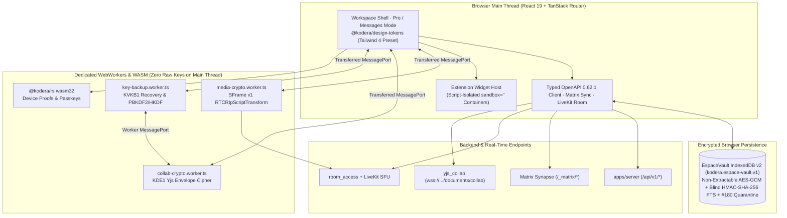

# `@kodera/web` (`apps/web`)

Status: Active (`Apache-2.0`, OpenAPI `0.62.1`)

`@kodera/web` is the unified workspace web client and customer administration console in the `kodera-hq/kodera` monorepo (`https://community.kodera.io` for the public Community workspace and `https://app.kodera.io` for shared-realm SMB and dedicated Sovereign organisations). Client architectural decisions live in [`docs/adr/`](docs/adr), and cryptographic worker boundaries are documented in [`docs/security/THREAT_MODEL_AND_CRYPTOGRAPHY.md`](../../docs/security/THREAT_MODEL_AND_CRYPTOGRAPHY.md).

## Client & Worker Isolation Architecture



## Shipped Product & Console Surfaces

- **Workspace Onboarding & Administration:** Cardless shared-realm SMB self-serve (`POST /api/v1/workspaces/self-serve` at `/workspaces/new`, `<= 5` seats, `5 GiB` storage, `< 5 s` creation-to-chat with automatic 6th-seat upgrade CTA), dedicated Sovereign ordering (`/workspaces/new?plan=sovereign` & `/$org/order`), `Kodera Passport` cross-workspace switcher & PKCE magic-link sign-in, people and invitations (with QR enrolment and domain verification UI previews; server routes `Planned`), SAML/SCIM enterprise settings, `0–100` cybersecurity posture advisor, Factur-X `380`/`381` invoices/credit notes, Community boosts & VIP passes, quota gauges, and GDPR Art. 17/20 exports and erasure.
- **Channels, Direct Messages & Voice/Video Rooms:** Matrix-backed channels, threads, replies, reactions, sanitized RIFF/WebP custom emojis (`:shortcode:`), *Send Later* scheduled messages, personal reminders, private `1:1` and bounded group DMs, Pro vs Messages mode switcher, LiveKit voice/video/screen-sharing rooms, `KoderaVoiceVisualizer`, async voice notes, `/poll` + live-call `PollCard` overlays, procedural soundboard & waiting-room ambience, ephemeral 8-language channel translation, and multi-party consent-gated live call captions.
- **Pages, Typed Collections, Whiteboard & Smart Calendar:** ProseMirror/Tiptap + Yjs collaborative Pages (`wss://<api-host>/documents/collab`), page trees, wikilinks/backlinks, typed Collections (`Table`, `Kanban`, `List`), collaborative Yjs `<canvas>` whiteboard, sovereign CalDAV calendar sync, and public zero-PII `.ics` booking pages.
- **Confidential Room Boundaries & 3-Tier Encryption Model:** Follows `tier-1-default-e2ee` (`Planned` for default DM/private-call E2EE; ordinary DMs are server-readable private rooms today), `tier-2-opt-in-confidential` (`🔒` confidential channels/rooms, refused fail-closed via `RoomBoundaryTracker` `#180` quarantine while full end-to-end client UX is `Planned`), and `tier-3-standard-channel` (`#arrivals`, `#general`, server-readable by design). Ships `EspaceVault` IndexedDB v2 (`kodera.espace-vault.v1`) with client-local blind-indexed `HMAC-SHA-256` search (`search_index`), plus worker-isolated `SFrame v1`, `KDE1`, SAS comparison, and local `KVKB1` (`PBKDF2-HMAC-SHA-512 -> HKDF-SHA-256 -> AES-256-GCM`) primitives (client `deviceSigner` server backup publication and `KDE1` epoch-key wiring `Planned`).
- **Extensions, Sandboxed Widgets & Importers:** Declarative `kodera.widget.v1` cards rendered in `sandbox=""` containers, web extension marketplace checkout/installation, outbound webhook management, and bounded `Slack`, `Discord`, and `Notion` workspace importers.

## Non-Negotiable Frontend Rules

- **Zero Secrets & Zero Inline Tokens:** `@kodera/web` holds only short-lived session tokens, never calls cloud/billing/IdP admin APIs directly (`WEB-ADR-0003`), and consumes all colours, spacing, and typography strictly from [`@kodera/design-tokens`](../../packages/design-tokens) (`WEB-ADR-0004`, enforced by `tests/unit/ui/tokens.test.ts`).
- **Contract-Locked API Client & Demo Parity:** API types and mock schemas are generated from [`packages/api-contract`](../../packages/api-contract/README.md) (`0.62.1`, locked in `contracts/contract.lock.json`). Every client call uses direct `coreApi().VERB('/literal/path', ...)` syntax (`capabilities.test.ts`) and has a corresponding handler in `src/mocks/overlays/demo.groupe-vercelli.ts` (`seed.test.ts`).
- **Catalogue-Only i18n & Bundle Budget:** All user-facing copy lives in [`docs/specs/copy/fr.md`](docs/specs/copy/fr.md) and [`docs/specs/copy/en.md`](docs/specs/copy/en.md) (`npm run i18n:generate` / `npm run i18n:check`). Initial entry-chunk gzip size is gated below `160.00 kB` (`npm run build:check`).

## Local Development & Verification

Stack baseline, browser floor (`Safari 16.4+`, `Chrome/Edge 111+`, `Firefox 128+`, [`docs/specs/tailwind-4-migration.md`](docs/specs/tailwind-4-migration.md)), testing, i18n, and client generation rules are detailed in [`docs/dev/BASELINE.md`](docs/dev/BASELINE.md), [`docs/dev/TESTING.md`](docs/dev/TESTING.md), [`docs/dev/I18N.md`](docs/dev/I18N.md), [`docs/dev/API_CLIENT.md`](docs/dev/API_CLIENT.md), and [`AGENTS.md`](AGENTS.md):

```bash
cd apps/web
npm run i18n:check
npm run docs:check
npm run lint
npm run typecheck
npx vitest run
npm run build && npm run build:check
```

End-to-end Playwright suites cover both deterministic Core API contract overlays and live Community full-stack runs against real PostgreSQL, Synapse, and LiveKit containers in CI.
