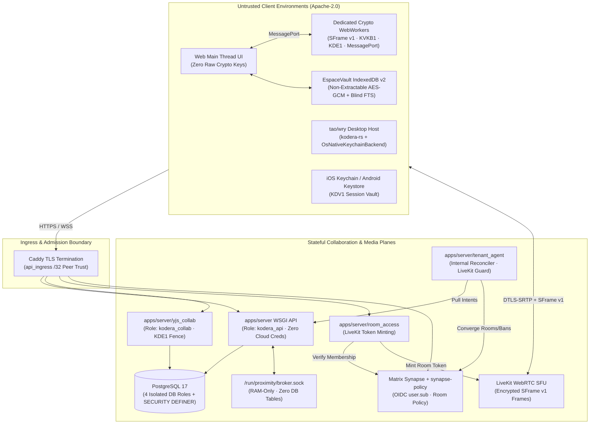

# Kodera Threat Model & Cryptographic Architecture

Status: Active

This document defines the cross-stack trust boundaries, Control-Plane-First identity projection, PostgreSQL least-privilege role separation, client-worker cryptographic primitives, and supply-chain verification gates enforced across the `kodera-hq/kodera` monorepo. Every control below cites its enforcing module and automated verification suite; capabilities still gated or on the roadmap are separated explicitly in [Section 6](#6-current-limitations--roadmap-boundaries).

---

## 1. Scope & Explicit Trust Boundaries

- **Startup Environment Hardening (`SRV-ADR-0003`):** [`apps/server/config/environment.py`](../../apps/server/config/environment.py) refuses process startup if cloud or infrastructure credentials (`SCW_*`, `AWS_*`, `TF_*`, `SSH_*`, `SOPS_*`, `AGE_*`, `KUBECONFIG`) or any secret-shaped environment variable outside `ADMITTED_SECRET_NAMES` is present.
- **Deny-By-Default Container Context:** [`apps/server/.dockerignore`](../../apps/server/.dockerignore) defaults to `**` (deny-all) and admits only the runtime API file allowlist, excluding operator commands, migration runners, test suites, and [`ee/`](../../ee/README.md) from the Community image ([`apps/server/tests/test_development_boundary.py`](../../apps/server/tests/test_development_boundary.py)).
- **Symlink-Safe Secret Mounts:** Runtime secret files are read through `PrivateVolume` (`O_NOFOLLOW` descriptor walks rejecting symlinks and world-readable modes).

---

## 2. Control-Plane-First IAM & State Projection

Kodera enforces one chain of authority (`SRV-ADR-0006`, `SRV-ADR-0016`, `SRV-ADR-0018`): external identity assertions establish `(issuer, subject)`, `apps/server` resolves organisation membership and policy in PostgreSQL, and downstream engines (`Synapse`, `LiveKit`, `yjs_collab`) execute projected decisions rather than maintaining independent user directories.

- **Offline Customer JWT Verification & Staff HTTPS JWKS ([`apps/server/services/identity/access_tokens.py`](../../apps/server/services/identity/access_tokens.py), [`apps/server/core/staff_api/auth.py`](../../apps/server/core/staff_api/auth.py)):**
  - Verifies customer tokens strictly offline against static `KODERA_AUTH_TRUST` issuer snapshots (`<= 8` entries, explicit `customer` vs `staff` lane separation, bounded `30 s` clock skew on `exp`, `RS256` `>= 2048-bit` or `ES256` `P-256`, `typ: Bearer`, `aud` containing `kodera-server`, `<= 16 KiB` token bound), while the `/staff/v1/*` operator plane fetches its staff-realm JWKS over HTTPS (`core/staff_api/auth.py`).
  - Refuses duplicate JSON/JWK keys and RSA-OAEP encryption keys; covered by unit tests and the standalone mutation harness [`apps/server/dev/mutate_token_guards.py`](../../apps/server/dev/mutate_token_guards.py).
- **Organisation-Scoped Identity Binding ([`apps/server/apps/identity/models.py`](../../apps/server/apps/identity/models.py)):**
  - Maps `(organisation_id, issuer, subject)` to an organisation-bound `Identity`, `User`, and active `Membership` carrying a monotonic `authority_revision` ([`apps/server/docs/specs/member-authority-revision.md`](../../apps/server/docs/specs/member-authority-revision.md)).
  - Never auto-links cross-organisation accounts by unverified email across OIDC, SAML 2.0 ([`ee/README.md`](../../ee/README.md)), or SCIM 2.0 provisioning.
- **Matrix Projection ([`packages/synapse-policy`](../../packages/synapse-policy/README.md) & [`apps/server/tenant_agent`](../../apps/server/tenant_agent/README.md)):**
  - Password login and open registration are disabled; Matrix localparts derive strictly from OIDC `{{ user.sub }}`.
  - `tenant_agent` converges room creation, channel membership sets, bans/mutes, and `io.kodera.room.policy` state events.
  - `KoderaPolicy` callbacks inside Synapse refuse ad-hoc client room creation, `m.room.encryption` inside standard rooms, unencrypted events inside confidential rooms, third-party invites, directory publishing, and unauthorized federation. Single-channel guests are fenced at the reverse proxy via `/_synapse/client/kodera/v1/request_scope`.
- **Media Token Isolation ([`apps/server/room_access`](../../apps/server/room_access/README.md)):**
  - `room_access` verifies live Matrix room membership and confidential call admission (fail-closed) before minting short-lived room-scoped LiveKit tokens; `LIVEKIT_API_SECRET` never enters Django WSGI API workers and is held only by `room_access` and `tenant_agent`.
- **Collaborative Document Admission ([`apps/server/yjs_collab`](../../apps/server/yjs_collab/server.mjs)):**
  - Mints short-lived (`<= 300 s`), single-use tickets redeemed atomically via `docs_redeem_collaboration_ticket(uuid, bigint)` in PostgreSQL, scoped to one `(organisation_id, document_id)` and `editor` / `viewer` role (dropping and auditing `ViewerWrite` attempts via `docs_collab_audit`).

---

## 3. PostgreSQL Least-Privilege Role Separation & `SECURITY DEFINER` Guards

Runtime processes never connect as table owners or superusers. `kodera_api` and `kodera_collab` validate their own effective PostgreSQL privileges against `pg_roles`, `pg_class`, and `pg_attribute` before serving traffic, while `kodera_retention_worker` and `kodera_retention_admission` are grant-defined SQL roles verified in the server test suite:

| Database Role | Runtime Consumer | Privilege Definition & Verification | Permitted Surface |
| :--- | :--- | :--- | :--- |
| `kodera_api` | `apps/server` HTTP WSGI workers | [`apps/server/core/db/api_database_boundary.py`](../../apps/server/core/db/api_database_boundary.py) + [`api_writer_role.py`](../../apps/server/core/db/api_writer_role.py) (startup `pg_catalog` check refusing `rolsuper`, `rolcreatedb`, `rolcreaterole`, `rolbypassrls`, `rolinherit`, `pg_auth_members`, `CREATE`, `TRUNCATE`, `REFERENCES`, `TRIGGER`, sequence grants, and unlisted column privileges) | Explicit per-table `SELECT`/`INSERT` and per-column `UPDATE` allowlists; append-only (`SELECT` + `INSERT`, zero `UPDATE`/`DELETE`) on `audit_auditevent`, `ee_audit_ledger`, and `ee_audit_signing_key` |
| `kodera_collab` | `apps/server/yjs_collab` WebSocket service | [`apps/server/yjs_collab/database-boundary.mjs`](../../apps/server/yjs_collab/database-boundary.mjs) (`assertDatabaseBoundary` startup `pg_catalog` check, rejecting `PGOPTIONS` / `SET ROLE` privilege masking) | Scoped strictly to `docs_document` (`UPDATE` only `markdown`, `revision`, `updated_at`), `docs_documentsnapshot`, `docs_documentlink`, `docs_documentupdate`, and `EXECUTE` on 4 `SECURITY DEFINER` routines (`docs_collab_fence`, `docs_collab_audit`, `docs_redeem_collaboration_ticket`, `docs_collab_snapshot_admit`); zero read access to `identity_*`, `orgs_*`, `billing_*`, or `e2ee_*` |
| `kodera_retention_worker` | Statutory privacy & retention worker | [`apps/server/core/db/retention_worker_role.py`](../../apps/server/core/db/retention_worker_role.py) (grant emitter verified in `tests/test_retention_worker_role.py`) | Executes already-admitted GDPR Art. 17 and statutory billing purges via narrow `SECURITY DEFINER` routines (`privacy_purge_core`, `privacy_purge_account_core`, `billing_purge_due_record`); cannot mint erasure intents or alter retention clocks |
| `kodera_retention_admission` | Operator privacy & fiscal admission | [`apps/server/core/db/retention_worker_role.py`](../../apps/server/core/db/retention_worker_role.py) (grant emitter verified in `tests/test_retention_worker_role.py`) | Operator-only admission of `privacy_begin_erasure`, `privacy_admit_account_erasure`, and `billing_close_contract` |

All `SECURITY DEFINER` functions have `PUBLIC` execution revoked, pin an explicit `SET search_path` (`pg_catalog, public, pg_temp` with `pg_temp` last on privacy/erasure, scope, and extension routines — verified in [`apps/server/tests/test_k2c_privacy_idempotency.py`](../../apps/server/tests/test_k2c_privacy_idempotency.py) — or `pg_catalog, public` with schema-qualified table references on quota and collaboration routines), and enforce scope/epoch/cutoff invariants (`e2ee_scope_guard()`, `e2ee_counter_guard()`, `e2ee_cutoff_guard()`, and gapless invoice issuance `billing_issue_draft_invoice`).

---

## 4. Cryptography, Worker Isolation & Zero-Knowledge Primitives

- **Memory-Safe Rust Core ([`packages/kodera-rs`](../../packages/kodera-rs/README.md) & [`apps/desktop/src-tauri`](../../apps/desktop/README.md)):** Enforces `#![forbid(unsafe_code)]` workspace-wide; compiles natively for Desktop and to `wasm32-unknown-unknown` ([`packages/kodera-rs/src/browser_bindings.rs`](../../packages/kodera-rs/src/browser_bindings.rs)) with deterministic cross-platform test vectors shared across Rust, WebCrypto, Swift (`CryptoKit`), and Kotlin (`javax.crypto`).
- **OpenMLS (`RFC 9420`, [`packages/kodera-rs/src/mls_engine.rs`](../../packages/kodera-rs/src/mls_engine.rs)) & Megolm ([`packages/kodera-rs/src/megolm_engine.rs`](../../packages/kodera-rs/src/megolm_engine.rs)):**
  - Uses `MLS_128_DHKEMX25519_AES128GCM_SHA256_Ed25519` (`openmls_rust_crypto` `0.6.0` backport) and Vodozemac `0.11.2` Megolm v1 (`AES-256` + `Ed25519`).
  - Staged copy-on-write transitions ensure rejected commits or malformed ciphertexts never advance live epochs or consume ratchets; media epoch secrets derive via `export_secret` label `kodera-livekit-media-v1`.
- **`SFrame v1` Real-Time Media Encryption (`RFC 9605`-aligned, [`packages/kodera-rs/src/sframe_media.rs`](../../packages/kodera-rs/src/sframe_media.rs) & [`apps/web/src/features/confidential/media-crypto.worker.ts`](../../apps/web/src/features/confidential/media-crypto.worker.ts)):**
  - Runs inside a dedicated WebWorker over `RTCRtpScriptTransform` / encoded streams; the main UI thread holds zero raw keys (32-byte epoch secrets cross only a transferred `MessagePort`).
  - Derives keys via two-stage `HKDF-SHA-256` (`kodera-sframe-media-v1`) binding `(room_id, epoch u64 BE, sender_device_id, track_kind, ratchet_step u16 BE)`, `AES-256-GCM` with `base_salt XOR counter` nonces, codec-safe cleartext prefixes (`0 B` Opus, `<= 64 B` VP8/H.264/AV1) authenticated in AAD, a 1024-frame sliding replay window, self-reflection rejection, and live `rotateEpochKey` (`2000 ms` grace on normal rotation; `0 ms` immediate zeroization on `memberRemoved: true`), verified against [`packages/kodera-rs/vectors/sframe-media-v1.json`](../../packages/kodera-rs/vectors/sframe-media-v1.json).
- **`KVKB1` Zero-Knowledge Key Backup ([`packages/kodera-rs/src/key_backup.rs`](../../packages/kodera-rs/src/key_backup.rs) & [`apps/web/src/features/confidential/key-backup.worker.ts`](../../apps/web/src/features/confidential/key-backup.worker.ts)):**
  - `KVKB1` 5-byte magic + `u32 BE` header length + canonical JSON header `["kodera-zk-key-backup", 1, organisationId, accountId, backupEpoch, kdfKind, iterations, saltBase64, ivBase64]` (first 7 fields bound as canonical AAD, 16-byte salt, 12-byte IV, `AES-256-GCM` 16-byte tag); `packages/kodera-rs` provides native structural header validation while WebCrypto inside `key-backup.worker.ts` performs sealing and unsealing.
  - Supports 32-byte worker-generated recovery keys (`iterations = 0`, 2-byte SHA-256 checksum) or `PBKDF2-HMAC-SHA-512` passphrases (`>= 12` chars, bounded `600,000..=2,000,000` iterations) -> `HKDF-SHA-256` -> `AES-256-GCM` non-extractable `CryptoKey`. Server backup routes (`/organisations/{organisation_id}/confidential/key-backup`) store only opaque `KVKB1` ciphertext with monotonic `backup_epoch` enforcement (client `deviceSigner` wiring for server publication `Planned`).
- **`KDE1` Confidential Collaboration Envelopes ([`apps/web/src/features/confidential/collab-crypto.worker.ts`](../../apps/web/src/features/confidential/collab-crypto.worker.ts) & [`apps/server/yjs_collab/protocol.mjs`](../../apps/server/yjs_collab/protocol.mjs)):**
  - `KDE1` (`0x4b444531`) 4-byte magic + `u16 BE` canonical JSON metadata (`{epoch, sender, sequence, kind, ratchet}`) + 96-bit nonce + `AES-256-GCM` ciphertext/tag under context-bound `HKDF-SHA-256`.
  - Confidential documents disable plaintext IndexedDB/REST Markdown persistence; `yjs_collab` enforces epoch-bound `KDE1` admission via `docs_collab_fence` and closes unsealed frames with WebSocket `4403`.
- **`KDV1` Native Session Vault ([`packages/kodera-rs/src/mobile_ffi.rs`](../../packages/kodera-rs/src/mobile_ffi.rs), [`apps/ios`](../../apps/ios/README.md), [`apps/android`](../../apps/android/README.md)):**
  - `KDV1` (`0x4b445631`) `AES-256-GCM` envelope bound to `(organisation_id, device_id)` AAD inside iOS Keychain (`kSecAttrAccessibleAfterFirstUnlockThisDeviceOnly`) and Android Keystore (cloud-backup excluded), verified against [`packages/kodera-rs/vectors/mobile-ffi-v1.txt`](../../packages/kodera-rs/vectors/mobile-ffi-v1.txt).
- **`EspaceVault` IndexedDB v2 & Local Blind-Indexed Search ([`apps/web/src/features/espace/matrix/encryptedCache.ts`](../../apps/web/src/features/espace/matrix/encryptedCache.ts) & [`localEncryptedSearch.ts`](../../apps/web/src/features/espace/localEncryptedSearch.ts)):**
  - Per-`(ownerId, organisationId, membershipId, deviceId)` non-extractable 256-bit `AES-GCM` `CryptoKey` with random `incarnation` UUID, `{ durability: 'strict' }` transactions, and full context AAD across 6 stores (`owners`, `rooms`, `outbox`, `drafts`, `quarantine`, `search_index`).
  - `search_index` computes client-local `HMAC-SHA-256` (`kodera-local-fts-v1`) blind term tags inside IndexedDB with zero network query egress; legacy plaintext caches are wiped on open, account switch, sign-out, and privacy erasure.
- **Sticky Fail-Closed Room Quarantine (`#180`, [`apps/web/src/features/confidential/room-boundary.ts`](../../apps/web/src/features/confidential/room-boundary.ts)):**
  - `RoomBoundaryTracker` pins any room ever observed with `io.kodera.room.confidential` or `m.room.encryption` in a sticky `#protected` set. Marker stripping, untrusted creators, mismatched algorithms, or missing verified sessions transition the room to `'invalid'` or `'confidential-unavailable'` (`permitsPlaintext() === false`), quarantining local storage, synchronously evicting RAM search shards, and refusing server AI (`ai_gateway` triple-layer `403`), scheduled messages, reminders, and extensions.
- **Universal ES256 Passkeys & `#proximity` Beacons ([`packages/kodera-rs/src/passkey_binding.rs`](../../packages/kodera-rs/src/passkey_binding.rs), [`src/proximity_beacon_v2.rs`](../../packages/kodera-rs/src/proximity_beacon_v2.rs)):**
  - Zero-AAGUID-lock-in WebAuthn Level 3 ES256 verification (`UP+UV` flags `0x05`/`0x0D`/`0x1D`, rejecting non-canonical DER) and rotating 5-minute HMAC v2 (`KP\x02`) beacons with 15-minute HKDF epoch leases over RAM-only `/run/proximity/broker.sock` (workspace check-in authentication, never an emergency service).

---

## 5. Supply-Chain Integrity, Zero-Secret PR CI & Mutation-Tested Gates

- **Zero-Secret Pull Request CI ([`scripts/ci/check-zero-secret-pr-ci.py`](../../scripts/ci/check-zero-secret-pr-ci.py)):** Every pull-request workflow runs with `permissions: contents: read`, `persist-credentials: false`, and zero custom `${{ secrets.* }}` exposure.
- **Deterministic Pinning & CycloneDX 1.6 SBOMs:**
  - All GitHub Actions are pinned to full 40-character commit SHAs ([`scripts/ci/check-workflow-pins.py`](../../scripts/ci/check-workflow-pins.py)); Docker base and Compose images are pinned by `sha256:` digest.
  - Lockfiles are enforced across Python (`uv.lock` / `--frozen`), Rust (`Cargo.lock` + [`scripts/ci/check-cargo-advisories.py`](../../scripts/ci/check-cargo-advisories.py)), and Node (`npm ci --ignore-scripts`), producing unified CycloneDX 1.6 inventories ([`scripts/ci/assemble-release-sbom.py`](../../scripts/ci/assemble-release-sbom.py)) and SPDX license checks ([`scripts/ci/check-licenses.py`](../../scripts/ci/check-licenses.py)).
- **Self-Testing & Mutation-Proven Gates:** Security checks ship with automated `--selftest` or fault-injection suites executed in CI:
  - [`scripts/ci/check-secrets.sh`](../../scripts/ci/check-secrets.sh) (live synthetic RSA private key detection probe before full-history `gitleaks`),
  - [`packages/synapse-policy/tests/mutate.py`](../../packages/synapse-policy/tests/mutate.py),
  - [`scripts/ci/check-community-deploy.py`](../../scripts/ci/check-community-deploy.py), [`scripts/ci/check-docs-truth.py`](../../scripts/ci/check-docs-truth.py), [`.github/scripts/check-required-clauses.selftest.sh`](../../.github/scripts/check-required-clauses.selftest.sh), and [`scripts/ci/check-native-packaging.selftest.py`](../../scripts/ci/check-native-packaging.selftest.py).

---

## 6. Current Limitations & Roadmap Boundaries

| Area | Shipped Enforcement Today | Remaining Gate / Planned Scope |
| :--- | :--- | :--- |
| Standard Workspace Channels, Ordinary DMs & Pages | TLS in transit; Control-Plane IAM + Synapse/Postgres authorization; `tier-3-standard-channel` server-readable at rest by design for server history/search | Universal end-to-end encryption across standard channels is not claimed, default `1:1`/group DM E2EE (`tier-1-default-e2ee`) remains `Planned`, and opt-in confidential rooms/Pages/calls (`tier-2-opt-in-confidential`) refuse fail-closed in the shipped client while usable client UX is `Planned` |
| Multi-Device MLS Group Coordination | Single-session/epoch MLS (`RFC 9420`), `SFrame v1` media worker, `KDE1` collab fence, and server opaque `KVKB1` backup capsules | Durable multi-device MLS group coordinators and native mobile `KVKB1` backup restore remain in progress |
| Native Mobile Rust FFI & Media | Pure Swift/Kotlin `KDV1` vaults and `PacketDispatcher` verified against shared `kodera-rs` golden vectors; PushKit/CallKit & `ConnectionService` admission | Unmangled C-ABI dynamic Rust linking (held while `#![forbid(unsafe_code)]` is enforced), live WebRTC media SDK binding, and physical-device/store qualification |
| Desktop OS Keychain & Installers | `OsNativeKeychainBackend` (`security -i` / `secret-tool` / `PasswordVault`) + zeroized RAM cache + 42-command IPC validator | Operator code-signing, macOS notarisation, SmartScreen reputation, and signed-package login-keychain prompt qualification |
| Build Provenance Attestations | 40-SHA workflow pins, digest-pinned images, SHA-256 release manifests, and CycloneDX 1.6 SBOMs | Cryptographic SLSA v1.0 build-provenance attestations on tagged release artifacts (`Planned`) |
| `#proximity` Local Discovery | Signed `KE` / `KP\x02` beacons, HKDF epoch leases, and RAM-only `/run/proximity/broker.sock` | Physical two-device BLE/Wi-Fi radio qualification on hardware |
